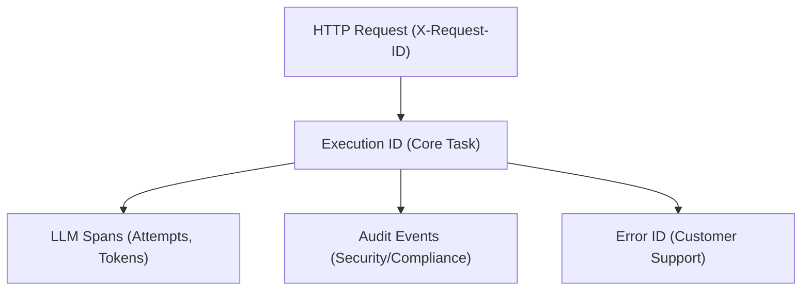

# Observability

## Objetivo

Documentar estratégia de observability: logging estruturado, métricas, e tracing (quando implementados).

## Escopo

**Inclui:**

- Logging estruturado (Zap)
- Modelo de Correlação (Request ID, Execution ID, Error ID)
- LLM Observability (Spans, Tokens, Latência)
- Governança & Auditoria (Audit Events)
- Health Strategy (Liveness vs Readiness)

**Não Inclui:**

- Deployment de ferramentas de observability (ver [DEPLOYMENT.md](./DEPLOYMENT.md))

## Logging

### Framework

**Biblioteca:** `go.uber.org/zap`  
**Localização:** `internal/observability/log/log.go`

### Níveis de Log

- `debug` - Informações detalhadas para debugging
- `info` - Eventos normais de operação
- `warn` - Situações anormais mas não críticas
- `error` - Erros que requerem atenção
- `fatal` - Erros críticos que causam shutdown

### Configuração

**Variável de Ambiente:** `LOG_LEVEL` (default: `info`)

**Formato:** JSON estruturado

```json
{
  "level": "info",
  "timestamp": "2026-01-26T15:00:00Z",
  "msg": "operation completed",
  "module": "agent",
  "action": "interpret",
  "workspace_id": "uuid",
  "request_id": "uuid"
}
```

### Campos Obrigatórios (Compliance AAA)

- `request_id` - UUID único da request HTTP (via `X-Request-ID`).
- `execution_id` - UUID mestre da tarefa agentic (persistido em `execution_trace_index`).
- `error_id` - UUID retornado ao cliente em falhas, usado para localizar logs internos.
- `workspace_id` - ID do tenant para isolamento multitenant.
- `module` / `action` - Localização e operação (ex: `mcp.runtime` / `execute`).

### Exemplo de Uso

```go
logger.Info("operation started",
    log.String("module", "agent"),
    log.String("action", "interpret"),
    log.String("workspace_id", workspaceID),
    log.String("request_id", requestID),
)
```

## Modelo de Correlação

Para auditoria e resposta a incidentes, seguimos o grafo de correlação:



### 1. Execution ID

- **Geração:** Injetado no contexto no início de fluxos agentic (`AgentGateway`).
- **Uso:** Chave primária composta (`workspace_id`, `execution_id`) em `execution_trace_index`.
- **Idempotência:** Garante que a mesma tarefa não seja executada múltiplas vezes para o mesmo `execution_id`. O sistema persiste o resultado final, permitindo retentativas seguras.
- **Visibilidade:** Retornado em todas as respostas de execução do MCP.

### 2. Error ID

- **Geração:** Criado dinamicamente pelo pacote `internal/http/respond`.
- **Sanitização:** Em produção, erros 5xx são mascarados como `internal_error`. O `error_id` é o único elo para descobrir o erro bruto nos logs.

## LLM Observability (Privacy-First)

O sistema monitora cada chamada LLM através de **Spans**, focados em telecontabilidade e diagnóstico sem comprometer a privacidade:

- **Métricas Gravadas:** Provedor, modelo, latência (ms), tokens (in/out) e status (success/failed).
- **Privacy Policy:** Prompts e Responses NUNCA são persistidos em texto claro. Apenas o hash SHA-256 é armazenado para prova de integridade.
- **Attempts:** Cada tentativa de fallback é registrada como um span individual vinculado ao mesmo `execution_id`.

### Persistência de Spans (As-Built)

Spans são persistidos pelo `ExecutionSpanRepo` (`internal/persistence/span_repo.go`) na tabela `ai_execution_spans`:

| Coluna                     | Descrição                         |
| -------------------------- | --------------------------------- |
| `execution_id`             | FK para `execution_trace_index`   |
| `workspace_id`             | Tenant isolation                  |
| `provider`                 | Ex: `openai`, `anthropic`         |
| `model`                    | Ex: `gpt-4o`, `claude-3-5-sonnet` |
| `prompt_hash`              | SHA-256 do prompt (hex)           |
| `response_hash`            | SHA-256 da response (hex)         |
| `latency_ms`               | Duração da chamada em ms          |
| `tokens_in` / `tokens_out` | Contagem de tokens                |
| `status`                   | `success` \| `failed`             |
| `created_at`               | ISO 8601 UTC                      |

**Ciclo de Vida:**

1. `SpanRepo.CreateSpan()` — criado antes da chamada LLM com status `pending`
2. `SpanRepo.UpdateSpan()` — atualizado após retorno: preenche latência, status, hashes

## Auditoria e Governança

Eventos de segurança (violações de policy, alterações de config, execuções agentic) são registrados pelo `AuditRepo` (`internal/persistence/audit_repo.go`) na tabela `ai_audit_events`:

| Coluna         | Descrição                                   |
| -------------- | ------------------------------------------- |
| `id`           | UUID v4 gerado pelo servidor                |
| `workspace_id` | Tenant isolation                            |
| `execution_id` | FK para `execution_trace_index`             |
| `actor_id`     | `user_id` do JWT autenticado                |
| `event_type`   | Ex: `execution.started`, `policy.violation` |
| `payload`      | JSONB redactado (sem segredos)              |
| `payload_hash` | SHA-256 do payload                          |
| `created_at`   | ISO 8601 UTC                                |

**Garantias:**

- **Payload Redaction:** Segredos e credenciais são automaticamente removidos antes da persistência.
- **Integridade:** O `payload_hash` garante que o evento não foi adulterado após o registro.
- **Imutabilidade:** Nenhuma operação de UPDATE/DELETE é executada sobre `ai_audit_events`.

## Saúde e Operação

### Health Strategy

- `/health/live` (Liveness): Retorno imediato `200 OK` para indicar que o processo Go está ativo.
- `/health/ready` (Readiness): Check profundo. Retorna `503` se a conexão com o banco de dados falhar ou se o serviço estiver em processo de Graceful Shutdown.

### Rate Limit Monitoring

Headers disponíveis para troubleshooting de degradação:

- `X-RateLimit-Limit`: Capacidade contratada/configurada.
- `X-RateLimit-Remaining`: Margem atual antes do throttling.
- `X-RateLimit-Reset`: Tempo de espera necessário para recuperação de quota.

## Referências no Código

- Logger: `internal/observability/log/log.go`
- Request ID: `internal/observability/requestid/requestid.go`
- HTTP Middleware: `internal/observability/httpmw/middleware.go`

## Checklist de Atualização

Este documento deve ser atualizado quando:

- [ ] Novo campo obrigatório é adicionado aos logs
- [ ] Métricas são implementadas
- [ ] Tracing é implementado
- [ ] Formato de log muda
