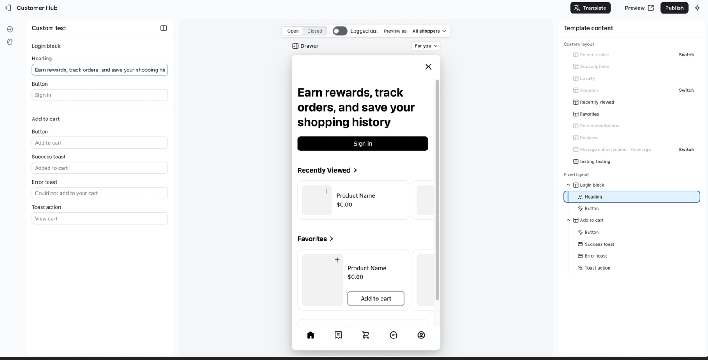
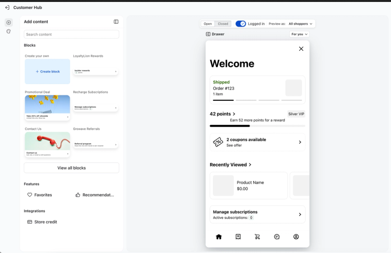

# Módulo Cliente Hub (área da loja): proposta

- **Status:** proposta do gerente de projeto, 24/10/2026, a partir da ideia do Marcelo e das telas do editor do Klaviyo Customer Hub. Para aprovar.
- **Relaciona-se com:** [ADR 0006](../../adr/0006-manifesto-de-modulos.md) (manifesto), [ADR 0013](../../adr/0013-idiomas-do-painel.md) (idiomas), [ADR 0014](../../adr/0014-shell-padrao-sidebar-08.md) (shell e a exceção de tela cheia), [ADR 0018](../../adr/0018-configuracoes-em-cascata.md) (cascata), [ADR 0027](../../adr/0027-guidu-chat-v1-console-bridge.md) (guidu.chat V1), [ponte dos mini-apps](../../architecture/mini-apps-bridge.md), [Cliente Hub no guidu-chat](https://github.com/smarthubaiagency/guidu-chat/blob/claude/produto-v1/docs/produto/cliente-hub.md).

## 1. A ideia

A loja escolhe, no console, **quais blocos o turista vê** e **as cores da marca**, do mesmo jeito que configura os mini-apps.

O Cliente Hub do guidu.chat tem duas partes:

| Parte                                                                                     | Quem controla                          |
| ----------------------------------------------------------------------------------------- | -------------------------------------- |
| **Hub do turista** (conta, perfil, consentimentos, todas as compras, conversas, carteira) | A plataforma. Nenhuma loja personaliza |
| **Área da loja** (o que o turista vê daquela loja, no Local e no Hub)                     | **A loja, por este módulo**            |

## 2. Referência: o editor do Klaviyo

| No Klaviyo                                                                                                                                 | O que aproveitamos                                                                                  |
| ------------------------------------------------------------------------------------------------------------------------------------------ | --------------------------------------------------------------------------------------------------- |
| Três painéis: biblioteca ou textos à esquerda, **prévia no centro**, árvore do conteúdo à direita                                          | Mesmo desenho                                                                                       |
| **Layout personalizado** (a loja liga, desliga e ordena blocos) e **layout fixo** (login, adicionar ao carrinho: a loja só muda os textos) | Mesma divisão: blocos da loja e partes fixas da plataforma                                          |
| Prévia por situação: **logado ou não**, aberto ou fechado, "ver como" um segmento                                                          | Logado ou não, loja aberta ou fechada; segmentos depois                                             |
| **Traduzir**, **Pré-visualizar**, **Publicar**                                                                                             | Tradução dos textos para os idiomas dos turistas, rascunho e publicação com versões                 |
| Biblioteca: criar bloco próprio, promoção, contato, fidelidade, assinaturas, indicação                                                     | Catálogo de blocos por versão (seção 4)                                                             |
| CSS personalizado                                                                                                                          | **Não adotamos**: segurança e consistência. A loja escolhe cores e imagens; o contraste é conferido |

## 3. Como funciona

1. **Editor no console** (novo módulo, `/app/<workspace>/cliente-hub`), em tela cheia com três painéis, como a exceção que o Inbox já tem na ADR 0014. Componentes do shadcn, como manda o `AGENTS.md`.
2. **A prévia é o próprio mini-app.** O centro do editor abre o template "área da loja" de `apps.guidu.chat` com a configuração de rascunho, por um token de prévia curto. O que a loja vê é exatamente o que o turista verá, sem uma segunda implementação.
3. **Rascunho e publicação.** A loja edita um rascunho; "Publicar" grava uma versão. Dá para voltar a uma versão anterior.
4. **Tradução.** "Traduzir" gera os textos em inglês e espanhol (outros depois) pelo motor de tradução do console, com a chave da loja; a loja revisa antes de publicar.
5. **Cascata (ADR 0018).** A plataforma define o catálogo de blocos; o parceiro pode limitar para os clientes dele; a loja escolhe dentro disso.
6. **No guidu.chat**, o template "área da loja" lê a versão publicada pela API (`GET /stores/{slug}/hub`) e monta a tela no Local e no Hub. A equipe guidu.chat só abre o mini-app nesses dois lugares.

## 4. Blocos e aparência por versão

| Versão      | Aparência                                         | Blocos da loja                                                                                          | Partes fixas (a loja só muda texto)                           |
| ----------- | ------------------------------------------------- | ------------------------------------------------------------------------------------------------------- | ------------------------------------------------------------- |
| **Janeiro** | Logo, capa, cor de destaque (contraste conferido) | Meus pedidos nesta loja, Favoritar, Últimos vistos, Conversar, Perguntas frequentes                     | Entrar ou criar conta, Adicionar ao carrinho (botão e avisos) |
| **V1.1**    | Estilo do ícone de favorito                       | Ofertas e cupons, Avaliações, Bloco próprio (título, texto, imagem e botão com link https), ordem livre | —                                                             |
| **V2**      | —                                                 | Fidelidade, Seguir com avisos de ofertas (com consentimento), Indicação                                 | "Ver como" segmentos                                          |

## 5. Dados

| Tabela (nome provisório) | Para quê                                                                |
| ------------------------ | ----------------------------------------------------------------------- |
| `hub_block_catalog`      | Blocos da plataforma: id, versão, campos de texto, se é fixo            |
| `workspace_hub_configs`  | Rascunho por loja: aparência, blocos ligados e ordem, textos por idioma |
| `workspace_hub_versions` | Versões publicadas (retrato completo), quem publicou e quando           |

Todas com `workspace_id` e RLS. Permissão nova `cliente_hub.manage` (owner e admin do workspace; no modo gerenciado, o parceiro).

## 6. Segurança

- Sem CSS nem HTML livre: só campos do bloco, com texto puro e imagens pelo Storage.
- Links do bloco próprio só em https, conferidos no servidor; nada de script.
- A área da loja mostra só dados daquela loja e do turista com ela; nunca de outra loja.
- A prévia usa um token curto, só de leitura do rascunho.

## 7. Equipes e prazo

- **Equipe console:** módulo, editor, tabelas, API `GET /stores/{slug}/hub` e template "área da loja". Cabe nas semanas de 10/11 (template e API) e 24/11 (editor), sem mudar o plano de janeiro.
- **Equipe guidu.chat:** abrir a área da loja no Local e no Hub.

## 8. Perguntas para o Marcelo

1. Nome no menu do console: "Cliente Hub", "Vitrine do turista" ou outro?
2. Os blocos de janeiro da seção 4 estão bons?
3. Idiomas da tradução no piloto: inglês e espanhol bastam?
