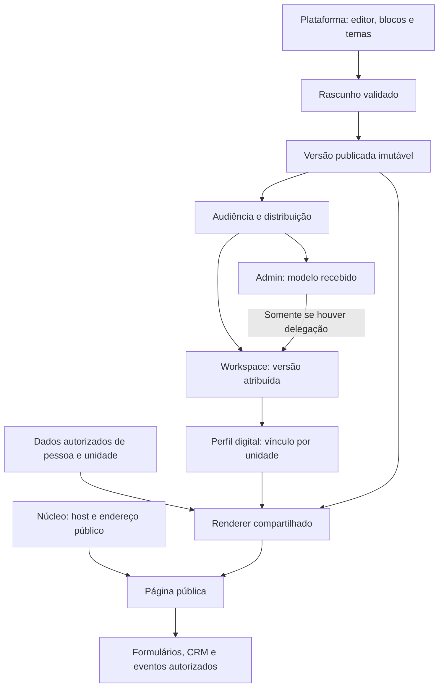
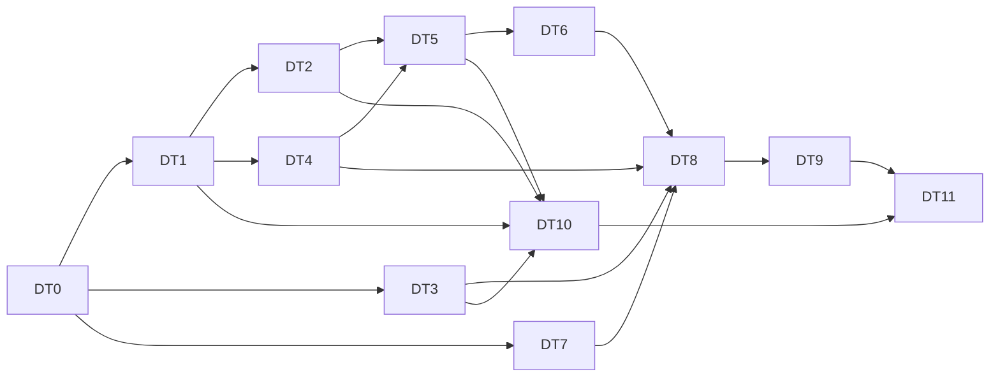

# Plano completo: Templates Digitais com autoria na plataforma

- **Versão:** 0.2, 20/10/2026.
- **Estado:** proposta para revisão. Esta branch entrega planejamento; não inicia implementação, altera banco ou libera o módulo.
- **Base auditada:** GUIDU `29e47607410b360a7b9e594682ac185cabf30323`; fonte e limites descritos na [análise](analise-viabilidade.md).
- **Fluxo:** Contexto → Objetivo → Requisitos → Lógica → Plano → Testes → Aceite.

## 1. Objetivo e definição de conclusão

Migrar o ecossistema completo de Templates Digitais para um módulo nativo do GUIDU, com criação e edição de design somente em `/platform`. Admin e app recebem versões publicadas prontas, sem editor visual ou mutação de estrutura. O consumidor Perfil digital continua responsável por unidade, pessoas e operação pública.

O plano anterior de Perfil digital foi baseado, segundo esclarecimento do solicitante em 20/10/2026, em outro projeto de estrutura padrão e ajustes de cores/dados, sem editores de blocos e templates. O escopo desta migração parte do construtor NextCRM: a plataforma constrói blocos e monta templates com estruturas diferentes. O plano antigo orienta a revisão de regras de negócio, não a arquitetura do construtor. Recuperar seu motor smart é opção independente, não requisito para concluir a extração.

Considerar concluído somente após demonstrar: autoria, biblioteca, temas, campos, os 16 tipos de elemento, mídia real, publicação/versionamento, distribuição, consumo com dados reais autorizados, página pública, integrações previstas no inventário, importação reconciliada, exclusão/exportação, segurança, operação, recuperação e piloto. Uma primeira entrega pode ser menor, mas não recebe o aceite de migração completa.

## 2. Arquitetura e sequência lógica

Não guardar dados do cliente no catálogo global e não copiar uma árvore editável para o app. O vínculo usa uma versão específica; atualizar e voltar à versão anterior são operações rastreáveis. O renderer não depende da UI editorial.

### 2.1 Dependências de implementação

DT10 pode começar com dry run antes de DT8/DT9. Seu aceite final depende de paridade e fluxo integrado. DT7 agrupa pré-requisitos do núcleo, entregues em PRs próprios; não os reimplementar dentro do módulo. Trabalho independente pode avançar em pares, respeitando o isolamento do `AGENTS.md`.

## 3. Etapas e entregas

| Etapa | Entrega principal                              | Depende de                    | Banco                 | Critério de saída                                                             |
| ----- | ---------------------------------------------- | ----------------------------- | --------------------- | ----------------------------------------------------------------------------- |
| DT0   | Decisões, proveniência e baseline reprodutível | Revisão desta proposta        | Não                   | Escopo e contratos de produto aceitos; matriz de paridade e origem fixadas.   |
| DT1   | Contrato JSON, normalização e prova do motor   | DT0                           | Não                   | Fixtures de todos os tipos; clone/referências e compatibilidade demonstrados. |
| DT2   | Dados globais, permissões, RLS e serviços      | Contratos DT1                 | Sim                   | Rascunho, release e audiência protegidos, auditados e testados.               |
| DT3   | Mídia/arquivos e fontes reais                  | DT0 e contrato de assets      | Sim/infra do núcleo   | Upload, publicação, retenção e recuperação de objetos verificados.            |
| DT4   | Renderer comum, tema e bindings reais          | DT1                           | Não por si            | Mesma saída em prévia e público para casos aprovados; sem mocks no runtime.   |
| DT5   | Editor completo em plataforma                  | DT2, DT4; DT3 para mídia real | Eventual ajuste       | Edição/salvamento/reabertura/publicação e conflitos funcionam.                |
| DT6   | Catálogo recebido, distribuição e vínculo      | DT2, DT4, DT5                 | Sim                   | Admin/app consomem apenas versões permitidas, sem autoria.                    |
| DT7   | Unidades, caminhos e contrato público          | DT0                           | Sim no núcleo         | CF2d/CF2e e extensão pública aceitas e verificadas.                           |
| DT8   | Consumidor Perfil digital de ponta a ponta     | DT3, DT4, DT6, DT7            | Sim                   | Unidade/modelo/master/pessoa/público/QR/vCard/SEO funcionando.                |
| DT9   | Recursos avançados, formulários e métricas     | DT8 e serviços do núcleo      | Sim quando necessário | Integrações reais, com proteção, observabilidade e evidência de paridade.     |
| DT10  | Importação e reconciliação da origem           | DT1, DT2, DT3, DT5            | Conforme pipeline     | Dry run e importação idempotente, mídia e conteúdo reconciliados.             |
| DT11  | Aceite integrado, piloto, liberação e operação | DT0–DT10                      | Sem DDL improvisado   | Rollback/restore/piloto aprovados e evidências arquivadas.                    |

### DT0 — Decisões, origem e baseline

- Registrar a nova política de autoria como proposta e revisar as decisões 8, 9, 10, 11, 14 e DP3 do plano de Perfil digital. Preservar unidade/master e dados pessoais onde não houver mudança aprovada.
- Separar no plano anterior regras de domínio úteis e premissas do modelo de estrutura fixa. Reescrever as seções técnicas e de editor a partir do inventário NextCRM; não converter referências a blocos fixos em limitação de composição.
- Aprovar `MODULE_SPEC.md` e registrar a origem NextCRM e arquivos elegíveis conforme ADR 0007. A autorização anterior de reaproveitamento de `cartaopro-linkko` não documenta automaticamente esta outra origem.
- Fechar a titularidade/autorização do código e dos ativos. A auditoria não localizou LICENSE/COPYING nem campo license da origem; isso não prova impedimento, mas exige rastreabilidade antes da extração.
- Fixar snapshot de origem com commit e hashes dos arquivos selecionados. O worktree atual tem mudanças locais em componentes, ações e schema; não usar só o HEAD como se representasse todo o material.
- Decidir se cada alteração local selecionada já pertence à versão desejada. Preservar mudanças alheias ao escopo; não commitar ou limpar todo o worktree para facilitar a migração.
- Inventariar modelos/blocos/temas reais e assets por export autorizado. Não ler banco ou copiar mídia/PII sem um caminho de acesso autorizado. Distinguir migração do motor e migração dos dados existentes.
- Gerar matriz de recursos e fixtures sintéticas: 16 tipos; temas; hierarquia; binding; campo; imagem; interação; formulário; clone/importação; publicado.
- Fechar os pontos da seção 6: seleção delegada, mídia de marca, política de versão, continuidade pública nos estados, retenção, quotas e contratos externos.
- Medir build/tamanho de bundle e registrar baseline do GUIDU antes de adicionar dependências.

**Aceite:** pacote de decisão revisável, matriz sem funcionalidade esquecida e snapshot reproduzível. Esta entrega documental atual é insumo da DT0, não afirma que todas essas decisões já foram aceitas.

### DT1 — Documento canônico, normalização e prova

- Definir schema com versão, finalidade, árvore, metadados, tema, bindings, slots, assets e requisitos de integração. Separar configurações puras de imports React para evitar ciclos e bundle excessivo.
- Migrar validações necessárias de Zod 3 para a versão do GUIDU, com fixtures que comprovem defaults e compatibilidade.
- Normalizar conteúdo antigo, árvore atual e os dois formatos de `fieldDefinitions`. Mapear IDs e referências de campo; detectar órfãos e colisões.
- Criar fixtures nomeadas para campo na raiz, campo por elemento, referência órfã, ID repetido e duas inserções do mesmo bloco; validar clone de cada representação.
- Consolidar operações puras de árvore, clone, nesting, detecção de hero/rodapé, defaults e extração de campos. Corrigir ordenação inteira e clonagem incompleta de template/bloco.
- Definir limites técnicos de bytes, nós, profundidade, itens em coleção e strings. Rejeitar propriedades desconhecidas ou perigosas.
- Prototipar renderer com dados sintéticos e amostras de Hero, conteúdo, rodapé, QR, formulário e coleção. A prova testa a extração, não uma interface final.
- Listar incompatibilidades, esforço novo e critérios de transformação para campos declarados que não funcionam no runtime de origem.

**Aceite:** nenhum cast de JSON como mecanismo de migração; clone preserva significado e remapeia referências; entradas inválidas têm relatório claro. Revisar estimativa depois da prova.

### DT2 — Banco, acesso global e ciclo de publicação

- Registrar `digital-templates`, namespace de rotas e trava técnica. O destino `admin` do manifesto atual corresponde à plataforma; não confundi-lo com console do parceiro.
- Criar catálogo e matriz de permissões do núcleo para leitura, edição, publicação e distribuição globais. Validar padrão de `owner/operations` como proposta, sem presumir liberação a todo usuário interno.
- Projetar migrations de catálogo, rascunho/revisão, versões publicadas, blocos/temas versionados, audiências e proveniência. Atualizar Prisma.
- Usar contexto de identidade para catálogo global e contexto de workspace nas operações de consumo. Não criar workspace falso para chamar guard de módulo.
- Aplicar RLS, `ENABLE/FORCE RLS`, grants mínimos e constraints; separar catálogo global de dados operacionais com `workspace_id NOT NULL` e FKs compostas.
- Implementar criação/edição, concorrência otimista, clone completo, validação de publicação, snapshot imutável e hash. Auditoria na mesma transação.
- Impedir UPDATE/DELETE indevido de publicação referenciada no banco, inclusive via chamadas diretas. Definir archival versus bloqueio emergencial.
- Fixar dependências de blocos/temas/assets por versão. Uma edição posterior da biblioteca não pode alterar um template publicado.
- Definir política de audiência e função/consulta segura que projeta somente publicações elegíveis, sem rascunhos ou conteúdo de outro público.
- Implementar serviço de estado global apropriado à autoria. Serviços de consumo validam estado/contrato real do consumidor, sem exigir compra/habilitação de editor inexistente no app.

**Aceite:** testes SQL e integração com usuário interno válido/inválido e consumidores diretos; rascunho invisível, publicação imutável e operações auditadas. Reaplicação de migrations do zero no CI.

### DT3 — Mídia, fontes e objetos

- Fechar a escolha Supabase Storage/Cloudflare R2 na F5e e o contrato de mídia do núcleo. Construir adapter isolado com testes; não fixar segredo no módulo.
- Separar namespaces e permissões de assets da plataforma e assets do cliente. Prefixo sozinho não é autorização.
- Portar upload/crop real: original, proporção, recorte circular e imagens de avatar/capa. Validar tamanho, dimensões, assinatura do arquivo e tipos reais no servidor; rejeitar conteúdo ativo não suportado.
- Trabalhar com referências de asset, não URL arbitrária de rascunho. Usar URLs privadas temporárias para edição e derivados publicados próprios para entrega.
- Rastrear referências por draft, versão e recurso; impedir exclusão de asset ainda usado. Coleta de órfãos considera retenção e rollback.
- Resolver fontes locais, licenças, preload e variantes; evitar dependência externa não prevista na página pública.
- Definir transformação, thumbnails, cache e limites de banda/armazenamento. Não copiar uploads antigos ou credenciais automaticamente.
- Implementar export/backup/restore de objetos junto do manifesto de referências e testar restauração isolada.

**Aceite:** mídia real sobrevive à reabertura e restore; usuário sem escopo não lê rascunho nem remove imagem alheia; versão antiga mantém seus objetos.

### DT4 — Renderer, tema e dados

- Criar registry dos 16 tipos do documento; usar componentes de runtime leves, desacoplados de seleção e formulários de inspector.
- Compartilhar renderer entre prévia e público. O editor adiciona contornos/seleção em wrapper próprio, sem duplicar interpretação visual.
- Resolver tema com tokens claros/escuros, defaults e regras versionadas; sobrescrita manual aprovada prevalece sobre derivação. Guardar resultado da resolução na publicação.
- Definir primeiro o tema/documento do construtor NextCRM. Avaliar separadamente se o motor smart do outro projeto agrega uma ferramenta interna de geração de paletas; sua adoção é opcional e não bloqueia o renderer nem a migração. Se adotado, converte sua saída para o mesmo contrato de tema.
- Implementar bindings reais de texto, imagem, link e coleção, com DTO público mínimo. Bloquear caminhos arbitrários e acesso implícito a objetos de usuário/CRM.
- Definir comportamento para campo vazio, indisponibilidade de integração, imagem ausente e elemento desconhecido. Publicação incompatível é barrada; runtime tem fallback seguro observável.
- Sanear rich text de forma consistente no servidor e navegador. Escopar estilos; `customCss` e `cssId` legados recebem política/conversão explícita.
- Testar layout, interação, contraste, teclado, links, hidratação, responsividade e preferência de movimento. Não levar `pointer-events-none`, placeholders ou lógica de edição ao público.
- Verificar a composição de hero, área rolável e rodapé na base; posição do rodapé e comportamento de rolagem precisam de aceite explícito, além da aparência do bloco.

**Aceite:** fixtures equivalentes em prévia e runtime; sem dependência de pacote de edição na página pública; relatório visual nas larguras móvel/tablet/desktop com mesma fonte/dados.

### DT5 — Editor e biblioteca em `/platform`

- Integrar catálogo, busca/filtros, criação, descrição/categoria/finalidade, duplicação, arquivamento e visualização de usos.
- Portar editor de blocos, árvore, DnD, nesting, inspector, formulários declarativos e controles. Manter as capacidades úteis do inventário; remover duplicações de implementações.
- Portar também a montagem do template: criar combinações diferentes de blocos, alterar sequência e layout e configurar cada composição sem codificar um novo perfil por modelo. O consumidor recebe o resultado publicado dessa estrutura.
- Adaptar shell padrão, `PageCanvas`, componentes modelo, `WorkbenchLayout` e `useStatus`. Canvas/estrutura/inspector precisam de layout utilizável dentro desses padrões; exceção exigiria decisão documentada, não shell próprio informal.
- Integrar biblioteca de blocos, hero/rodapé e temas persistentes. Retirar presets de exemplo do fluxo real sem apagar defaults válidos.
- Configurar slots de conteúdo e suas validações na plataforma; prevenir que um slot permita mutação de cor/CSS/estrutura por consumidores.
- Implementar persistência transacional de ordem, ativação, inserção, remoção e conteúdo. Autosave tem estado claro, retry controlado e revisão esperada; navegação avisa perda de alterações pelo padrão do produto.
- Implementar clone de template completo e de bloco com remapeamento de IDs/campos. Não usar frações em coluna inteira.
- Acrescentar histórico, comparação/revisão de publicação, dependências/integrações faltantes, validação e prévia de impacto.
- Traduzir interface nos idiomas suportados do GUIDU. Carregar controles pesados sob demanda.

**Aceite:** autor cria modelo completo, salva, fecha, reabre com fidelidade, publica e prepara nova versão sem alterar a anterior. Conflito de dois autores não perde trabalho. Admin/app não têm bundle/action editorial acessível como recurso autorizado.

### DT6 — Distribuição e consumo pronto

- Definir audiência por finalidade, parceiro, empresa e workspace. Um modelo preparado para um parceiro continua sendo de autoria da plataforma.
- Criar catálogo reduzido do parceiro com apenas versões publicadas e elegíveis. Integrar navegação específica do parceiro; não usar `destination: admin` para fingir `/admin`.
- Criar prévia e dados de resumo no app/Perfil digital, sem inspector, árvore ou controles de design.
- Implementar atribuição inicial pela plataforma. Se aprovada, delegação ao parceiro ou escolha pelo owner/admin usa permissões explícitas, escopo correto, quotas, auditoria e RLS; não depende de abrir dados pessoais.
- Definir vínculo de versão por unidade/recurso no consumidor. Garantir unicidade e integridade com workspace/empresa. Não criar duas tabelas concorrentes para o mesmo vínculo.
- Criar atualização explícita com prévia, diff, mapeamento/validação dos dados de slots e rollback. Uma publicação nova não atualiza unidades sozinha.
- Se houver atualização em lote, executar por job idempotente, em lotes, com retomada, resultados por recurso e revalidação de acesso/estado.
- Testar catálogo e acesso direto por ID, export, URL de preview, cache e jobs. Modo gerenciado ou suporte não concede autoria.

**Aceite:** dois parceiros e workspaces recebem somente seus modelos; nenhum consumidor altera JSON/design por chamada direta; rollback retorna versão e dados compatíveis. Atualizar audiência não apaga uso existente implicitamente.

### DT7 — Pré-requisitos públicos do núcleo

- Formalizar ADR e evolução do contrato para rota pública, como previsto na DP0. Versionar e testar schema/validador/navegação sem quebrar módulos atuais. Não acrescentar somente a string `public` e ignorar resolução/segurança.
- Entregar CF2d-1: finalidades em `workspace_locations`, interface Unidades e filtros nos leitores atuais. Não duplicar `Unit` da origem.
- Entregar CF2e-1: endereços, reservados, unicidade por host/ferramenta/workspace conforme contrato final, histórico, 308, reserva, carência e fallback 307. Resolver também conflitos entre ferramentas no mesmo domínio próprio.
- Integrar hosts da CF2c existente e o seletor por finalidade. Validar workspace e recurso por host+endereço, nunca só por slug recebido.
- Definir troca de host e proteção de QR já distribuído; CF2e-2 pode ser separada para primeira entrega, mas precisa entrar antes do aceite de migração de cartões/QR em circulação.
- Implementar leitura pública estreita por função aprovada, com `search_path` fixo, argumentos validados e projeção mínima. Sem acesso amplo de `anon/authenticated` a tabelas de domínio.
- Definir cache e invalidação por host, workspace, recurso, versão e estado. Preview de rascunho autenticado nunca entra no cache público nem em indexação de buscador.

**Aceite:** endereço de outro workspace não abre o recurso errado; redirecionamento/reserva/carência demonstrados; domínio de parceiro não abre `/platform`; URL de preview não expõe rascunho sem autorização.

### DT8 — Perfil digital integrado

- Atualizar especificação DP0 e banco de `digital-profile` para unidade → versão publicada, preservando um template ativo por unidade e perfis pessoais separados.
- Criar fluxo unidade → modelo recebido → perfil master → pessoa → edição de dados permitidos → publicação. O master só contém dados da empresa/unidade.
- Vincular campos pessoais permitidos; admin do workspace edita dados de perfis conforme regra aprovada e auditoria. Campos de dados não alteram o documento visual.
- Perfil só fica público com unidade ativa, versão aprovada e critérios de publicação satisfeitos. Desativar unidade/despublicar/excluir perfil invalida cache e reserva endereço conforme contrato.
- Integrar renderer comum a dados públicos reais, com QR, vCard, links de ação, SEO/Open Graph, imagem de compartilhamento e idiomas previstos.
- Definir comportamento do master, saída de membro e perfil sem conta, preservação de leads e restrição de dados pessoais. A exceção do attendant requer decisão própria.
- Registrar visita real com proteção contra abuso e sem fingir métrica em fixture; cliques e agregações completas seguem DT9.
- Separar a leitura de perfil/metadados do registro de visita, com deduplicação adequada. Não transportar o incremento de contador como efeito da função de consulta da origem.
- Cobrir exportação, exclusão e recuperação do consumidor; a exclusão de workspace não remove biblioteca global.

**Aceite:** modelo criado/publicado na plataforma aparece no perfil público com dados da unidade/pessoa corretos, sem editor no admin/app; alteração de dados e alteração de versão são demonstradas como operações distintas.

### DT9 — Integrações avançadas e métricas

- Completar Carousel manual/dinâmico e as coleções aprovadas. Equipe/produtos/unidades precisam de projeções autorizadas e limites; não importar todos os campos do cadastro.
- Completar Maps, marcadores e vínculo de endereço. Restringir chave pública por host/provedor quando aplicável; nenhuma chave secreta no documento.
- Completar CustomForm: campos, validação, layouts, estados, mensagens, sucesso/erro e acessibilidade. Submissão usa schema da versão publicada e resolve destino no servidor.
- Integrar CRM por serviço público próprio com origem, consentimento e regras de criador/owner. Resolver a restrição atual de `createdBy` sem permitir escrita anônima genérica.
- Implementar antispam, limite de taxa e verificação server-side de CAPTCHA quando contratado/configurado. Proteger reenvio e deduplicação.
- Entregar e-mail/webhook por eventos/jobs com idempotência, retry, timeout, monitoramento e política de destino. Não enviar PII/segredos indevidos em payload/log; bloquear requisições a redes internas e redirecionamentos não autorizados.
- Tratar conversão por eventos/pixels aprovados, com consentimento quando necessário. Não executar código livre de `conversionScript` importado. Oferecer equivalente suportado ou marcar incompatibilidade explícita.
- Completar QR/vCard/links de telefone, e-mail, WhatsApp e demais ações aprovadas. PIX/link de pagamento é ação de apresentação; não inventar checkout ou conciliação ausente no escopo.
- Registrar cliques por bloco/link e agregar métricas no worker; definir retenção, antirrobô, minimização e acesso aos relatórios. Eventos sem amostra mostram Sem dados.
- Ligar notificações no catálogo do núcleo, respeitando audiência e modo padrão/gerenciado, sem expor dados a quem só recebe situação.

**Aceite:** formulário real cria o registro correto uma vez, e-mail/webhook têm trilha e falhas recuperáveis, métricas são reais, e cada capacidade antiga tem equivalente ou limitação aprovada. O trecho avançado não fica implicitamente fora da migração completa.

### DT10 — Importação de modelos, blocos, temas e ativos

- Obter export mínimo e autorizado da origem com modelos, blocos, temas e manifesto de assets. Separar design reutilizável de dados pessoais e configurações de cliente.
- Criar pacote versionado com proveniência e hash. Converter cada formato para schema canônico, remapear IDs/campos, incorporar tema resolvido e validar referências.
- Criar modo somente validação: relatório de convertidos, incompatíveis, ausentes, recursos externos, direitos de uso e mudanças necessárias. Nunca publicar automaticamente um documento incompatível.
- Copiar somente assets autorizados, com verificação de conteúdo, licença, hash e referência no novo provedor. URLs externas quebradas entram no relatório, sem substituição silenciosa.
- Rodar importação de amostra em dev, reconciliar quantidades por `count(*)`, conteúdo, ligações e hash. Reexecutar o mesmo lote não duplica recursos.
- Validar visual e funcionalmente amostras de todos os 16 tipos, hero/rodapé, tema, campos, formulários e coleções; comparar com referência real da origem quando acessível.
- Mapear audiência e impedir que modelo de cliente vire global por causa de `workspaceId` ausente. Conteúdo pessoal é removido/mapeado, não promovido ao catálogo.
- Preparar lotes, relatório de erros, retomada e rollback da importação. Modelos entram como rascunho para revisão/publicação.
- Se houver migração de perfis/clientes em uso, abrir subplano próprio: mapeamento de identidade/unidades, consentimento, domínios/QR e cutover. Isso depende da disponibilidade real desses dados; não presumir que migração do editor inclua pessoas automaticamente.

**Aceite:** reconciliação e amostras assinadas pelo responsável; sem arquivo ausente não reportado; importação repetível e reversão demonstrada. Se os dados da origem não existirem/estiverem acessíveis, a migração de conteúdo fica explicitamente incompleta.

### DT11 — Verificação integrada, piloto e operação

- Executar a matriz da seção 5, incluindo negativos de segurança, concorrência, contexto e cache. Testes adequados por PR; suíte completa de aceite antes da integração final.
- Validar performance com templates de referência e cenário grande dentro dos limites. Medir página pública e bundle editorial separadamente, em ambiente registrado.
- Testar desativação, manutenção, suspensão, quota, atualização, rollback, exclusão e restore. Não usar rollback de banco destrutivo como rotina de reversão.
- Ligar flag primeiro em workspace/unidade piloto com modelo restrito. Registrar tempo de criação, erros, falhas de bindings/mídia, latência e validação do usuário.
- Distribuir por lotes, com responsável de plantão, critérios de interrupção e plano de comunicação. Produção somente pelo processo aprovado do projeto.
- Documentar playbook de modelo quebrado, mídia ausente, versão bloqueada, webhook falhando e importação interrompida. Separar retirada de catálogo de interrupção pública.
- Entregar handoff, documentação de autor/distribuidor/consumidor, operação de suporte, retenção e recuperação. Atualizar `docs/pendencias.md` e planos afetados com o estado real.

**Aceite:** responsável valida o fluxo completo e a matriz; piloto sem pendência crítica; evidências e limitações registradas. Somente então marcar migração completa.

## 4. Entregas parciais e prazo estimado

| Marco                     | Inclui          | O que já permite                                                          |
| ------------------------- | --------------- | ------------------------------------------------------------------------- |
| M0: decisão e prova       | DT0/DT1         | Confirmar formato, escopo, extração e esforço com fixtures.               |
| M1: estúdio da plataforma | DT2/DT3/DT4/DT5 | Criar/editar/salvar/publicar designs; sem afirmar fluxo público completo. |
| M2: uso de ponta a ponta  | DT6/DT7/DT8     | Receber modelo pronto e publicar perfil real com controles corretos.      |
| M3: migração completa     | DT9/DT10/DT11   | Paridade avançada, conteúdo migrado, operação e piloto aceitos.           |

Estimativa preliminar de engenharia, não orçamento fechado: **60 a 95 dias-pessoa**, aproximadamente **12 a 19 semanas de uma pessoa dedicada**, além da participação de produto, revisão, design/QA e operação. São faixas de planejamento por leitura estática, não medições do código em execução. Divisão aproximada: decisões/prova 5–9 dias; dados/mídia/renderer 14–23; editor/distribuição 13–20; núcleo/Perfil digital 11–18; avançados/importação/piloto 17–25.

Não somar cegamente trabalho que já esteja sendo entregue no GUIDU: se CF2d, CF2e, Storage ou Perfil digital avançarem em outras branches, rebasear o plano e descontar o trabalho concluído. Por outro lado, importação extensa, dados ruins, provedores externos, recuperação de assets e ampliação de formulários podem aumentar a faixa. Reestimar ao final da DT1 e após a amostra real da DT10. Duas pessoas podem reduzir calendário em partes independentes, mas o caminho de contrato → renderer → editor/publicação → consumidor continua dependente.

## 5. Matriz de testes e evidências de aceite

| ID   | Cenário obrigatório                                                                 | Evidência                                                           |
| ---- | ----------------------------------------------------------------------------------- | ------------------------------------------------------------------- |
| AC01 | Usuário interno autorizado edita/publica; billing/support sem capacidade não editam | Integração, SQL de RLS e e2e de papéis.                             |
| AC02 | Admin/app não alteram design por tela, action, API, ID direto, job ou banco         | Testes negativos em todos os caminhos existentes.                   |
| AC03 | Dois parceiros, duas empresas e dois workspaces não compartilham conteúdo restrito  | RLS, serviços, catálogo, preview e cache.                           |
| AC04 | Sem contexto/vínculo ativo ou após revogação, a operação é negada                   | Testes de contexto, pool reutilizado e concorrência.                |
| AC05 | Rascunho não é consumível; versão publicada é imutável                              | SQL e integração, inclusive update direto.                          |
| AC06 | Alterar bloco/tema/versão não muda publicação fixada                                | Fixture e e2e antes/depois.                                         |
| AC07 | Clone remapeia nós e campos e preserva documento                                    | Unitário com representações antigas e canônica.                     |
| AC08 | Ordem, ativação e conteúdo sobrevivem a salvar/reabrir                              | Integração/e2e; conflito de dois autores.                           |
| AC09 | 16 tipos editam/salvam/renderizam; preview e público equivalem                      | Matriz por tipo e capturas com dados iguais em três larguras.       |
| AC10 | Conteúdo vazio/coleção grande/binding negado tem resposta definida                  | Unitário e integração de contrato de dados.                         |
| AC11 | Rich text, URL, CSS e upload malicioso não executam conteúdo arbitrário             | Casos adversariais, CSP e validação no servidor.                    |
| AC12 | Mídia é isolada, persiste e não é removida enquanto referenciada                    | Testes de Storage e ciclo de vida de assets.                        |
| AC13 | Publicação/troca/rollback são atômicos e auditados                                  | Integração com falha intermediária e repetição.                     |
| AC14 | Quota/atribuição/publicação concorrente não duplica nem excede limite               | Integração concorrente e constraints.                               |
| AC15 | Módulo desligado, manutenção, fora do plano e suspensão seguem política             | Matriz de estados para autor, consumidor, público e jobs.           |
| AC16 | Host/endereço resolvem recurso correto; 308/307/carência funcionam                  | Integração e e2e de dois workspaces e domínio com duas ferramentas. |
| AC17 | Unidade inativa/perfil removido/workspace excluído não ficam em cache               | E2e de invalidação e teste de leitura pública estreita.             |
| AC18 | Formulário valida versão/destino; spam e duplicidade são tratados                   | Integração pública, CAPTCHA e rate limit.                           |
| AC19 | CRM/e-mail/webhook têm origem, consentimento e efeitos idempotentes                 | Eventos/jobs com retry, falha e recuperação.                        |
| AC20 | QR/vCard/Maps/coleções/ações/conversão aprovados funcionam de verdade               | Casos funcionais, sem depender só de screenshot.                    |
| AC21 | Visitas/cliques e relatórios usam dados reais, minimizados e autorizados            | Integração e conferência de amostra/agregação.                      |
| AC22 | Importar duas vezes não duplica; recursos e arquivos reconciliam                    | Dry run, `count(*)`, hashes, relatório e comparação visual.         |
| AC23 | Export/exclusão não vazam nem removem biblioteca de outro cliente                   | Integração de privacidade e assets.                                 |
| AC24 | Restore recupera banco+objetos e respeita revogações/exclusões                      | Ensaio isolado documentado e aprovado.                              |
| AC25 | Interface tem teclado, foco, contraste, mobile e idiomas                            | Checklist de acessibilidade e e2e.                                  |
| AC26 | Performance e bundle obedecem orçamento definido na DT0                             | Relatório com cenário, ambiente, amostra e antes/depois.            |
| AC27 | Migrações e checks do GUIDU passam                                                  | CI do zero; typecheck, lint, test, build e e2e pertinentes.         |
| AC28 | Operação consegue arquivar/bloquear/reverter com trilha                             | Ensaio de incidente e handoff de suporte.                           |

A meta de performance é aprovada na DT0 e medida na DT11. Pode usar LCP até 2,5 s no percentil 75 como candidato de produto, mas esta análise não afirma resultado nem requisito já aprovado. O orçamento de JavaScript, tamanho/profundidade do documento e amostra de teste devem ser explícitos.

Dois critérios complementares garantem a mudança de premissa:

- **AC29 — Estruturas diferentes:** montar na plataforma dois templates com hierarquia, composição e quantidade de blocos distintas, salvar, reabrir, publicar e renderizar ambos pelo mesmo runtime, sem criar página específica em código para cada modelo.
- **AC30 — Consumo preserva a composição:** atribuir cada template a um recurso de teste e demonstrar que admin/app recebem as respectivas estruturas prontas; preencher dados não altera a árvore, e nenhuma composição fixa do plano antigo é imposta aos dois modelos.

Na decisão D13 abaixo, o contrato NextCRM é a base do editor e o motor smart permanece opcional. Essa decisão só condiciona a eventual integração de paletas do outro projeto; não é um bloqueio da DT1/DT4.

## 6. Registro de decisões pendentes e defaults propostos

| ID  | Decisão                                                     | Recomendação para revisão                                                                                                                                                               | Necessária antes de                                |
| --- | ----------------------------------------------------------- | --------------------------------------------------------------------------------------------------------------------------------------------------------------------------------------- | -------------------------------------------------- |
| D01 | Autoria exclusiva da plataforma                             | Sim; remove autoria smart/parceiro e revisa DP3.                                                                                                                                        | DT1/DT2                                            |
| D02 | Quem escolhe o modelo no admin/app                          | Plataforma atribui inicialmente; delegação desligada até regra e RLS próprias.                                                                                                          | DT6                                                |
| D03 | Logo/capa e identidade de marca                             | Dados de origem autorizada em slots; tamanho/posição/design continuam bloqueados. Modelos exclusivos por parceiro/empresa quando preciso.                                               | DT1/DT4                                            |
| D04 | Vínculo versus cópia editável                               | Versão imutável fixada por unidade; dados separados; atualização explícita.                                                                                                             | DT2                                                |
| D05 | Papéis que editam e publicam                                | Owner/operations como proposta; capacidades separadas. Confirmar necessidade de revisão por segunda pessoa.                                                                             | DT2                                                |
| D06 | Audiência e retirada                                        | Global ou restrita por parceiro/empresa/workspace; arquivar não quebra usos existentes. Bloqueio emergencial separado.                                                                  | DT2/DT6                                            |
| D07 | Mídia e custo                                               | Escolher provedor na F5e; política comum do núcleo e backup de objetos.                                                                                                                 | DT3                                                |
| D08 | Estado editorial versus entrega pública                     | Preservar snapshots já publicados em manutenção editorial; bloquear novas escritas/atribuições. Suspensão/disabled e incidente precisam matriz aprovada e integração formal ao runtime. | DT2/DT8                                            |
| D09 | Quotas/comercial                                            | Definir no plano do consumidor, sem cobrar acesso a editor ausente; números pelo Comercial.                                                                                             | DT6/DT8                                            |
| D10 | Retenção e tratamento de dados                              | Definir prazos para formulários, métricas, importação, auditoria, versões e arquivos; validar papéis LGPD pelo processo do produto.                                                     | DT8/DT9/DT10                                       |
| D11 | Recursos legados perigosos ou sem execução                  | CSS restrito e eventos de conversão aprovados; sem JS livre. Alertar incompatibilidades e aprovar equivalentes.                                                                         | DT1/DT9/DT10                                       |
| D12 | Dados reais a migrar e direitos de uso                      | Inventário/export autorizado e manifesto; sem presumir banco/objetos disponíveis.                                                                                                       | DT10                                               |
| D13 | Base do construtor e motor smart opcional                   | Documento e renderer baseados no construtor NextCRM; avaliar motor smart separadamente, somente como gerador interno de paletas.                                                        | Antes da eventual integração; não bloqueia DT1/DT4 |
| D14 | Contrato público e navegação do parceiro                    | Público via ADR/versionamento; parceiro usa integração específica existente, salvo decisão de generalizar.                                                                              | DT7/DT6                                            |
| D15 | Operação do próprio perfil por attendant e perfis sem conta | Decidir rota e permissões próprias; não liberar áreas de workspace por consequência.                                                                                                    | DT8                                                |

Essas decisões não impedem entregar a análise e a prova sintética. Não preencher regras comerciais ou de dados silenciosamente durante a implementação.

## 7. Branches, PRs e isolamento de trabalho

### 7.1 Branch desta entrega

`codex/digital-templates-platform-plan`, no repositório `smarthubaiagency/console-guidu-gemini`, criada da base `main` auditada. Entrega os documentos de `docs/modules/digital-templates/` e uma nota de enquadramento no plano anterior de Perfil digital. O checkout local do NextCRM e suas alterações não são trocados de branch ou incluídos no commit.

### 7.2 Implementação posterior

- Manter o plano como branch/PR documental. Após revisão e integração, criar branches curtas por etapa a partir da `main` atualizada: por exemplo, `codex/digital-templates-dt1-contract`, `codex/digital-templates-dt2-data`, `codex/digital-templates-dt5-editor`.
- Não manter toda a migração por semanas em uma única branch divergente. Cada entrega revisável tem PR próprio; usar PR dependente apenas quando inevitável e declarar base/dependência.
- Seguir o `AGENTS.md`: no máximo duas etapas simultâneas, com subagentes, worktrees, branches e PRs próprios. Aqui a pesquisa da origem e do destino foi dividida em leituras independentes, sem worktree de implementação.
- Cada worktree de implementação/teste usa banco, portas e índice Redis próprios. Ninguém edita worktree enquanto seus testes rodam. O executor de testes segue a escolha de modelo definida pelo responsável; não inventar uma configuração ausente.
- Rodar verificações proporcionais em cada PR e a rodada completa no fim antes do push conforme rotina do projeto. Depois de falha, repetir só o que falhou até haver nova justificativa para rodada maior.
- Preservar migrations aplicadas. Novos timestamps precisam superar o último da `main` na hora da criação; na base auditada existe `20261220090000_tr1_contact_locale.sql`, além de reservas documentadas. Não usar a data deste documento como garantia de ordenação válida.
- O dev remoto autorizado é o do GUIDU conforme ADR 0010. Migrations remotas só após PR aprovado, a partir de arquivos versionados pelo fluxo do projeto. Produção e infraestrutura seguem autorização própria existente.

## 8. Liberação, reversão e continuidade

1. Publicar código compatível e migrations expansivas; manter flag desligada.
2. Validar seed mínimo de modelos sintéticos e publicação no dev.
3. Migrar amostra autorizada como rascunho; revisar/publicar; atribuir versão no piloto.
4. Validar fluxos e métricas, depois ampliar distribuição em lotes.
5. Em falha de versão: interromper novas atribuições, manter diagnóstico e reverter vínculos à versão anterior compatível; restaurar dados de slots quando necessário.
6. Em incidente de segurança: bloquear explicitamente a versão, invalidar cache e executar política pública/alerta aprovada. Não usar exclusão da biblioteca como resposta automática.
7. Em falha de código: reverter implantação mantendo schema expansivo compatível; não aplicar DROP improvisado. Em migração de dados, usar mapeamento e lote para desfazer somente o que foi importado, preservando o que já está em uso.
8. Antes de produção, testar restore de banco e objetos em ambiente isolado. Aplicar revogações/exclusões e referências corretas antes de voltar a servir.

Monitorar publicação/validação/importação, falhas de renderer/binding, assets ausentes, latência, formulários, fila e webhook, com correlação e sem segredos/PII desnecessários. O handoff deve indicar responsável e ação para cada alerta.

## 9. Evidência desta entrega documental

- Auditoria estática da fonte e destino, com limites e referências na análise.
- Branch dedicada no GUIDU, sem mudança no código funcional ou banco.
- Especificação candidata e plano completo; propostas não são decisões já aceitas.
- Verificação de formatação, referências internas e integridade dos arquivos antes da entrega. Testes de aplicação não se aplicam a esta mudança somente documental; não houve execução nem aprovação alegada das suítes do produto.

## 10. Histórico

| Versão | Data       | Mudança                                                                                               |
| ------ | ---------- | ----------------------------------------------------------------------------------------------------- |
| 0.1    | 20/10/2026 | Plano DT0–DT11, dependências do núcleo, paridade, riscos, aceite e estratégia de branches.            |
| 0.2    | 20/10/2026 | Construtor NextCRM como base; motor smart opcional; acrescentados AC29/AC30 de composição estrutural. |
