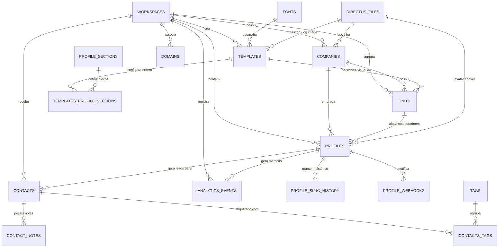

# Relatório de Análise Técnica — Módulo Perfil Digital (CartãoPRO / Linkko)

> **Documento de Engenharia P0 — Extração Completa do Legado para Migração ao GUIDU**  
> **Data:** 14/10/2026  
> **Autor da análise:** Antigravity (Google DeepMind Advanced Agentic Coding)  
> **Repositório analisado:** `smarthubaiagency/cartaopro-linkko` (`g:\RECUP CARTAOPRO SET26\cartaopro-linkkopro`)  
> **Destino:** `smarthubaiagency/console-guidu-gemini` (`docs/modules/perfil-digital/`)  
> **Modo de auditoria:** Estritamente somente-leitura, sem execução remota, sem exposição de credenciais ou dados sensíveis.

---

## Confirmação e Correção das Premissas do Usuário

Antes do detalhamento das 16 seções, registram-se as confirmações e correções pontuais sobre o conhecimento prévio apresentado:

1. **"Cada usuário pertence a uma unidade da empresa (filial ou setor)"**
   - **Confirmação com ressalva arquitetural:** No código, a entidade central da apresentação pública não é o `user` diretamente, mas o **`profile`** (`profiles.unit` aponta para `units.id` via chave estrangeira em `schema-dump.sql:profiles`, e `profiles.company` aponta para `companies.id`). Um usuário físico (`directus_users`) pode possuir mais de um perfil cadastrado (`profiles.user_id`, `profiles.is_default` em `types/index.ts:1155-1157`). O perfil pertence obrigatoriamente a uma empresa e a um workspace, e opcionalmente a uma unidade (`types/index.ts:1173-1174`).

2. **"Cada unidade tem um template, que é o modelo do cartão de visita digital"**
   - **Confirmado:** A tabela `units` possui as colunas `template` e `template_id` (`units.template_id_foreign` FK → `templates.id` em `schema-dump.sql:units`). Quando o perfil público é resolvido em `app/(public)/[...segments]/page.tsx:60-64`, o template do cartão é extraído exatamente de `profile.unit.template`.

3. **"O template é composto por módulos: hero, CTA, mapa, links, formulário e possivelmente outros"**
   - **Confirmado e ampliado:** O template gerencia a ordem e visibilidade de seções através da tabela de junção N:N `templates_profile_sections` ligada a `profile_sections` (`components/server/ProfileRenderer.tsx:98-117`). Além das seções básicas (Hero, CTA, Redes Sociais, Mapa, Links e QR Code), existem módulos integrados configurados diretamente no template: Formulário de Troca B2B (`ExchangeContactSheet`), Formulário de Contato com Upload (`ContactFormClient`), WhatsApp Conecte / Lead Form, Horário de Funcionamento avançado, Google Business, Chatwoot Live Chat e Passes de Carteira Digital (Google Wallet e Apple Wallet).

4. **"O admin muda o design e os módulos do template"**
   - **Confirmado:** A edição de design, cores, tipografia, altura de logos e seções do template (`app/(dashboard)/app/[workspaceSlug]/profile/t/[id]/page.tsx:26-30`) é rigidamente restrita a administradores do workspace (`session.is_workspace_admin === true`). Caso um usuário comum tente acessar, é redirecionado para a edição de seus próprios dados pessoais.

5. **"O usuário altera só as suas informações pessoais"**
   - **Corrigido com apontamento de dívida técnica crítica (P-03):** Na interface de usuário (`app/(dashboard)/app/[workspaceSlug]/profile/u/[slug]/page.tsx:139`), a aba "Design" fica oculta (`showDesignTab={false}`), e o usuário edita apenas seus dados pessoais (nome, cargo, bio, avatar, foto de capa, redes sociais, telefone e links). Porém, no legado, **links úteis e redes sociais corporativas eram gravados diretamente na tabela `templates`** (`templates.network` e `templates.Link`), o que fazia com que edições feitas por um membro na filial afetassem indevidamente os cartões de outros colaboradores da mesma unidade! Apenas o campo `personal_linkedin` existia isolado por usuário (`profiles.personal_linkedin`). O usuário também pode ligar/desligar a visibilidade de seções no seu cartão através de 17 flags booleanas (`profiles.show_*`).

---


## 1. Visão Geral

### 1.1 Stack Tecnológica e Arquitetura do Legado
O sistema **CartãoPRO / Linkko** é uma aplicação web multi-inquilino baseada na seguinte pilha de componentes:
- **Framework Web:** Next.js 16.2.1 App Router (`package.json:50`), utilizando primariamente Server Components (RSC) com hidratação client-side estrita (`package.json:59`, `audit-context.md:26`).
- **Linguagem:** TypeScript 5 estrito (`package.json:82`, `audit-context.md:18`).
- **Renderização e Runtime:** Node.js standalone — o uso de Edge Runtime é explicitamente proibido no projeto (`audit-context.md:19`).
- **Estilização e Design System:** Tailwind CSS v4 (`package.json:68,81`) acoplado a um gerador de variáveis CSS customizadas (`--brand-*` e `--dash-*`), dispensando cores hexadecimais hardcoded nos componentes (`audit-context.md:23-25`, `lib/theme/buildCSSVariables.ts:1-73`).
- **Biblioteca de Ícones:** `@hugeicons/react` (`package.json:30`), Lucide React (`package.json:49`) e `@lobehub/icons` (`package.json:31`).
- **Camada de Dados & CMS:** Directus 11+ via SDK oficial `@directus/sdk` v21.2.0 (`package.json:27`, `lib/directus.ts:1-25`). A maior parte dos dados do perfil digital reside em coleções nativas do Directus.
- **Banco de Dados Relacional:** PostgreSQL 17 (`schema-dump.sql:7-8`, `package.json:52`). O repositório documenta uma migração parcial de banco de dados (EasyPanel → Supabase), onde apenas tabelas de mensageria, eventos e c15t ganharam RLS (`audit-context.md:57-84`, `migrations/006_rls_policies.sql:1-161`), enquanto as tabelas de perfil digital e templates permaneceram sob gestão do Directus sem RLS de banco.
- **Sessão & Autenticação:** `iron-session` v8.0.4 (`package.json:44`, `lib/auth/session.ts:1-120`) com cookie selado e criptografado contendo token JWT do Directus.
- **Cache & Rate Limit:** Redis via `ioredis` v5.10.1 (`package.json:43`, `lib/redis.ts:1-40`) para resolução rápida de domínios (TTL 5 min) e controle de frequência de visualizações (rate-limit de 60s por IP).
- **QR Code & vCard:** `qrcode` v1.5.4 (`package.json:53`) para renderização server-side de SVG vetorial, com geração manual de vCard RFC 2426 v3.0 (`lib/vcard.ts:8-46`).
- **Gestão de Consentimento e LGPD:** Suíte c15t v2.1.0 (`package.json:24-26`, `migrations/018_c15t_2x_rls.sql:1-100`) para controle de cookies e preferências de privacidade.

### 1.2 Estrutura de Pastas e Localização da Feature
A funcionalidade de Cartão de Visita Digital distribui-se nas seguintes pastas principais:
- `app/(public)/[...segments]/page.tsx`: Rota catch-all pública do perfil (`/[slug]`, `/en/[slug]`, `/es/[slug]`), responsável pela resolução do host, injeção de metadata SEO, carregamento do perfil e renderização SSR (`app/(public)/[...segments]/page.tsx:1-217`).
- `app/(public)/id/[userId]/page.tsx`: Rota de permalink estável (redireciona via HTTP 308 para o slug atual).
- `app/(public)/t/[slug]/page.tsx`: Rota pública de pré-visualização de template utilizando um perfil "manequim" de teste (`TEMPLATE_PREVIEW_PROFILE_SLUG`).
- `app/(public)/contato/[slug]/page.tsx`: Página pública autônoma do formulário de contato extendido.
- `app/(dashboard)/app/[workspaceSlug]/profile/u/[slug]/`: Interface do usuário/membro para edição do perfil pessoal (`page.tsx`, com subpáginas para `/bio`, `/personal`, `/professional`, `/contact`, `/unit`, `/social`, `/website`, `/links`, `/cta`, `/qrcode`, `/seo`, `/contact-form`, `/exchange-form`, `/opening-hours`, `/footer`, `/chatwoot`, `/google-business`, `/whatsapp-conecte`, `/pwa`).
- `app/(dashboard)/app/[workspaceSlug]/profile/t/[id]/`: Interface do administrador para configuração visual e design do template (`page.tsx`, com abas `/seo`, `/pwa`, `/footer`).
- `app/(dashboard)/app/[workspaceSlug]/templates/`: Listagem e gerenciamento de templates do workspace.
- `app/(dashboard)/app/[workspaceSlug]/settings/workspace/units/`: CRUD e parametrização de filiais/unidades.
- `app/api/vcard/[slug]/route.ts`: Endpoint que gera e entrega o arquivo `.vcf` inline.
- `app/api/contacts/route.ts`: Endpoint dual (autenticado/público) para troca de cartões e captura de leads.
- `app/api/contacts/form/route.ts`: Endpoint público para submissão do formulário de contato com anexo de arquivos.
- `components/server/ProfileRenderer.tsx`: Componente orquestrador central de renderização do cartão.
- `components/server/HeroPremium.tsx`, `HeroCTA.tsx`, `SocialSection.tsx`, `AddressSection.tsx`, `QRCodeSection.tsx`, `LinksSection.tsx`, `Footer.tsx`: Componentes de apresentação de cada módulo.
- `lib/theme/buildTheme.ts`: Motor de mesclagem e resolução de cores e design tokens em 5 camadas.
- `lib/server/domain-resolver.ts`: Motor de identificação de tenant a partir do domínio HTTP.

---

## 2. Modelo de Dados

### 2.1 Detalhamento das Tabelas Ligadas à Feature
Abaixo estão as tabelas do PostgreSQL (`schema-dump.sql`) e do Directus (`directus-schema-snapshot.json`) que sustentam o perfil digital:

#### 1. `workspaces`
Entidade raiz da conta do cliente (tenant de faturamento).
- **Colunas:** `workspace_id` (UUID, PK), `status` (varchar, default 'draft'), `name` (varchar), `slug` (varchar, UNIQUE), `assigned_base_domain` (varchar, UNIQUE), `upgrade_custom_rules` (json), `user_created` (uuid), `date_created` (timestamptz), `user_updated` (uuid), `date_updated` (timestamptz).
- **Índices:** `workspaces_pkey` (PK), `workspaces_slug_unique`, `workspaces_assigned_base_domain_index`.
- **Políticas RLS:** Sem RLS no PostgreSQL (gerenciado pelo Directus SDK).

#### 2. `companies`
Representa a pessoa jurídica / marca comercial vinculada ao workspace.
- **Colunas:** `id` (UUID, PK), `workspace_id` (UUID, FK → `workspaces.workspace_id`), `name` (varchar), `slug` (varchar, UNIQUE), `logo` (UUID, FK → `directus_files.id`), `logo_update` (UUID), `icon` (UUID, FK → `directus_files.id`), `background_image` (UUID), `theme_color` (varchar), `background_color` (varchar), `google_business_profile` (varchar), `links` (json, array de links institucionais do rodapé), `cnpj` (varchar), `email_nf` (varchar), `owner_id` (UUID, FK → `profiles.id`), `contact_id` (UUID, FK → `profiles.id`), campos PWA (`pwa_name`, `pwa_short_name`, `pwa_display`, `pwa_description`, `pwa_maskable_icon`), campos Google Wallet corporativos (`wallet_company_*`), campos Chatwoot corporativos (`chatwoot_*`).
- **Relações:** 1:N com `units` e 1:N com `profiles`.

#### 3. `units`
Representa a filial, loja física ou setor da empresa.
- **Colunas:** `id` (UUID, PK), `workspace_id` (UUID, FK → `workspaces.workspace_id`), `Company` (UUID, FK → `companies.id`), `Name` (varchar), `Google_Maps_Location` (json NOT NULL: objeto com `address`, `street`, `number`, `neighborhood`, `city`, `uf`, `cep`, `lat`, `lng`, `url`), `opening_hours` (text ou json, string descritiva ou grade semanal com slots de horários), `template` (UUID, FK → `templates.id`), `template_id` (UUID, FK redundante → `templates.id`), `status` (varchar, default 'draft').
- **Relações:** Pertence a uma `company` e a um `workspace`; aponta para um `template`; é referenciada por múltiplos `profiles`.

#### 4. `templates`
Modelo visual e estrutural do cartão de visita digital para os colaboradores daquela unidade.
- **Colunas de Identificação e Controle:** `id` (UUID, PK), `workspace_id` (UUID, FK → `workspaces.workspace_id`), `name` (varchar), `slug` (varchar), `status` (varchar, default 'draft'), `is_master` (boolean), `is_default` (boolean), `source_master_id` (UUID, FK auto-referencial para clonagem), `design_mode` (varchar, 'smart' | 'managed', default 'smart'), `hero_design` (varchar, 'hero_premium' | 'hero_personal' | 'hero_linq' | 'hero_business').
- **Cores e Design (Flat Fields):** `primary_color`, `secundary_color` (sic), `accent_color`, `background_dark`, `background_base`, `background_card`, `background_surface`, `background_foreground`, `background_muted`, `text_on_dark`, `text_on_light`, `text_on_card`, `text_muted`, `button_primary_bg`, `button_primary_text`, `button_secundary_bg`, `button_secundary_text`, `button_dark_bg`, `button_dark_text`, `button_ctalink_bg`, `button_ctalink_text`, `minibutton_ctalink_bg`, `minibutton_ctalink_text`, `social_bg`, `social_icon`, `link_color`, `divider_color`, `qr_code_color`, `avatar_border_color`.
- **Métricas de Layout:** `border_radius` (int), `border_radius_btn` (int), `border_radius_avatar` (int), `avatar_border_width` (int), `logo_mobile_height` (int, default 40), `logo_footer_height` (int, default 40), `header_mobile_height` (int), `padding_mobile` (int, default 20).
- **Tipografia e Tokens JSON:** `font` (UUID, FK → `fonts.id`), `design_tokens` (json, override de `ThemeTokens`).
- **Módulos e Conteúdos:**
  - *CTA:* `cta_type` ('whatsapp' | 'link' | 'default' | 'chat'), `cta_label`, `cta_url`, `cta_target`, `cta_whatsapp_number`, `cta_whatsapp_message`, `Icon` (UUID, FK → `directus_files.id`).
  - *Redes Sociais:* `network` (json, array de `{ Social_Network, Social_Network_URL }`).
  - *Links Úteis:* `Link` (json, array de `{ Titulo, CTA_URL, CTA_Button }`), `links_title`, `links_description`.
  - *Mapa:* `map_id` (varchar, Google Cloud Map Style ID).
  - *QR Code:* `qr_code_version` ('link' | 'offline' | 'custom'), `qr_code_title`, `qr_code_description`, `qr_code_url`.
  - *Formulário de Troca:* `exchange_require_name`, `exchange_require_email`, `exchange_require_phone`, `exchange_require_note`, `exchange_show_company`, `exchange_show_job_title`, `exchange_custom_message`, `exchange_consent_active`, `exchange_consent_text`.
  - *Formulário de Contato:* `contact_form_enabled`, `contact_form_title`, `contact_form_subtitle`, `contact_form_intro`, `contact_form_button_label`, `contact_form_schema` (json).
  - *Lead Form / WhatsApp Conecte:* `lead_form_interests` (json), `lead_form_whatsapp_mesage` (sic), `lead_form_coupon_text`, `lead_form_webhook_url`.
  - *SEO e Rodapé:* `open_graph_image` (UUID), `profile_seo_title`, `profile_seo_description`, `copyright`, `header_scripts` (varchar).

#### 5. `profile_sections` e `templates_profile_sections`
Controlam a composição, estilos e ordem vertical das seções no cartão.
- **`profile_sections`:** `id` (UUID, PK), `type` (varchar: 'Header', 'Hero', 'CTA', 'Social', 'Map', 'Links', 'QR Code', 'Footer'), `is_visible` (boolean), `sort` (int), `style` ('card' | 'flat' | 'none'), `padding_top` (int), `padding_bottom` (int).
- **`templates_profile_sections` (Junction M2M):** `id` (int, PK serial), `templates_id` (UUID, FK → `templates.id`), `profile_sections_id` (UUID, FK → `profile_sections.id`). Permite sobrescrever por template as propriedades `sort`, `is_visible`, `style`, `padding_top`, `padding_bottom`.

#### 6. `profiles`
Instância individual de um colaborador/profissional. É a entidade resolvida no acesso à URL pública.
- **Colunas de Associação:** `id` (UUID, PK), `user_id` (UUID, FK → `directus_users.id`), `workspace_id` (UUID, FK → `workspaces.workspace_id`), `company` (UUID, FK → `companies.id`), `unit` (UUID, FK → `units.id`), `is_default` (boolean).
- **Dados Pessoais & Apresentação:** `slug` (varchar, NOT NULL, indexado), `name` (varchar, NOT NULL), `prefix` (varchar, ex: "Dr.", "Eng."), `pronouns` (varchar, ex: "ele/dele"), `post_nominals` (varchar, ex: "PhD, CRM 12345"), `title` (varchar, cargo/profissão), `email` (varchar), `cell_phone` (varchar), `work_phone` (varchar), `url_da_agenda` (varchar, link Calendly/Cal.com), `avatar` (UUID, FK → `directus_files.id`), `cover_photo` (UUID, FK → `directus_files.id`), `personal_linkedin` (varchar), `color_mode` ('light' | 'dark').
- **Biografia:** `bio_title` (varchar), `bio_text` (text), `bio_skills` (json, array de tags/habilidades).
- **17 Flags de Visibilidade (`show_*`):** `show_bio`, `show_cta`, `show_social`, `show_links`, `show_qrcode`, `show_unit`, `show_website`, `show_files`, `show_google_business`, `show_opening_hours`, `show_form`, `show_contact_form`, `show_exchange_form`, `show_lead_form`, `show_google_wallet`, `show_apple_wallet`, `show_chatwoot`.
- **Modo Evento:** `event_mode_active` (boolean), `event_mode_tag` (varchar), `event_mode_start` (date), `event_mode_end` (date), `event_mode_message` (text).
- **Integrações & Wallet Individual:** `chatwoot_agent_id` (int), `leads_webhook_url` (varchar), `lead_notifications_active` (boolean), `remove_branding` (boolean), `wallet_card_color`, `wallet_accent_color`, `wallet_logo_id`, `wallet_hero_image_id`.

#### 7. `profile_slug_history`
Mantém o histórico de alterações de slug de cada perfil para evitar links quebrados em cartões físicos ou impressos já distribuídos.
- **Colunas:** `id` (int, PK serial), `profile_id` (UUID, FK → `profiles.id`), `old_slug` (varchar, NOT NULL), `changed_at` (timestamp).
- **Comportamento:** Ao acessar um slug antigo, `app/(public)/[...segments]/page.tsx:146-150` busca nessa tabela e devolve um `permanentRedirect` (HTTP 308) para o slug atual.

#### 8. `contacts` (Leads do Cartão)
Armazena leads gerados via formulário de contato simples ou troca de cartões B2B.
- **Colunas:** `id` (UUID, PK), `workspace_id` (UUID, FK → `workspaces.workspace_id`), `profile_id` (UUID, FK → `profiles.id`), `name` (varchar), `email` (varchar), `cell_phone` (varchar), `work_phone` (varchar), `company` (varchar), `job_title` (varchar), `website` (varchar), `lead_address` (text), `note` (text), `subject` (varchar), `message` (text), `source` (varchar, ex: 'form', 'scan', 'manually', 'direct'), `status` (varchar, default 'New'), `extra_payload` (json, campos dinâmicos do formulário customizado), `lead_metadata` (json), `chatwoot_contact_id` (int), `sync_source` (varchar).
- **Campos de Auditoria LGPD:** `consent_at` (timestamptz), `consent_ip` (varchar), `consent_user_agent` (text), `consent_term_version` (varchar), `consent_term_hash` (varchar), `consent_cookies` (json).
- **Tabelas Auxiliares:** `contact_notes` (notas manuais) e `contacts_tags` / `tags` (etiquetas).

#### 9. `analytics_events`
Registra acessos e interações no perfil digital.
- **Colunas:** `id` (UUID, PK), `profile_id` (UUID, FK → `profiles.id`), `workspace_id` (UUID, FK → `workspaces.workspace_id`), `source` (varchar, default 'direct', 'nfc', 'qr', canais customizados), `event_type` (varchar, default 'view'), `ip_hash` (varchar(16), hash SHA-256 truncado do IP do visitante para privacidade LGPD), `timestamp` (timestamptz, default now()).
- **Agregações:** Consultas agrupadas por fonte e contagem distinta de `ip_hash` para visitas únicas (`lib/queries/analytics.ts:57-69`).

#### 10. `domains`
Domínios customizados (ex: `cartao.suaempresa.com.br`) vinculados a um workspace.
- **Colunas:** `id` (UUID, PK), `workspace_id` (UUID, FK → `workspaces.workspace_id`), `domain` (varchar, UNIQUE), `status` ('pending' | 'active' | 'error'), `is_primary` (boolean), `cloudflare_hostname_id` (varchar).

### 2.2 Diagrama Entidade-Relacionamento (Mermaid)



---

## 3. Hierarquia e Permissões

### 3.1 Níveis de Inquilino no Legado vs. GUIDU
No legado, a hierarquia de entidades é híbrida e reflete o modelo Directus:
1. **Workspace:** Unidade máxima de isolamento da conta, faturamento, instâncias de WhatsApp e domínios.
2. **Company:** Entidade de branding corporativo dentro do workspace. Armazena logo principal, ícone PWA, dados fiscais (CNPJ) e links de rodapé.
3. **Unit:** Subdivisão da Company que representa filial física ou setor. Armazena a localização no Google Maps, horários de funcionamento e está amarrada ao **Template**.
4. **Profile:** O cartão digital individual de um colaborador. Pertence a uma Unit (para herdar o Template e o endereço) e a uma Company (para herdar a marca).
5. **Directus User:** A credencial de autenticação de login (e-mail e senha). Vinculada a um ou mais perfis através da tabela `profiles.user_id`.

### 3.2 Papéis e Matriz de Acesso no Legado
O sistema legado apresenta uma dualidade de papéis:
- **Papéis no Directus (`directus_roles`):**
  - `Administrator`: Super-admin da plataforma com acesso irrestrito (`session.is_super_admin === true`).
  - `Workspace Owner`: Criador/proprietário da conta do workspace.
  - `Workspace Admin`: Administrador do workspace com permissão para gerenciar templates, filiais e outros membros (`session.is_workspace_admin === true`).
  - `Workspace User`: Colaborador comum da empresa.
- **Papéis na tabela de associação (`workspace_users.role`):**
  - Armazena as roles em string: `'owner'`, `'admin'`, `'member'`, `'viewer'` (`types/index.ts:1232`).

### 3.3 Regras de Edição: Quem Pode Alterar o Quê?
- **Edição de Template e Design:**
  - Controlada pelo guard `app/(dashboard)/app/[workspaceSlug]/profile/t/[id]/page.tsx:26-30`. Apenas usuários com `is_workspace_admin === true` conseguem carregar a tela e salvar no endpoint `POST /api/profile/design`.
  - Usuários comuns (`member`) são bloqueados e redirecionados para a tela de seus próprios dados pessoais.
- **Edição de Unidades / Filiais:**
  - Restrita aos administradores do workspace em `/settings/workspace/units`.
- **Edição de Perfil Individual:**
  - Controlada pelo guard de servidor `resolveEditorProfileOrRedirect` (`lib/server/profile-edit-guard.ts:22-44`).
  - Um colaborador comum pode editar **apenas** o perfil cujo slug corresponde ao seu `session.active_profile_slug` (self-edit).
  - Um administrador pode editar seu próprio perfil e os perfis de **qualquer outro membro** pertencente ao mesmo `session.workspace_id` (cross-user admin edit).
  - Tentativas de acessar perfis de outro workspace resultam em redirecionamento forçado de volta ao perfil do próprio usuário.

### 3.4 Comparação com os Papéis do GUIDU (ADR 0012)
O GUIDU adota uma separação institucional rigorosa de 4 níveis:
- **Plataforma (`/platform`):** Operação interna do GUIDU. Roles: `owner`, `operations`.
- **Parceiro (`/admin`):** Agência white-label. Roles: `partner_owner`, `partner_admin`. O parceiro não acessa dados privados de clientes sem concessão de suporte auditada (ADR 0012).
- **Empresa / Organização (`Organization`):** O cliente corporativo do parceiro (razão social, CNPJ, faturamento).
- **Workspace (`Workspace`):** O ambiente onde os módulos operam. Roles: `owner`, `admin`, `editor`, `viewer`.
  - O papel `member` do legado mapeia perfeitamente para o papel **`editor`** do GUIDU (usuário autorizado a editar seu próprio cartão e interagir com seus próprios dados).

---


## 4. Templates e Design

### 4.1 Como o Template Guarda o Design (Tokens, JSON e Banco de Dados)
O modelo de design do Linkko é sofisticado e implementa redundância entre colunas relacionais planas e um objeto JSON mestre:
1. **Flat Fields no Banco (`templates.*`):**
   - Mais de 40 colunas individuais no PostgreSQL armazenam diretamente os valores calculados de cores hexadecimais, raios de borda e alturas (`templates.primary_color`, `templates.background_base`, `templates.border_radius`, etc. em `schema-dump.sql:templates`).
   - Essa estrutura permite consultas rápidas e compatibilidade nativa com os formulários do Directus Admin.
2. **Objeto JSON Mestre (`templates.design_tokens`):**
   - Campo JSON que armazena a estrutura `DeepPartial<ThemeTokens>` (`types/index.ts:18-73`).
   - Sincronizado bidirecionalmente com os campos planos no endpoint de salvamento (`app/api/profile/design/route.ts`).

### 4.2 O Motor de Cores Inteligente (`Smart Design System`)
A geração de paletas visuais baseia-se em um modelo algorítmico suportado por duas tabelas:
- **`smart_color_presets`:** Tabela com combinações prontas de 3 cores-semente: `primary` (ex: #222222), `secondary` (ex: #FF643A) e `accent` (`types/index.ts:1390-1400`). O editor possui 5 fallbacks nativos (`TemplateDesignEditorClient.tsx:37-43`).
- **`smart_design_system`:** Mapeia cada token visual (`token_key`, ex: `background_card`, `button_primary_bg`) para uma cor-semente (`source_seed`: primary, secondary, accent), uma parada de escala de luminosidade para o modo claro (`stop_light`: 50 a 950) e outra para o modo escuro (`stop_dark`: 50 a 950), e uma regra de contraste (`value_type`: 'color' ou 'contrast') (`types/index.ts:1369-1384`).
- **Função `generateScale(hex)` (`lib/theme/color-utils.ts`):** Gera uma escala tonal HSL completa de 11 paradas (50, 100, 200, 300, 400, 500, 600, 700, 800, 900, 950) a partir da cor-semente.
- **Função `getContrastColor(hex)`:** Calcula a luminância relativa segundo as diretrizes WCAG e devolve automaticamente branco (`#ffffff`) ou preto (`#111111`) para garantir acessibilidade visual.

### 4.3 A Cascata de Resolução em 5 Camadas (`buildTheme.ts`)
Quando um cartão é renderizado, o tema final é construído pela função `buildTheme(company, template, colorMode, designSystemData)` (`lib/theme/buildTheme.ts:79-122`), seguindo rigorosamente a cascata:
- **Layer 1 — Safety Net (`presets.default`):** Preenchimento obrigatório de todos os tokens possíveis para garantir que nenhuma variável fique nula.
- **Layer 2 — Base Corporativa (`presets.corporate`):** Base visual refinada da plataforma aplicada sobre o default.
- **Layer 3 — Template Flat Fields:** Valores específicos gravados nas colunas planas do template.
- **Layer 4 — Template `design_tokens` JSON:** Sobrescritas finas salvas no JSON do template (prevalecem sobre as colunas planas).
- **Layer 5 — Derivação Algorítmica das Cores-Semente (`deriveSeedsToTokens`):** Aplicação das paradas calculadas com base nas cores primária, secundária e de destaque do template para o modo de cor ativo (`light` ou `dark`).

### 4.4 Injeção no DOM como Variáveis CSS (`buildCSSVariables.ts`)
O objeto final `ThemeTokens` é processado por `buildCSSVariables()` (`lib/theme/buildCSSVariables.ts:11-72`), que gera um mapa de propriedades CSS embutido no elemento container pelo componente `ThemeProvider` (`components/server/ThemeProvider.tsx:26`). Todos os estilos filhos consomem variáveis nativas:
```css
--brand-primary: #...;
--brand-secondary: #...;
--brand-bg-base: #...;
--brand-bg-card: #...;
--brand-text-card: #...;
--brand-btn-primary-bg: #...;
--brand-btn-primary-text: #...;
--brand-radius: 4px;
--brand-radius-avatar: 100px;
--brand-font: 'Inter, sans-serif';
```

### 4.5 Tipografia e Fontes Dinâmicas
- O template referencia um registro da coleção `fonts` (`templates.font` FK → `fonts.id` em `types/index.ts:1439-1448`).
- Cada registro possui `font_family` (ex: "Montserrat, sans-serif"), `google_font_name` (ex: "Montserrat") e `weights` (ex: "300,400,500,600,700").
- O componente `FontLoader` (`components/server/FontLoader.tsx`) injeta a tag `<link rel="stylesheet">` apontando para a API do Google Fonts no cabeçalho do cartão.

### 4.6 Versões e Prévia
- **Versões:** Templates visuais no legado **não possuem histórico de versões** (não há tabela de revisões no Postgres; qualquer alteração no template sobrepõe os dados anteriores imediatamente).
- **Prévia Pública (`/t/[slug]`):** Renderiza o cartão utilizando o template indicado associado aos dados de um perfil de demonstração ("manequim") configurado na variável `TEMPLATE_PREVIEW_PROFILE_SLUG` (`app/(public)/t/[slug]/page.tsx:24-63`), exibindo um banner superior "Modo de Pré-visualização de Template" (`TemplatePreviewBanner`).

---

## 5. Catálogo de Módulos (Fichas Técnicas)

Abaixo estão as fichas técnicas completas de cada bloco componente do perfil digital:

### Módulo 1: Hero (Identidade do Membro)
- **Componente:** `components/server/HeroPremium.tsx` (Server Component) e `components/client/HeroDesignSelector.tsx`.
- **Quem edita:** Admin escolhe o estilo estrutural no template (`templates.hero_design`: `hero_premium`, `hero_personal`, `hero_linq`, `hero_business`). O usuário preenche seus dados pessoais em seu perfil.
- **Campos Pessoais (do Perfil):** Avatar (`avatar`), Nome (`name`), Cargo (`title`), Prefixo (`prefix`), Pronomes (`pronouns`), Pós-nominais (`post_nominals`), Foto de capa (`cover_photo`).
- **Campos Fixo/Template:** Espaçamento superior/inferior (`padding_top`, `padding_bottom`), borda do avatar (`avatar_border_width`, `avatar_border_color`), formato do recorte do avatar (`border_radius_avatar`).
- **Comportamento e Ações:** Exibe foto de perfil circular com anel de destaque; botões rápidos de ação: Ligar (`tel:`), E-mail (`mailto:` ou redirecionamento para o formulário de contato), WhatsApp (`wa.me/`) e botão "Salvar Contato" que aciona o download do vCard (`/api/vcard/[slug]`).
- **Validações:** Nome obrigatório; telefone sanitizado removendo caracteres não-numéricos (`replace(/\D/g, '')`).
- **Estado Vazio:** Sem avatar exibe iniciais do nome; sem cargo ou pronomes omite as linhas correspondentes sem quebrar layout.

### Módulo 2: CTA (Botão de Chamada para Ação)
- **Componentes:** `HeroCTA.tsx` (botão padrão), `HeroCTADefault.tsx` (gatilho do formulário de troca), `HeroCTAChat.tsx` (gatilho de chat ao vivo).
- **Quem edita:** Administrador no template (`templates.cta_*`).
- **Tipos de CTA (`templates.cta_type`):**
  - `whatsapp`: Abre conversa direta no WhatsApp com número (`cta_whatsapp_number`, com fallback para o celular do membro) e mensagem pré-formatada codificada em URI (`cta_whatsapp_message`).
  - `link`: Redireciona para URL externa (`cta_url`) abrindo em nova aba (`cta_target = '_blank'`) ou na mesma aba.
  - `default`: Abre a gaveta modal de Troca de Cartão B2B (`ExchangeContactSheet`).
  - `chat`: Abre a gaveta de chat direto com a equipe / IA (`PublicChatSheet`), condicionado ao status ativo do addon Chatwoot (`chatWidgetEnabled`).
- **Campos:** `cta_label` (texto do botão, default "Agendar uma reunião"), `Icon` (ícone SVG customizado).
- **Estado Vazio:** Se o CTA for do tipo link e a URL estiver vazia, renderiza como link inativo (`#`). Se for do tipo chat e o addon estiver inativo, o botão é omitido em tempo de execução.

### Módulo 3: Redes Sociais
- **Componentes:** `components/server/SocialSection.tsx` e `components/client/SocialManagerClient.tsx`.
- **Quem edita:** Admin no template (configura a lista base de redes da empresa/unidade em `templates.network`). Usuário pode configurar seu LinkedIn individual (`profiles.personal_linkedin`).
- **Campos:** Array JSON de objetos `{ Social_Network: string, Social_Network_URL: string }`. Redes suportadas: LinkedIn, Instagram, Facebook, WhatsApp, YouTube, X (Twitter), Website, TikTok, GitHub, Behance.
- **Sobrescrita por Usuário:** Se `profiles.personal_linkedin` estiver preenchido, o componente substitui dinamicamente o LinkedIn institucional pelo link pessoal do colaborador (`ProfileRenderer.tsx:228-233`).
- **Estilo Visual:** Suporta estilo `card` (com fundo e bordas arredondadas) ou `flat` (em linha com o fundo da página). Cores controladas por `--brand-social-bg` e `--brand-social-icon`.
- **Estado Vazio:** Oculta a seção inteira se a lista de redes for vazia.

### Módulo 4: Mapa / Localização da Unidade
- **Componentes:** `components/server/AddressSection.tsx` e `components/client/DynamicMap.tsx`.
- **Quem edita:** Admin nas configurações da unidade (`units.Google_Maps_Location`, `units.opening_hours`). O usuário tem a flag `profiles.show_unit` para ocultar a seção se atuar em home-office.
- **Campos:** Endereço completo, CEP, bairro, cidade, UF, latitude, longitude, URL para o Google Maps, e ID de estilo de mapa do Google Maps Cloud (`templates.map_id`).
- **Comportamento:** Carrega mapa interativo do Google Maps via `@googlemaps/js-api-loader`; botão "Como Chegar" que abre o app de navegação do dispositivo (Waze / Google Maps); exibe o horário de funcionamento resumido ou grade semanal; link para avaliação no Perfil de Empresa do Google (`companies.google_business_profile`).
- **Estado Vazio:** Se o JSON de localização da unidade não tiver endereço preenchido, a seção inteira retorna `null` e não é renderizada.

### Módulo 5: Links Úteis / Lista de Links
- **Componentes:** `components/server/LinksSection.tsx` e `components/client/LinksManagerClient.tsx`.
- **Quem edita:** Admin no template (`templates.Link`, `templates.links_title`, `templates.links_description`).
- **Campos:** Título da seção (ex: "Materiais Úteis"), Descrição, e array JSON de itens `{ Titulo: string, CTA_URL: string, CTA_Button?: string }`.
- **Estilos:** Botões em bloco largo com hover states, cores mapeadas para `--brand-btn-ctalink-bg` e texto `--brand-btn-ctalink-text`.
- **Estado Vazio:** Se a lista for vazia, a seção não ocupa espaço visual (`ProfileRenderer.tsx:287`).

### Módulo 6: QR Code
- **Componentes:** `components/server/QRCodeSection.tsx` e `components/client/QRCodeEditorClient.tsx`.
- **Quem edita:** Admin no template (`templates.qr_code_*`). O usuário pode alternar a exibição via `profiles.show_qrcode`.
- **Modos de Geração (`templates.qr_code_version`):**
  - `link` (padrão): Gera QR code apontando para a URL canônica pública do perfil.
  - `offline`: **Codifica a string completa do vCard 3.0 dentro dos módulos do QR Code.** Permite que outra pessoa aponte a câmera sem sinal de internet e salve o contato na agenda imediatamente!
  - `custom`: Codifica uma URL alternativa arbitrária configurada no template.
- **Renderização Técnica:** Gera elemento SVG puro no servidor sem requisições a APIs externas (`lib/qrcode.ts:11-24`), colorindo os módulos do QR com `--brand-qr-color` e o fundo com `--brand-bg-foreground`.

### Módulo 7: Formulário de Contato Estendido
- **Componentes:** `components/client/ContactFormClient.tsx` e `app/(public)/contato/[slug]/page.tsx`.
- **Quem edita:** Admin no template (`templates.contact_form_*`).
- **Campos do Template:** `contact_form_enabled` (boolean), `contact_form_title`, `contact_form_subtitle`, `contact_form_intro`, `contact_form_button_label`, e o esquema dos campos dinâmicos `contact_form_schema` (`ContactFormFieldDef[]`: texto, e-mail, telefone, textarea, select, radio e upload de arquivo).
- **Submissão:** Envia via multipart/form-data para `POST /api/contacts/form`. Suporta envio de anexos (até 5MB, PDF ou imagens), campos dinâmicos gravados em `extra_payload`, proteção por honeypot (`_hp`) e termo de aceite LGPD.

### Módulo 8: Formulário de Troca (Exchange Contact Form / B2B)
- **Componente:** `components/client/ExchangeContactSheet.tsx`.
- **Quem edita:** Admin no template (`templates.exchange_*`).
- **Objetivo:** Captura instantânea e qualificação do lead que está visitando o cartão em uma feira, reunião ou evento.
- **Campos Parametrizáveis:** Exigência de nome (`exchange_require_name`), e-mail (`exchange_require_email`), telefone (`exchange_require_phone`), nota rápida (`exchange_require_note`), exibição de cargo e empresa do visitante, mensagem de agradecimento personalizada e texto de consentimento da LGPD.
- **Submissão:** Envia para `POST /api/contacts`, deduping por e-mail/celular, cria o lead e dispara automações no WhatsApp via Event Bus.

### Módulo 9: WhatsApp Conecte / Lead Form
- **Componente:** `components/client/WhatsAppConnecteConfiguratorClient.tsx`.
- **Quem edita:** Admin no template (`templates.lead_form_*`).
- **Campos:** Lista de interesses selecionáveis (`lead_form_interests`), cupom/recompensa de incentivo (`lead_form_coupon_text`), mensagem inicial do WhatsApp e URL de webhook dedicada.
- **Comportamento:** Permite ao visitante selecionar áreas de interesse comercial antes de ser direcionado para uma conversa contextualizada no WhatsApp.

### Módulo 10: Rodapé Corporativo (Footer)
- **Componentes:** `components/server/Footer.tsx` e `components/client/FooterEditorClient.tsx`.
- **Quem edita:** Dados da empresa em `companies` e texto de copyright no template (`templates.copyright`).
- **Campos:** Logo da empresa (`companies.logo`), Razão social/Nome (`companies.name`), Copyright legal, e links corporativos de rodapé (`companies.links`, ex: Política de Privacidade, Termos de Uso).
- **Brand Protection:** Se o workspace não possuir o recurso `feature_remove_branding` contratado em seu plano, o rodapé exibe obrigatoriamente a assinatura "Criado com CartãoPRO / Linkko".

### Módulo 11: Bio e Habilidades
- **Componentes:** `components/client/BioEditorClient.tsx` e `components/server/ProfileRenderer.tsx`.
- **Quem edita:** O usuário/colaborador no seu próprio perfil (`profiles.bio_*`).
- **Campos:** `bio_title` (título da biografia, ex: "Sobre mim"), `bio_text` (texto de apresentação profissional), `bio_skills` (array de tags de especialidades, habilidades ou competências).
- **Visibilidade:** Controlada por `profiles.show_bio`.

### Módulo 12: Carteiras Digitais (Google Wallet & Apple Wallet)
- **Componentes:** `components/client/GoogleWalletPageClient.tsx`, `docs/google-wallet.md`.
- **Quem edita:** Admin configura os modelos visuais da empresa (`companies.wallet_company_*`) e usuário liga a exibição no seu perfil (`profiles.show_google_wallet`).
- **Campos:** Cor de fundo do passe, título do cartão, imagem de hero (banner 1032x336), logotipo e link de suporte.
- **Comportamento:** Gera um arquivo de passe assinado criptograficamente (JWT assinado pela Service Account do Google) que permite ao visitante ou ao próprio membro adicionar o cartão profissional à carteira nativa do Android/iOS com botão "Save to Google Wallet".

### Módulo 13: Chatwoot Live Chat (Atendimento Direto)
- **Componentes:** `components/client/PublicChatSheet.tsx` e `components/client/ChatwootConfiguratorClient.tsx`.
- **Quem edita:** Admin configura as credenciais do inbox da empresa; no perfil do colaborador, pode-se vincular o ID do agente Chatwoot correspondente (`profiles.chatwoot_agent_id`).
- **Comportamento:** Botão flutuante ou CTA que abre gaveta de chat direto com a equipe humana ou agente de IA SDR (`PublicChatSheet`), sem sair da página do perfil digital.
- **Checagem Dupla de Segurança:** O widget só aparece se a flag `profiles.show_chatwoot` estiver ativa E o addon Chatwoot no workspace estiver com status 'active' (`ProfileRenderer.tsx:176-182`).

### Módulo 14: Horário de Funcionamento
- **Componentes:** `components/client/OpeningHoursEditorClient.tsx`.
- **Quem edita:** Admin na unidade (`units.opening_hours`). O usuário pode ocultar via `profiles.show_opening_hours`.
- **Formatos:** Modo texto simples (ex: "Segunda a sexta das 8h às 18h") ou modo avançado estruturado em JSON com dias da semana e múltiplos slots de início/fim (`ProfileRenderer.tsx:31-49`).

### Módulo 15: PWA (Progressive Web App)
- **Componentes:** `components/client/PWAInstallSheet.tsx` e endpoint de manifesto dinâmico `/api/manifest/[companySlug]/[profileSlug]/route.ts`.
- **Quem edita:** Admin define nome e ícones em `companies.pwa_*`; usuário pode ativar o prompt de instalação.
- **Comportamento:** Gera arquivo `manifest.json` dinâmico que permite ao visitante "instalar" o perfil digital na tela inicial do smartphone como se fosse um aplicativo nativo, com ícone maskable e splash screen nas cores da marca.

---

## 6. Página Pública

### 6.1 Roteamento e Estrutura de URLs
O perfil digital público opera na rota catch-all `app/(public)/[...segments]/page.tsx`:
- `/[slug]`: Visualização em Português (padrão).
- `/en/[slug]`: Visualização com dicionário traduzido em Inglês (`lib/i18n/dictionaries/en.ts`).
- `/es/[slug]`: Visualização com dicionário em Espanhol (`lib/i18n/dictionaries/es.ts`).
- `/id/[userId]`: Rota permanente via UUID (`app/(public)/id/[userId]/page.tsx`), garantindo que URLs gravadas em cartões físicos NFC continuem funcionando caso o usuário mude seu slug amigável.
- `/[channel]/[slug]`: Rota com atribuição de marketing (ex: `/nfc/joao-silva`, `/qr/joao-silva`).
- `proxy.ts:72-106`: Roteamento de domínios curtos para cartões físicos NFC (`mobqr.co`, `mobiz.me`, `linkko.me`).

### 6.2 Resolução Multi-Tenant de Domínios (`domain-resolver.ts`)
Para atender a domínios próprios e subdomínios, o sistema utiliza uma resolução em 3 camadas (`lib/server/domain-resolver.ts:168-193`):
1. **Cache Redis (TTL 5 min):** Chave `domain:${host}`. Se houver hit, responde em ~1 ms.
2. **Coleção `domains` (Custom Domains CNAME):** Busca onde `domain == host` e `status == 'active'`. Retorna o `workspace_id` proprietário.
3. **Subdomínios da Plataforma (`workspaces.assigned_base_domain`):** Valida se o TLD do host está na lista permitida de `globals.system_allowed_domains` (ex: `oab.linkko.app`).
4. **Sem correspondência:** Trata como acesso ao domínio principal da plataforma.
- **Importante:** Respostas nulas NUNCA são salvas no cache Redis para evitar envenenamento de cache transitório (`domain-resolver.ts:166`).

### 6.3 SEO, Meta Tags e Open Graph Dinâmico
A função `generateMetadata` (`app/(public)/[...segments]/page.tsx:45-109`) constrói os metadados de forma reativa:
- **Título (`title` / `og:title`):** Cascata: `profile.Profile_SEO_Title` → `template.profile_seo_title` → fallback `"${profile.name} — ${company.name}"`.
- **Descrição (`description` / `og:description`):** `profile.Profile_SEO_Description` → `template.profile_seo_description`.
- **Imagem Open Graph (`og:image`):** Cascata: `template.open_graph_image` → `profile.avatar`. A imagem é gerada dinamicamente via Directus Assets com parâmetros de corte perfeito: `?width=1200&height=630&fit=cover&format=webp` (`page.tsx:78-80`).
- **Favicon & Apple Touch Icon:** Gerados a partir do ícone da empresa (`company.icon`) nos tamanhos 32x32 e 180x180.
- **Canonical URL:** Injeta a URL canônica resolvida considerando o host do cliente (`getProfileUrl(slug, resolvedHost)`).
- **Twitter Card:** Tipo `summary_large_image` quando há imagem de capa, ou `summary` simples.

### 6.4 Geração e Download de vCard (.vcf)
- Rota: `GET /api/vcard/[slug]` (`app/api/vcard/[slug]/route.ts:1-48`).
- Formato: RFC 2426 vCard 3.0 em UTF-8 gerado puramente em TypeScript por `generateVCardString()` (`lib/vcard.ts:8-46`).
- Headers HTTP: `Content-Type: text/vcard; charset=utf-8` e `Content-Disposition: inline; filename="${slug}.vcf"`.
- Campos serializados: FN (Nome completo), TITLE (Cargo), ORG (Empresa), EMAIL (Internet), TEL WORK (Telefone fixo), TEL CELL (Celular), URL (Link do cartão digital) e X-SOCIALPROFILE (LinkedIn).
- Evento de Rastreamento: Ao baixar o vCard, o endpoint emite o evento `vcard.downloaded` de forma assíncrona ("fire-and-forget") para métricas.

### 6.5 Performance, Cache e Acessibilidade
- **Zero Client JS no Core:** `ProfileRenderer` e todos os componentes de bloco (Hero, Social, Address, Links, Footer, ThemeProvider) são **React Server Components (RSC)**. Não há hidratação de bundle JavaScript para exibir os dados do perfil.
- **Métricas Assíncronas:** A contagem de visualizações utiliza o utilitário `after()` do Next.js 16 (`page.tsx:186-191`), enviando o log de acesso ao banco depois que a resposta HTTP foi entregue ao navegador do visitante, resultando em latência zero na renderização.
- **Acessibilidade:** Marcação semântica HTML5, links com atributos `aria-label`, e cálculos de cores com contraste verificado por WCAG.

---


## 7. Formulário e Leads

### 7.1 Destino das Respostas e Pipeline de Dados
A captação de leads pelo cartão digital opera através de dois endpoints dedicados:
1. **`POST /api/contacts` (Modo Dual / Troca de Cartão B2B):**
   - Utilizado pelo botão CTA padrão e pela gaveta `ExchangeContactSheet` (`app/api/contacts/route.ts:30-194`).
   - Recebe nome, e-mail, celular, telefone de trabalho, empresa, cargo, site, endereço e nota rápida.
   - **Deduplicação Inteligente (`findOrCreateContact`):** Antes de inserir, faz uma busca no banco pelo par `(email, cell_phone)` restrito ao `workspace_id`. Se o lead já existir, faz `UPDATE` incremental sem sobrescrever dados anteriores com valores vazios (`upsert-contact.ts`). Se não existir, executa `INSERT`.
   - Se o lead incluiu uma mensagem/nota, um registro correspondente é criado na tabela `contact_notes`.
2. **`POST /api/contacts/form` (Formulário de Contato com Uploads):**
   - Utilizado pela página `/contato/[slug]` (`app/api/contacts/form/route.ts:22-130`).
   - Processa campos arbitrários serializados com o prefixo `dynamic_*` e salva-os como um dicionário chave-valor na coluna JSON `contacts.extra_payload`.
   - Gerencia upload de anexos enviados pelo visitante (prefixo `file_*`), validando MIME type e tamanho máximo de 5MB antes de persistir no storage do Directus (`directus_files`).

### 7.2 Notificações Automáticas e Event Bus
Ao capturar o lead, o sistema dispara eventos através do barramento interno `emitEvent()` (`lib/events.ts:1-70`):
- Se o membro estiver com o **Modo Evento** ativo (`profiles.event_mode_active`), emite `event.lead_exchange`.
- Caso contrário, emite `contact.exchange` ou `contact.form`.
- O barramento aciona o motor de mensageria **MobioCHAT** (via instâncias WhatsApp Evolution API ou Meta Cloud API vinculadas ao workspace), enviando uma mensagem WhatsApp de boas-vindas / cartão de agradecimento automático ao número celular fornecido pelo visitante.
- Caso o visitante não informe celular, o pipeline interrompe o envio de WhatsApp mas mantém a gravação do lead no banco.

### 7.3 Proteção Anti-Spam
- **Técnica de Honeypot (`_hp`):** Ambos os formulários possuem um campo invisível para usuários humanos (`_hp`). Robôs de spam costumam preencher todos os campos do formulário automaticamente. Se o payload contiver qualquer valor no campo `_hp`, a API aborta a gravação e retorna silenciosamente `HTTP 200 { success: true }` (`app/api/contacts/route.ts:201-203`), enganando o bot sem sobrecarregar o banco.
- **Validação Estrita de Slug e Workspace no Servidor:** As rotas públicas não aceitam `workspace_id` vindo do corpo da requisição cliente. O servidor faz a busca obrigatória pelo `slug` e descobre o `workspace_id` legítimo via banco de dados, impedindo injeção de leads em contas de terceiros (`app/api/contacts/route.ts:213-233`).

### 7.4 LGPD, Consentimento e Gestão de Privacidade
O sistema implementa regras estritas de conformidade com a LGPD:
- **Auditoria de Consentimento por Registro:** A tabela `contacts` armazena:
  - `consent_at`: Data e hora exata do clique no aceite dos termos.
  - `consent_ip`: Endereço IP do visitante.
  - `consent_user_agent`: Navegador e sistema operacional do visitante.
  - `consent_term_version`: Versão do termo exibido no momento (`CONSENT_TERM_VERSION`, ex: '1.0').
  - `consent_term_hash`: Hash criptográfico SHA-256 do texto exato do termo legal que o usuário leu (`hashConsentTerm(CONSENT_TERM_TEXT)` em `lib/compliance.ts`).
- **Política de Retenção e Não-Armazenamento (`getDataTreatmentPolicy`):**
  - O workspace pode configurar nas configurações de privacidade (`workspace_consent_settings`) a proibição de armazenar dados pessoais no banco.
  - Se `allowStorage == false`, a API **não grava o lead no banco de dados**, mas executa `forwardContactDataByEmail()` (`data-treatment.ts`), enviando os dados do lead diretamente para o e-mail cadastrado da empresa, atendendo aos clientes corporativos que possuem políticas de Zero Data Retention.
- **Banner de Cookies:** Integrado com a plataforma `c15t` v2.1.0 com RLS (`migrations/018_c15t_2x_rls.sql`), registrando consentimento granular para cookies analíticos e de marketing.

### 7.5 Integrações Externas (Webhooks e CRM)
- **Webhooks Salvos em Cascata:** A função `dispatchContactWebhooks()` (`lib/server/dispatch-contact-webhooks.ts`) consulta os webhooks cadastrados para o workspace (`workspace_webhooks`) e para o perfil (`profile_webhooks`).
- **Disparo HTTP Assíncrono:** Para cada webhook ativo com gatilho correspondente (`form_contact` ou `contact_exchange`), envia payload JSON com transformação de variáveis (`{{contact.name}}`, `{{contact.email}}`, etc.) com timeout configurável e registro de respostas.
- **Sincronização Bidirecional com Chatwoot:** Se o workspace possuir conta no Chatwoot, o contato é espelhado no CRM com trava de anti-loop (`sync_locked_until`, `chatwoot_contact_id`).

---

## 8. Métricas

### 8.1 Coleta e Tipos de Eventos
O sistema monitora o ciclo de engajamento do perfil através de 3 tipos de eventos:
- `view`: Acesso à página do perfil digital.
- `cta_click`: Clique em botões de ação (telefone, e-mail, WhatsApp, redes sociais, links).
- `vcard_save`: Download do arquivo de contato `.vcf`.

### 8.2 Mecanismo de Coleta e Anonimização de IP (`analytics.ts`)
- **Anonimização LGPD por Hashing:** O endereço IP do visitante nunca é gravado em texto claro no banco de dados. A função `hashIp()` (`lib/server/analytics.ts:27-29`) calcula o hash SHA-256 do IP e trunca para os primeiros 16 caracteres hexadecimais:
  ```ts
  createHash('sha256').update(ip).digest('hex').slice(0, 16)
  ```
- **Rate-Limiting de Métricas via Redis:** Para evitar que múltiplos recarregamentos de página (F5) ou bots inflem artificialmente os números, a função `trackProfileView` registra uma chave no Redis `view_limit:${profileId}:${ipHash}` com expiração de **60 segundos** usando `SET EX 60 NX` (`lib/server/analytics.ts:57-63`). Se a chave já existir, a visualização adicional no mesmo minuto é descartada.
- **Tolerância a Falhas:** Caso o Redis esteja fora do ar, o rate-limit é ignorado e o evento é gravado no banco sem lançar exceções. Se o banco falhar, o erro é engolido silenciosamente pelo bloco try/catch para nunca interromper a entrega da página ao visitante.

### 8.3 Onde as Métricas Ficam Guardadas
- Tabela relacional `analytics_events` no PostgreSQL.
- Colunas: `id`, `profile_id`, `workspace_id`, `source` (ex: 'direct', 'nfc', 'qr', 'instagram', 'linkedin'), `event_type` ('view'), `ip_hash` e `timestamp`.

### 8.4 Onde as Métricas Aparecem na Interface
1. **Dashboard Home (`/app/[workspaceSlug]/dashboard`):**
   - Cartões de KPI (`MetricCard.tsx`) com indicadores consolidados dos últimos 7 dias:
     - Total de visualizações (e variação percentual vs período anterior).
     - Leads capturados.
     - Cartões salvos na agenda (vCards).
     - Taxa de conversão (Leads / Visualizações).
2. **Painel de Analytics Detalhado (`/app/[workspaceSlug]/analytics`):**
   - Filtros por intervalo de tempo (últimos 7, 30 ou 90 dias).
   - Filtro por colaborador específico (`profile_id`).
   - Gráfico de tráfego discriminado por canal de origem (NFC físico, QR Code impresso, Link na Bio do Instagram, WhatsApp, Acesso Direto).

---

## 9. Fluxos de Tela

### 9.1 Fluxo do Administrador do Workspace
O administrador da empresa possui uma visão gerencial com as seguintes etapas:
1. **Configuração de Unidades / Filiais (`/settings/workspace/units`):**
   - Tela de listagem com cartões das filiais (`UnitCard.tsx`).
   - Botão "Nova Unidade": abre formulário (`NewUnitEditorClient.tsx`) solicitando Nome da filial, endereço com geocodificação automática via Google Places / Google Maps (`AddressFormFields.tsx`), horários de funcionamento e seleção do **Template** que a filial utilizará.
2. **Gerenciamento de Templates (`/templates`):**
   - Painel com catálogo de templates do workspace (`TemplatesHubClient.tsx`).
   - Criação de novo template ou duplicação de template existente (`NewTemplateEditorClient.tsx`).
3. **Editor Visual de Design do Template (`/profile/t/[id]`):**
   - Abas superiores: *Design*, *SEO*, *PWA* e *Rodapé* (`TemplateEditorTabBar.tsx`).
   - Aba Design: seletor de paleta inteligente com presets ou seletor de cores HSL (`TemplateDesignEditorClient.tsx`), seleção de tipografia Google Fonts, upload de logo e foto de capa corporativa, ajuste de altura de logos e seletor de estilo do Hero (`HeroDesignSelector.tsx`).
   - Alternância rápida Perfil ↔ Template via chave flutuante no cabeçalho (`ContextSwitcher.tsx`).
4. **Gestão e Convite de Colaboradores (`/settings/workspace/members`):**
   - Listagem dos membros com avatar, cargo, unidade e status (`MembersPageClient.tsx`).
   - Botão "Adicionar Membro" (`NewMemberFormClient.tsx`): preenchimento de nome, e-mail de login, cargo, celular, filial vinculada e papel (`admin`, `member`, `viewer`). Cria o perfil e gera o link de acesso.
   - Opção de importação em massa via planilha Excel/CSV (`ImportMembersClient.tsx`).
5. **Configurações Avançadas:**
   - Domínio Próprio (`/settings/workspace/domain`): adição de CNAME próprio com verificação Cloudflare for SaaS.
   - Pixels de Rastreamento (`/settings/workspace/pixels`): injeção de tags GTM, GA4, Meta Pixel.

### 9.2 Fluxo do Usuário / Colaborador (Membro)
O colaborador comum tem acesso apenas à gestão do seu cartão individual:
1. **Hub do Perfil (`/app/[workspaceSlug]/profile/u/[slug]`):**
   - Cabeçalho com botão para pré-visualização ao vivo do cartão público.
   - Carrossel de cartões virtuais com efeito 3D (`Virtual3DCard.tsx`).
   - Três abas principais (`ProfileTabsManager.tsx`):
     - **Conteúdo:** lista de blocos que podem ser editados e ligados/desligados.
     - **Integrações:** ativação de webhooks pessoais e chat.
     - **Configurações:** ativação do Modo Evento (tag do evento, data início/fim, mensagem contextual) e link para alteração de senha.
2. **Telas de Edição de Dados Pessoais:**
   - `/personal`: Nome, foto de perfil com ferramenta de recorte interativo (`react-easy-crop`), prefixo de tratamento, pronomes, sufixos.
   - `/professional`: Cargo, departamento e empresa.
   - `/contact`: E-mail pessoal/profissional, celular, telefone fixo, link de agendamento de reuniões (Calendly).
   - `/bio`: Título da bio, texto de apresentação e tags de competências/habilidades.
   - `/social`: LinkedIn pessoal.
   - `/qrcode`: Visualização e download do QR Code pessoal nos formatos SVG e PNG de alta resolução.
3. **Visibilidade de Seções:**
   - O membro pode ativar ou desativar chaves seletoras para ocultar do seu cartão público elementos como mapa da filial, botões de redes, biografia ou QR Code caso não queira exibi-los.

---

## 10. Uploads e Mídia

### 10.1 Arquitetura de Armazenamento
No legado, todo upload de arquivo é enviado para a API de arquivos do Directus:
- Endpoint: `POST ${DIRECTUS_URL}/files` (`app/api/profile/upload-avatar/route.ts:57-61`).
- Autenticação: Bearer Token de serviço administrativo (`DIRECTUS_TOKEN`).
- Persistência: A API do Directus grava o arquivo no storage do servidor e cria um registro na tabela `directus_files` contendo metadados (nome original, tipo MIME, tamanho em bytes, dimensões em pixels).
- Armazenamento no Banco de Aplicação: As tabelas de domínio armazenam apenas o **UUID** do arquivo (ex: `profiles.avatar`, `companies.logo`, `templates.open_graph_image`).

### 10.2 Limites de Tamanho e Validação de Tipos MIME
- **Fotos de Perfil, Capas e Logos:**
  - Limite rígido no servidor: **5 MB** (`MAX_SIZE_BYTES = 5 * 1024 * 1024` em `upload-avatar/route.ts:10`).
  - Tipos MIME aceitos: estritamente imagens (`file.type.startsWith('image/')`). Arquivos não-imagem retornam `HTTP 400 "Only image files are allowed"`.
- **Anexos de Formulário de Contato:**
  - Limite rígido no servidor: **5 MB** (`MAX_FILE_SIZE_BYTES = 5 * 1024 * 1024` em `app/api/contacts/form/route.ts:20`).
  - Tipos permitidos: `image/jpeg`, `image/png`, `image/webp`, `image/gif` e `application/pdf` (`app/api/contacts/form/route.ts:13-19`).

### 10.3 Processamento e Transformações Dinâmicas de Imagem
- O Directus possui um motor embutido de transformação de imagem on-the-fly (via biblioteca `sharp` em C++).
- A aplicação utiliza esse recurso para entregar imagens otimizadas no cliente através de parâmetros de query string na URL retornada por `getDirectusAssetUrl(fileId)`:
  - Favicon 32x32: `?width=32&height=32&fit=cover&format=png` (`app/(public)/[...segments]/page.tsx:68`).
  - Apple Icon 180x180: `?width=180&height=180&fit=cover&format=png` (`page.tsx:71`).
  - Open Graph Banner 1200x630: `?width=1200&height=630&fit=cover&format=webp` (`page.tsx:79`).
  - Na interface de edição, o corte de foto de perfil é feito no navegador pelo usuário via `react-easy-crop` (`package.json:57`) antes de enviar o binário final.

---


## 11. Planos e Limites

### 11.1 Modelo de Dados dos Planos
O modelo de monetização e governança de recursos é estruturado nas tabelas `plan`, `plan_features` e `subscriptions` (`docs/plan-limits.md:1-160`, `types/index.ts:337-396`):
- **`plan`:** Define os planos comerciais (`Free`, `PRO`, `Corporate`, etc.) com preços, ciclos de cobrança e limites base.
- **`plan_features`:** Armazena dois arrays JSON:
  - `features`: Array de objetos `{ feature_key: FeatureKey, value: boolean }` com as flags de funcionalidade ativadas.
  - `features_limits`: Array de objetos `{ feature_key: LimitKey, value: string }` com os limites numéricos serializados.

### 11.2 Catálogo de Limites e Features do Cartão
- **Chaves Booleanas de Seções e Addons (`FeatureKey`):**
  - `section_bio`, `section_cta`, `section_social`, `section_website`, `section_google_business`, `section_unit`, `section_opening_hours`, `section_links`, `section_qrcode`, `section_files`.
  - `addon_contact_form`: Libera o formulário de contato estendido.
  - `addon_exchange_form`: Libera a troca de contato B2B.
  - `section_lead_form`: Libera o WhatsApp Conecte.
  - `addon_custom_domain`: Permite configurar CNAME próprio.
  - `addon_google_wallet`: Permite geração de passes Google Wallet.
  - `addon_chatwoot`: Permite widget de live chat.
  - `feature_remove_branding`: Remove o selo da Linkko no rodapé.
- **Limites Numéricos (`LimitKey`):**
  - `profiles_limit`: Número máximo de perfis de colaboradores permitidos no workspace (padrão Free = 1; PRO = definido pela quantidade de licenças contratadas).
  - `team_members_limit`: Máximo de membros com acesso ao painel.
  - `pixels_limit`: Quantidade máxima de pixels de rastreamento cadastrados.
  - `custom_channels`: Quantidade de canais de marketing personalizados.
  - `wa_messages_month_limit`: Cota de disparos de notificações WhatsApp.

### 11.3 Mecanismo de Conferência em Duas Camadas
A verificação de direitos opera em duas camadas complementares (`docs/plan-limits.md:68-100`):
1. **Camada de Apresentação / UI (Síncrona, Server Components):**
   - No momento do login ou alternância de workspace, os recursos ativos são carregados em `session.features: string[]` gravados no cookie de sessão.
   - Os componentes de página utilizam a função pura `hasFeature(session, key)` (`lib/auth/session.ts:36-38`). Se a feature não estiver no array, a aba, seção ou botão correspondente não é renderizado no dashboard.
2. **Camada de Validação / API (Assíncrona, Rotas de Escrita):**
   - O serviço `lib/server/plan-limits.ts` consulta os limites reais do banco com **cache em memória de 5 minutos** por workspace.
   - Métodos:
     - `hasFeature(workspaceId, featureKey)`: confere se o workspace pode executar a ação.
     - `checkLimit(workspaceId, limitKey, currentCount, defaultLimit)`: retorna `{ allowed: boolean, current: number, limit: number }`. Se `allowed === false`, a rota recusa a criação com `HTTP 409 Conflict` ou `HTTP 403 Forbidden`.

---

## 12. Integrações Externas

A feature de perfil digital interage com os seguintes provedores externos:
1. **Google Maps Platform:**
   - Variável: `NEXT_PUBLIC_GOOGLE_MAPS_API_KEY` (`_bmad-output/product-vision.md:193`).
   - Uso: Geocodificação de endereços de unidades, autocompletação de locais no cadastro da filial e renderização do mapa dinâmico via `@googlemaps/js-api-loader`. Suporte ao Google Cloud Map Styling (`map_id`).
2. **Cloudflare for SaaS (Custom Hostnames):**
   - Variáveis: `CLOUDFLARE_API_TOKEN`, `CLOUDFLARE_ZONE_ID` (`docs/custom-domain-cloudflare-ssl.md:70-76`).
   - Uso: Criação de Custom Hostnames com emissão de certificado SSL DV automático via validação HTTP (Google Trust Services), permitindo aos clientes usarem domínios próprios (ex: `cartao.empresa.com.br`) apontados via CNAME para o proxy da aplicação.
3. **Google Wallet API:**
   - Variáveis: `GOOGLE_ISSUER_ID`, `GOOGLE_CLIENT_EMAIL`, `GOOGLE_PRIVATE_KEY` (`docs/google-wallet.md`).
   - Uso: Geração de passes digitais para carteira do smartphone via assinatura de token JWT com chave de conta de serviço Google.
4. **WhatsApp Business (Meta Cloud API & Evolution API):**
   - Variáveis: `WA_BRIDGE_URL`, `WA_BRIDGE_API_KEY`, `EVOLUTION_BASE_URL`, `EVOLUTION_API_KEY` (`audit-context.md:38`, `product-vision.md:187-189`).
   - Uso: Disparo de mensagens automáticas de confirmação, apresentação e envio de cartão digital para o número de WhatsApp informado pelos leads nos formulários.
5. **Chatwoot CRM:**
   - Variáveis: `CHATWOOT_URL`, `CHATWOOT_API_TOKEN` (`product-vision.md:190`).
   - Uso: Sincronização automática dos leads capturados como contatos do Chatwoot e renderização de widget de chat ao vivo no perfil.
6. **OpenAI (GPT-4o / Vision):**
   - Variável: `OPENAI_API_KEY` (`product-vision.md:195`).
   - Uso: Scanner óptico (OCR) inteligente no endpoint `/api/contacts/scan-extract`, extraindo automaticamente nome, telefone, e-mail e cargo a partir da foto de um cartão de visita de papel.
7. **c15t (Consent Management Platform):**
   - Variáveis: `NEXT_PUBLIC_C15T_URL`, `C15T_BASE_URL` (`product-vision.md:200`).
   - Uso: Banner de cookies e centro de preferências de privacidade compatível com LGPD/GDPR.
8. **Redis (Cache & Pub/Sub):**
   - Variável: `REDIS_URL` (`product-vision.md:197`).
   - Uso: Resolução ultra-rápida de domínios em memória e rate limiting de métricas por IP.
9. **Serviço de E-mail (Nodemailer / SMTP):**
   - Envio de notificações de leads por e-mail quando a política de retenção do workspace exige descarte do banco (`lib/server/data-treatment.ts`).

---

## 13. Testes Existentes e Cobertura

### 13.1 Diagnóstico do Repositório
Uma inspeção completa de arquivos de teste no repositório (`git ls-files "*test*" "*spec*"`) revelou:
- Configuração do executor: `vitest.config.ts` com framework Vitest v4.1.6 (`package.json:84`).
- Arquivos de teste de unidade presentes:
  - `__tests__/unit/notifications-permissions.test.ts` (17 KB): Teste dos guards de permissão do sistema de mensageria WhatsApp.
  - `__tests__/unit/resolve-instance.test.ts` (7 KB): Teste da resolução de instâncias Evolution.
- **Cobertura da Feature Perfil Digital:** **ZERO por cento (0%)**.
  - Não existem testes unitários para a função `buildTheme.ts` ou para o gerador de variáveis CSS.
  - Não existem testes para o resolvedor de domínios (`domain-resolver.ts`).
  - Não existem testes para o componente `ProfileRenderer.tsx`.
  - Não existem testes para a geração de vCard (`lib/vcard.ts`) ou geração do SVG do QR Code (`lib/qrcode.ts`).
  - Não existem testes para os endpoints de formulário (`app/api/contacts/route.ts`).
  - Não existem testes de integração E2E (Playwright ou Cypress inexistem no `package.json`).

---

## 14. Problemas e Dívidas Técnicas

A análise minuciosa do código legado identificou fragilidades arquiteturais, bugs latentes e débitos técnicos que **não devem ser replicados** no GUIDU:

### 14.1 Problemas de Segurança e Vulnerabilidades
1. **Risco de Stored XSS via Scripts no Header:**
   - A tabela `templates` possui a coluna `header_scripts` (`schema-dump.sql:templates`). Se um usuário administrador malicioso ou uma conta comprometida injetar um payload com tags `<script>`, esse código pode ser executado no navegador de todos os visitantes públicos dos colaboradores daquela unidade.
2. **Hash de IP sem Salt (Privacidade Frágil):**
   - O endereço IP dos visitantes é transformado com SHA-256 e truncado para 16 caracteres hexadecimais sem adição de um segredo/salt (`lib/server/analytics.ts:28`). Como o espaço amostral de endereços IPv4 é de apenas 4,2 bilhões de combinações, uma tabela rainbow pré-computada consegue reverter os hashes para os IPs originais com facilidade.
3. **Falta de Constraint Única no Banco para Slugs Históricos:**
   - A tabela `profile_slug_history` não possui índice UNIQUE para `old_slug`. Se dois usuários trocarem de slug de forma cruzada, pode ocorrer colisão ou loop de redirecionamento.
4. **Ausência de RLS Real no PostgreSQL para o Core:**
   - Toda a segurança multi-inquilino de perfis, unidades, contatos e templates depende estritamente das regras do Directus SDK e de checagens em JavaScript na camada da aplicação (`lib/server/profile-edit-guard.ts`). O banco de dados PostgreSQL não impõe RLS nessas tabelas (`migrations/006_rls_policies.sql:48-50`), abrindo brechas para vazamento entre inquilinos caso uma query seja executada diretamente sem filtro de `workspace_id`.

### 14.2 Dívidas Técnicas e Bugs de Negócio
1. **Vazamento de Dados da Unidade entre Membros (P-03):**
   - No legado, os links customizados (`templates.Link`) e redes sociais corporativas (`templates.network`) pertencem à tabela `templates`, vinculada à `unit`. Quando um colaborador tentava customizar seus próprios links no painel, a alteração era salva no template e afetava instantaneamente todos os demais cartões da mesma unidade. No GUIDU, links e redes sociais devem pertencer primariamente ao membro/cartão individual, com opção de herdar links corporativos da empresa.
2. **Inconsistência Terminológica e Nomenclatura Híbrida no Banco:**
   - Mistura desordenada de convenções nas colunas do banco:
     - PascalCase entre aspas: `units."Company"`, `units."Google_Maps_Location"`, `units."Name"`, `templates."Icon"`, `templates."Link"`.
     - Typos graves em inglês: `templates.secundary_color` (secundary em vez de secondary), `templates.lead_form_whatsapp_mesage` (mesage com apenas um s).
     - snake_case em português: `profiles.url_da_agenda`.
     - Chaves estrangeiras duplicadas: `units.template` e `units.template_id` coexistindo na mesma tabela apontando para o mesmo destino.
3. **Acoplamento Extremo ao Directus:**
   - O sistema depende do Directus como CMS, orquestrador de arquivos, gestor de permissões e executor de queries, enquanto mantém código Next.js rodando em paralelo. Esse modelo gerou duplicidade de estado e complexidade desnecessária.
4. **Prévia com Perfil Manequim Hardcoded:**
   - A rota de prévia `/t/[slug]` depende de um perfil manequim estático no banco (`TEMPLATE_PREVIEW_PROFILE_SLUG`). Se esse perfil for renomeado ou excluído, a prévia de qualquer template falha com `404 Not Found`.

### 14.3 O que NÃO Vale a Pena Trazer para o GUIDU
- **NÃO trazer o Directus SDK nem suas coleções de sistema (`directus_*`).** O GUIDU possui o Prisma Client com RLS nativo no PostgreSQL como caminho único (ADR 0001).
- **NÃO trazer o modelo de gravação direta de links de membros dentro do template da unidade.**
- **NÃO trazer os campos com nomenclatura inconsistente ou typos.**
- **NÃO trazer a tabela `profile_sections` como coleção separada no banco.** As seções do perfil digital são fixas no código (Hero, CTA, Redes, Mapa, Links, QR Code, etc.), devendo a ordem e visibilidade ser salvas em um array estruturado JSON validado por Zod no template do cartão.

---


## 15. Mapeamento para o GUIDU

Para garantir que a transição seja perfeita e aproveite as convenções modernas do GUIDU (`console-guidu-gemini`), foi realizada a leitura e cruzamento direto com os documentos canônicos da arquitetura do GUIDU:
- `AGENTS.md` e `CLAUDE.md` (Caminho único via Prisma com RLS, `AppShell`, `useStatus`, testes e convenções).
- `docs/adr/0001-prisma-como-caminho-unico.md` (Supabase dev `console-guidu`, RLS nativo com `withContext`).
- `docs/adr/0005-rotas-de-modulos.md` e `docs/adr/0006-manifesto-de-modulos.md` (Estrutura do manifesto, rotas `/app` e `/admin`, schema de configuração único via Zod).
- `docs/adr/0012-plataforma-de-parceiros.md` (Hierarquia: Plataforma → Parceiro → Empresa [`Organization`] → Workspace).
- `docs/adr/0018-configuracoes-em-cascata.md` (Tabela `settings` em cascata com `SettingsShell` em dois cards).
- `docs/operacao/dominios.md` (Infraestrutura de domínios públicos de workspace com Traefik, CNAME e Cloudflare for SaaS).
- Módulo de referência: `src/modules/portfolio/` (`manifest.ts`, `quotas.ts`, `server/actions.ts`).

### 15.1 Tabela de Mapeamento: Conceito do Legado → Equivalente no GUIDU

| Conceito no Legado (`cartaopro-linkko`) | Equivalente Canônico no GUIDU | Justificativa e Regra Arquitetural |
|---|---|---|
| **Workspace (conta/faturamento)** | **`Organization` (Empresa)** | Representa a pessoa jurídica contratante no parceiro, titular do faturamento e dos planos. |
| **Company (marca/branding)** | **`Workspace` (Ambiente de Trabalho)** | O workspace é onde residem os módulos, domínios públicos, membros operacionais e canais de comunicação. |
| **Unit (filial/departamento)** | **`WorkspaceLocation`** | **Descoberta fundamental da análise:** O modelo `WorkspaceLocation` **já existe nativamente no Prisma schema do GUIDU** (`prisma/schema.prisma:1240-1260`), contendo campos prontos: `id`, `workspaceId`, `name`, `address` (JSON), `latitude`, `longitude`, `hours` (JSON) e `status`! |
| **Profile (cartão individual)** | **`WorkspaceMember` + `DigitalProfile`** | O membro do workspace ganha uma extensão (`DigitalProfile`) contendo seus dados de exibição pública, slug único, bio e foto. |
| **Template (design e blocos)** | **`DigitalProfileTemplate`** | Tabela própria do módulo com as cores-semente, tipografia, estilo de Hero e layout, validada pelo Zod. |
| **Templates_Profile_Sections** | **Configuração JSON no Template** | Em vez de tabela relacional N:N, a ordem e visibilidade das seções são guardadas como array tipado em JSON no próprio template. |
| **Contacts (leads capturados)** | **`CrmContact` / `DigitalProfileLead`** | Leads capturados alimentam o módulo CRM nativo do GUIDU, marcados com a origem `digital_card`. |
| **Domains (domínios customizados)** | **`WorkspaceDomain`** | Já implementado na etapa CF2b (`docs/operacao/dominios.md`). O runtime do GUIDU com Cloudflare for SaaS já é 100% compatível. |
| **Roles: `owner`, `admin`, `member`** | **`owner`, `admin`, `editor`, `viewer`** | O papel `member` do legado vira `editor` no GUIDU (pode gerenciar seu próprio cartão). |
| **Directus Files (armazenamento)** | **Storage do GUIDU (S3 / R2 / Supabase)** | Conforme a decisão arquitetural pendente F5e. |

---

### 15.2 Como a "Unidade" Deve Virar Algo no GUIDU: Análise Comparativa

A decisão sobre como tratar a "unidade" é a mais crucial para o sucesso da modelagem no GUIDU. Apresentam-se 3 opções arquiteturais com seus prós e contras:

#### Opção A: Utilizar a Entidade Nativa `WorkspaceLocation` (ALTAMENTE RECOMENDADA)
- **Como funciona:** O GUIDU já possui a tabela `workspace_locations` no Prisma (`prisma/schema.prisma`), pertencente a um `workspace_id`, com campos de endereço (`address` JSON), geolocalização (`latitude`, `longitude`) e horários semanais (`hours` JSON). O módulo Perfil Digital apenas acrescenta uma relação de chave estrangeira opcional no template ou vincula o cartão do membro à `WorkspaceLocation`.
- **Prós:**
  - **Zero débito arquitetural:** Reaproveita uma tabela que já foi aprovada por Marcelo e implementada no banco com RLS por workspace.
  - **Consistência Cross-Módulo:** Se o módulo Portfólio ou Google Business precisar do endereço da filial, usa o mesmo `WorkspaceLocation`.
  - **Experiência Idêntica ao Legado:** Uma única empresa gerencia todas as suas filiais no mesmo painel sem precisar alternar entre múltiplos workspaces.
  - **Custo-Benefício:** Não infla cobrança de workspaces para clientes com muitas filiais pequenas.
- **Contras:**
  - Gerentes de filial que precisarem de acesso administrativo local exigirão uma checagem de permissão no nível do registro (ex: "só gerencia colaboradores da sua unidade").

#### Opção B: Cada Unidade Vira um Workspace Separado
- **Como funciona:** A Empresa (`Organization`) cria um Workspace para a "Matriz", outro para a "Filial Moema", outro para a "Filial Barra".
- **Prós:**
  - Isolamento nativo absoluto via RLS (`app.workspace_id`).
  - Total autonomia para o gerente local administrar apenas sua filial.
- **Contras:**
  - Fricção de usabilidade: a diretoria da empresa precisa ficar alternando de workspace no seletor para ver relatórios de filiais diferentes.
  - Dificuldade de compartilhar templates corporativos padronizados entre filiais sem um motor complexo de sincronização cross-workspace.
  - Inviável para redes de varejo ou franquias com dezenas de postos de atendimento.

#### Opção C: Criar um Conceito Novo de "Equipe / Time" (`Team`) no Core
- **Como funciona:** Introduzir uma nova tabela transversal `workspace_teams` no core do GUIDU.
- **Prós:**
  - Conceito corporativo elegante para agrupar pessoas.
- **Contras:**
  - Fere o princípio de estabilidade do Core: exige alterar o núcleo do GUIDU e aprovar nova ADR apenas para satisfazer um módulo de perfil digital.
  - Equipes em geral não possuem endereço físico nem horário de funcionamento no Google Maps.

**Conclusão e Parecer Técnico:** A **Opção A (`WorkspaceLocation`)** é indiscutivelmente a solução ideal, correta e natural no GUIDU.

---

## 16. Proposta de Módulo

### 16.1 Identificação e Chave do Módulo
- **Nome do Módulo:** `Perfil Digital` (ou `Cartão de Visita Digital`).
- **Chave Única (`moduleKey`):** `digital-profile` (ou `perfil-digital`).
- **Versão Inicial:** `0.1.0` (Beta).
- **Compatibilidade:** Plataforma GUIDU v0.1.0+.

### 16.2 Novas Tabelas Propostas (Prisma Schema com RLS Nativo)

Todas as novas tabelas nascem com `organization_id` e `workspace_id`, e políticas RLS rigorosas seguindo o padrão da ADR 0001:

```prisma
/// Template visual do cartão digital (cores, tipografia, seções e layout).
model DigitalProfileTemplate {
  id             String            @id @default(dbgenerated("gen_random_uuid()")) @db.Uuid
  organizationId String            @map("organization_id") @db.Uuid
  workspaceId    String            @map("workspace_id") @db.Uuid
  locationId     String?           @map("location_id") @db.Uuid
  name           String
  isDefault      Boolean           @default(false) @map("is_default")
  designMode     String            @default("smart") @map("design_mode") // smart | managed
  heroDesign     String            @default("hero_premium") @map("hero_design")
  colors         Json              @default("{}") // primary, secondary, accent, backgrounds
  typography     Json              @default("{}") // font_family, weights, google_font
  layout         Json              @default("{}") // border_radius, heights, padding
  sections       Json              @default("[]") // lista ordenada de seções com visibilidade e estilo
  ctaConfig      Json              @default("{}") @map("cta_config")
  qrCodeConfig   Json              @default("{}") @map("qr_code_config")
  seoConfig      Json              @default("{}") @map("seo_config")
  createdBy      String            @map("created_by") @db.Uuid
  updatedBy      String?           @map("updated_by") @db.Uuid
  createdAt      DateTime          @default(now()) @map("created_at") @db.Timestamptz()
  updatedAt      DateTime          @updatedAt @map("updated_at") @db.Timestamptz()

  location       WorkspaceLocation? @relation(fields: [locationId, workspaceId], references: [id, workspaceId], onDelete: SetNull)
  profiles       DigitalProfile[]

  @@unique([id, workspaceId])
  @@index([workspaceId, isDefault])
  @@map("digital_profile_templates")
}

/// Extensão do membro do workspace contendo os dados do cartão digital público.
model DigitalProfile {
  id             String                 @id @default(dbgenerated("gen_random_uuid()")) @db.Uuid
  organizationId String                 @map("organization_id") @db.Uuid
  workspaceId    String                 @map("workspace_id") @db.Uuid
  memberId       String                 @map("member_id") @db.Uuid
  templateId     String?                @map("template_id") @db.Uuid
  locationId     String?                @map("location_id") @db.Uuid
  slug           String                 @unique
  name           String
  title          String?
  prefix         String?
  pronouns       String?
  postNominals   String?                @map("post_nominals")
  bioText        String?                @map("bio_text")
  bioSkills      Json                   @default("[]") @map("bio_skills")
  avatarUrl      String?                @map("avatar_url")
  coverUrl       String?                @map("cover_url")
  email          String?
  phoneCell      String?                @map("phone_cell")
  phoneWork      String?                @map("phone_work")
  calendarUrl    String?                @map("calendar_url")
  socialNetworks Json                   @default("[]") @map("social_networks")
  customLinks    Json                   @default("[]") @map("custom_links")
  sectionToggles Json                   @default("{}") @map("section_toggles") // show_bio, show_unit, etc.
  colorMode      String                 @default("light") @map("color_mode")
  status         String                 @default("active")
  createdBy      String                 @map("created_by") @db.Uuid
  updatedBy      String?                @map("updated_by") @db.Uuid
  createdAt      DateTime               @default(now()) @map("created_at") @db.Timestamptz()
  updatedAt      DateTime               @updatedAt @map("updated_at") @db.Timestamptz()

  template       DigitalProfileTemplate? @relation(fields: [templateId, workspaceId], references: [id, workspaceId], onDelete: SetNull)
  location       WorkspaceLocation?     @relation(fields: [locationId, workspaceId], references: [id, workspaceId], onDelete: SetNull)
  slugHistory    DigitalProfileSlugHistory[]

  @@unique([id, workspaceId])
  @@index([workspaceId, slug])
  @@map("digital_profiles")
}

/// Histórico de slugs de perfis para redirecionamento 308 permanente.
model DigitalProfileSlugHistory {
  id          String         @id @default(dbgenerated("gen_random_uuid()")) @db.Uuid
  workspaceId String         @map("workspace_id") @db.Uuid
  profileId   String         @map("profile_id") @db.Uuid
  oldSlug     String         @unique @map("old_slug")
  createdAt   DateTime       @default(now()) @map("created_at") @db.Timestamptz()

  profile     DigitalProfile @relation(fields: [profileId, workspaceId], references: [id, workspaceId], onDelete: Cascade)

  @@index([oldSlug])
  @@map("digital_profile_slug_history")
}

/// Eventos analíticos do perfil digital com hashing de IP e proteção LGPD.
model DigitalProfileEvent {
  id          String   @id @default(dbgenerated("gen_random_uuid()")) @db.Uuid
  workspaceId String   @map("workspace_id") @db.Uuid
  profileId   String   @map("profile_id") @db.Uuid
  source      String   @default("direct") // nfc, qr, direct, instagram, etc.
  eventType   String   @default("view") @map("event_type") // view, cta_click, vcard_save
  ipHash      String   @map("ip_hash") @db.VarChar(64) // HMAC-SHA256 com salt seguro
  createdAt   DateTime @default(now()) @map("created_at") @db.Timestamptz()

  @@index([workspaceId, profileId, createdAt])
  @@index([profileId, source])
  @@map("digital_profile_events")
}
```

### 16.3 Telas da Aplicação nos 3 Níveis

1. **No Console da Plataforma (`/platform`):**
   - `/platform/settings/modules/digital-profile`: Políticas globais, templates modelo da casa ("master templates") que podem ser herdados por novos clientes, limites padrão de cartões por plano.
2. **No Console do Parceiro (`/admin`):**
   - `/admin/settings/modules/digital-profile`: Gerenciamento dos modelos visuais exclusivos da agência parceira para revenda aos seus clientes white-label.
3. **No Console do Cliente / Workspace (`/app`):**
   - `/app/[workspaceSlug]/digital-profile`: Hub principal de cartões com busca, métricas rápidas e listagem dos colaboradores.
   - Edição de perfil em gaveta lateral interna (`WorkbenchLayout`, conforme ADR 0015): edição ágil de foto, bio, dados de contato e links sem sair do contexto.
   - `/app/[workspaceSlug]/settings/modules/digital-profile`: Configurações de templates da empresa, seções ativas, vinculação de filiais (`WorkspaceLocation`) e opções de captura de leads.
4. **Visão do Usuário / Colaborador (`editor`):**
   - `/app/[workspaceSlug]/my-card`: Interface simplificada para o próprio colaborador personalizar seus dados pessoais, ver prévia ao vivo e baixar seu QR Code ou vCard.

### 16.4 Rota Pública via Domínio do Workspace
- O GUIDU já possui o resolvedor `resolvePublicDomain(host)` pronto na etapa CF2b (`docs/operacao/dominios.md`), que identifica o `workspaceId` de qualquer requisição pública via CNAME Cloudflare ou subdomínio da plataforma.
- **Extensão do Manifesto para Destino Público:** Atualmente o manifesto de módulos aceita apenas `app` e `admin`. Propõe-se formalizar o destino `public` no contrato do manifesto (ou registrar rota sob `app/(public)/[slug]` atendida pelo módulo).
- A página pública consome o tema resolvido pelas variáveis CSS corporativas e renderiza os blocos em **Server Components com latência mínima e zero client JS**.

### 16.5 Cotas por Plano (`Entitlements`)
- `digital-profile.profiles_limit`: Número máximo de cartões digitais ativos por workspace (padrão: 5).
- `digital-profile.templates_limit`: Número de templates visuais customizados (padrão: 1 no plano base, ilimitado em planos Pro/Enterprise).
- `digital-profile.custom_domains`: Integração com a cota existente `core.public_domains`.
- `digital-profile.remove_branding`: Flag booleana para remoção do selo "Desenvolvido com GUIDU".

### 16.6 Etapas de Implementação Sugeridas (Roadmap MVP)

- **Fase 1 — MVP Essencial:**
  - Criação da migration do módulo no Supabase com RLS.
  - Manifesto `digital-profile` registrado no catálogo de módulos.
  - Editor visual do template com derivação inteligente de cores (Smart Design) e tipografia Google Fonts.
  - Tela de edição do cartão do membro (`DigitalProfile`) no painel do workspace em `WorkbenchLayout`.
  - Página pública SSR (`/[slug]`), vCard 3.0 para download e QR Code vetorial em SVG.
  - Rastreamento assíncrono de visitas com IP anonimizado por HMAC-SHA256 com salt.
- **Fase 2 — Captura e Atendimento:**
  - Formulário de troca de contato B2B e formulário de contato com envio de leads para o CRM nativo.
  - Vinculação com `WorkspaceLocation` para exibição de mapa do Google Maps e horários de funcionamento.
  - Histórico de redirecionamento de slugs alterados (308 permanente).
  - Webhooks de notificação de leads.
- **Fase 3 — White-Label & Avançado:**
  - Modelos de templates mestres configuráveis pelo Parceiro no `/admin`.
  - Passes de Carteira Digital (Google Wallet e Apple Wallet).
  - PWA com manifesto dinâmico por empresa.
  - Integração com o canal de chat do agente de IA (GUIDS) para atendimento conversacional no próprio cartão.

---

## 17. As 10 Perguntas Mais Importantes para Marcelo Decidir

Para dar início imediato ao desenvolvimento do módulo no GUIDU, destacam-se as 10 decisões estratégicas prioritárias:

1. **Adoção de `WorkspaceLocation` para Unidades:** Confirma o uso da tabela nativa existente `workspace_locations` do GUIDU como a representação definitiva de filiais/unidades no perfil digital? *(Recomendação técnica: Sim).*
2. **Posse dos Links e Redes Sociais:** No legado, links e redes sociais ficavam no template da unidade e vazavam entre todos os colaboradores da filial (P-03). Confirma que no GUIDU links e redes devem pertencer primariamente ao membro (`DigitalProfile`), herdando opcionalmente os links institucionais da empresa? *(Recomendação técnica: Sim).*
3. **Extensão do Manifesto para Rotas Públicas:** O contrato atual de módulos (`src/core/module-contracts/manifest.ts`) suporta destinos `app` e `admin`. Marcelo aprova a formalização de rotas com destino `public` no manifesto, permitindo que módulos registrem páginas públicas acessíveis via `resolvePublicDomain`?
4. **Papel do Parceiro no Design (`/admin`):** O parceiro da agência white-label deve poder criar "Templates Mestres" em `/admin` para que seus clientes corporativos apenas escolham um modelo pronto, ou cada empresa cria seus templates do zero? *(Recomendação: Permitir que o parceiro defina templates padrão na Fase 3).*
5. **Permissões de Membro Comum (`editor`):** O colaborador comum da empresa (`editor`) terá permissão apenas de gerenciar seus dados pessoais e alternar a visibilidade de suas seções em uma tela simplificada (`/my-card`), ficando a criação de templates e configurações de filiais estritamente com os `admin` / `owner` do workspace?
6. **Destino dos Leads:** Quando um visitante preencher o formulário no cartão, o contato deve ser salvo diretamente na tabela de contatos do módulo CRM nativo do GUIDU, disparando notificações aos responsáveis?
7. **Provedor Definitivo de Arquivos / Mídia (Pendência F5e):** Qual serviço de armazenamento deve ser integrado para os avatares, fotos de capa e logos no GUIDU (Supabase Storage nativo, Cloudflare R2 ou AWS S3)?
8. **Modo Evento com Agente de IA:** No legado existia um "Modo Evento" básico (troca de mensagem e tag de lead por período). No GUIDU, deseja que o Modo Evento conecte automaticamente um agente de IA (GUIDS) do workspace para fazer o follow-up inteligente do lead via WhatsApp?
9. **Anonimização de IP com Salt Corporativo:** Aprova a substituição do hash simples do legado por um hash HMAC-SHA256 com segredo do ambiente (`APP_SECRET`), blindando a plataforma contra vazamento de IPs sob a LGPD?
10. **Escopo do MVP (Fase 1):** Aprova a entrega prioritária do MVP (Fase 1: Template, Perfil do Membro, Rota Pública com Domínio Próprio, vCard, QR Code e Analytics com latência zero) postergando Google Wallet e Apple Wallet para a Fase 3?

---
