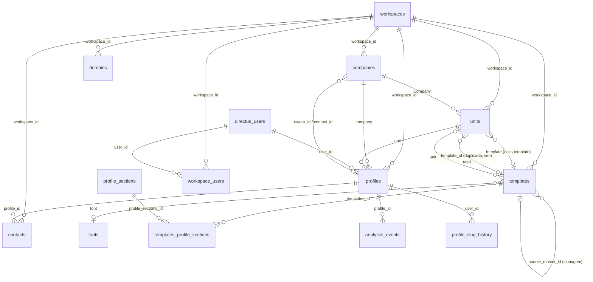

# Perfil digital (cartão de visita digital) — análise do legado

Análise do repositório legado `smarthubaiagency/cartaopro-linkko` (CartãoPRO / Linkko), feita só por leitura de código, migrations, snapshots e documentos. Nenhum banco ou serviço remoto foi acessado, nada foi executado e o `.env.local` não foi aberto (só os nomes das variáveis foram levantados).

**Convenções deste documento**

- Todo caminho de arquivo está relativo à raiz do repositório legado, no formato `caminho/arquivo.ts:linha`.
- Quando a afirmação é dedução e não está escrita no código, aparece a palavra **inferido**.
- Quando algo não foi encontrado, aparece **não encontrado** e a busca foi feita no repositório inteiro, salvo quando indicado.
- Fontes de schema, em ordem de confiança: `directus-schema-snapshot.json` (16/06/2026, Directus, 37 coleções), `schema-dump.sql` (25/05/2026, Postgres) e `types/index.ts` (tipos TypeScript, que estão defasados em alguns pontos).

---

## 1. Visão geral

### 1.1 Stack

| Camada | Tecnologia | Origem |
| --- | --- | --- |
| Framework | Next.js 16.2.1 (App Router), React 19.2.4 | `package.json` (nome do pacote: `frontend`) |
| CMS e API de dados | Directus, via `@directus/sdk` ^21.2.0 | `package.json`, `lib/directus.ts`, `lib/directus-client.ts` |
| Postgres com RLS (só tabelas migradas) | `pg` + `kysely`, role `authenticated` | `lib/db.ts:1-12`, `docs/architecture.md` (seção "Camada de Dados — Dual Backend") |
| Sessão | `iron-session` | `lib/auth/session-config`, `proxy.ts` |
| Cache e rate limit | Redis (`ioredis`), `REDIS_URL` | `lib/redis.ts`, `lib/server/domain-resolver.ts:17` |
| UI | Tailwind 4, Radix, shadcn, Tiptap, `react-easy-crop` | `package.json` |
| QR Code | `qrcode` (SVG no servidor) e `react-qr-code` | `lib/qrcode.ts:1-24` |
| Pagamentos | Stripe | `lib/server/stripe.ts`, `app/api/webhooks/stripe` |

**Dual backend.** O próprio repositório documenta que há duas camadas de dados. Tabelas com RLS vivem no Postgres e são acessadas por `lib/db.ts`. Todo o restante, incluindo `profiles`, `units`, `templates`, `companies`, `analytics_events` e `contacts`, vive no Directus, sem RLS no Postgres (`docs/architecture.md`, seção "Tabelas ainda no Directus (sem RLS ativo)"). **Consequência para o GUIDU:** a segurança desses dados depende das permissões do Directus, que não estão versionadas neste repositório. Não há como auditá-las a partir do código.

### 1.2 Onde a feature mora

**Painel (área logada)**

- `app/(dashboard)/app/[workspaceSlug]/templates/` — lista e edição de templates, restrita a admin (`templates/page.tsx:14-17`).
- `app/(dashboard)/app/[workspaceSlug]/profile/` — editor do perfil. Há duas árvores duplicadas: `profile/u/[slug]/...` (editor do usuário) e `profile/[slug]/...` (que redireciona para `profile/u/[slug]`, `profile/[slug]/page.tsx:11`). Também há `profile/t/[id]/...` para o template (`footer`, `pwa`, `seo`).
- `app/(dashboard)/app/[workspaceSlug]/analytics/`, `dashboard/`, `leads/`, `contacts/`, `store/`, `settings/`, `mobiochat/`.

**Público**

- `app/(public)/[...segments]/page.tsx` — perfil público com prefixo de idioma (`pt` padrão, `en` e `es`, `lib/i18n/index.ts:3-6`).
- `app/(public)/[channel]/[slug]/page.tsx` — perfil por canal de atribuição (NFC, QR, customizados).
- `app/(public)/[channel]/opt-out/`, `app/(public)/[channel]/base/`.
- `app/(public)/id/[id]/page.tsx` — permalink que faz `308` para o slug atual do usuário (`id/[id]/page.tsx:1-24`).
- `app/(public)/t/[slug]/page.tsx` — prévia do template usando `TEMPLATE_PREVIEW_PROFILE_SLUG` (`t/[slug]/page.tsx:27`).
- `app/(public)/contato/[slug]/`, `app/(public)/obrigado/`, `app/(public)/claim/[code]/`.

**Roteamento por host.** `proxy.ts` trata domínios curtos de cartões físicos (`routeShortDomain`, `proxy.ts:72`). Para `/{código}` e `/q/{código}`, reescreve para `/c/{código}` com `?ch=nfc` ou `?ch=qr`. **Não encontrei `app/(public)/c/`** na listagem de rotas, então esse destino pode não existir (verificar). O perfil por host customizado é resolvido em `lib/server/domain-resolver.ts`.

**API**

- `app/api/profile/*` — 37 rotas de edição (bio, contact, contact-form, cta, design, exchange-form, footer, links, opening-hours, personal, professional, qrcode, seo, settings, slug, social, theme, website, whatsapp-conecte, switch, default, sections, upload-*, webhooks, chatwoot-config).
- `app/api/vcard/[slug]/route.ts` — download do `.vcf`.
- `app/api/manifest/[companySlug]/[userSlug]/` — manifesto PWA por perfil.
- `app/api/cards/*` — vínculo de cartões físicos (NFC/QR) a perfis: `batch`, `claim`, `link-by-code`, `[id]/link|set-primary|unlink`.
- `app/api/workspace/templates/[id]`, `app/api/workspace/templates/clone`, `app/api/workspace/[workspaceSlug]/units/[unitId]`, `app/api/units/`.
- `app/api/domains/*` — `check`, `verify`, `activate`, `status`, `retry-ssl`.
- `app/api/contacts/form/`, `app/api/public/[profileSlug]/opt-out/`, `app/api/wallet/pass/[slug]/`.

**Lib**

- `lib/queries/profiles.ts` (458 linhas), `lib/queries/units.ts`, `lib/queries/slugs.ts`, `lib/queries/analytics.ts`, `lib/queries/design-system.ts`.
- `lib/server/profile-resolver.ts`, `lib/server/profile-edit-guard.ts`, `lib/server/analytics.ts`, `lib/server/domain-resolver.ts`, `lib/server/cloudflare.ts`, `lib/server/plan-limits.ts`, `lib/server/metrics-engine.ts`, `lib/server/pixel-engine.ts`.
- `lib/vcard.ts`, `lib/qrcode.ts`, `lib/theme/buildTheme.ts` (289 linhas), `lib/ctaIconMap.tsx`, `lib/socialIconMap.tsx`, `lib/utils.ts` (`getProfileUrl`, `getDirectusAssetUrl`).

**Componentes públicos.** `components/server/ProfileRenderer.tsx` monta a página a partir das seções do template (importa `Header`, `HeroPremium`, `HeroCTA`, `HeroCTADefault`, `HeroCTAChat`, `SocialSection`, `AddressSection`, `QRCodeSection`, `LinksSection`, `Footer`, `BottomNav`, `PWAInstallSheet`). Há ainda `components/server/ThemeProvider.tsx` e `components/server/FontLoader.tsx`.

### 1.3 Escala observada

- 1.118 arquivos em `app/`, `components/`, `lib/`, `types/` e `proxy.ts` (contagem de `find`).
- 21 migrations SQL em `migrations/` (001 a 022, sem 005 e 012).
- 2 arquivos de teste no repositório inteiro (`__tests__/unit/notifications-permissions.test.ts` e `__tests__/unit/resolve-instance.test.ts`). Nenhum cobre a feature.

---

## 2. Modelo de dados

### 2.1 Diagrama (Mermaid)



Observação: `units` tem duas FKs para `templates` (`template` e `template_id`). O código só lê e grava `template` (`app/api/units/route.ts:267`). **`template_id` é um campo morto ou duplicado.** (Snapshot, `data.relations`.)

### 2.2 Tabelas, colunas e chaves

Colunas de sistema do Directus (`date_created`, `user_created` etc.) foram omitidas. Fonte: snapshot Directus, salvo quando indicado.

**`workspaces`** (tenant): `workspace_id`, `slug`, `name`, `status`, `subscriptions`, `assigned_base_domain`, `upgrade_custom_rules`. Chave primária `workspace_id`. Usada como fronteira de dados em quase todas as tabelas da feature.

**`companies`** (empresa dentro do workspace, marca): `id` uuid, `name`, `slug` (único, `schema-dump.sql:2426-2430`), `workspace_id` FK, `logo`, `icon`, `background_image`, `theme_color`, `background_color`, `google_business_profile`, `links` json, campos PWA (`pwa_name`, `pwa_short_name`, `pwa_description`, `pwa_display`, `pwa_maskable_icon`), campos de Wallet (`wallet_company_*`), campos Chatwoot (`chatwoot_base_url`, `chatwoot_account_id`, `chatwoot_inbox_id`, `chatwoot_api_token`, `chatwoot_webhook_secret`), `cnpj`, `email_nf`, `owner_id` e `contact_id` (FK para `profiles`). Tipos em `types/index.ts:1114-1150`.

**Atenção:** `chatwoot_api_token` e `chatwoot_webhook_secret` estão em `varchar` puro, sem criptografia no esquema (`schema-dump.sql` e snapshot). Quem grava o token é `app/api/profile/chatwoot/route.ts:101` (`update.chatwoot_api_token = body.apiToken.trim()`), sem chamada de `lib/crypto.ts` no arquivo. **Inferido:** o token fica em texto puro no Directus. Verificar.

**`units`** (filial, endereço e horários): `id` uuid, `status`, `Name`, `Google_Maps_Location` json (endereço, rua, número, bairro, cidade, UF, CEP, lat, lng, URL; tipo em `types/index.ts:1402-1423`), `opening_hours` text (JSON com `text`, `advanced` e `schedule`), `Company` FK para `companies`, `template` FK para `templates`, `template_id` (não usado), `workspace_id` FK. Tipo: `types/index.ts:1425`.

**`templates`** (design e configuração do cartão): é a tabela mais larga, com cerca de 114 campos no snapshot. Os grupos são:

- identidade: `name`, `slug` (único, `schema-dump.sql:3050`), `status`, `is_master`, `workspace_id`, `unit`, `source_master_id` (self-FK, lineage de clonagem), `font` (FK para `fonts`);
- cores e tokens: `primary_color`, `secundary_color`, `accent_color`, `background_*`, `text_*`, `button_*`, `social_*`, `link_color`, `divider_color`, `avatar_border_*`, `design_tokens` json (JSON mestre sincronizado com os campos planos, `types/index.ts:1308`), `design_mode` (`smart` | `managed`), `hero_design` (`hero_premium` | `hero_personal` | `hero_linq` | `hero_business`);
- geometria: `border_radius`, `border_radius_btn`, `border_radius_avatar`, `logo_mobile_height`, `logo_footer_height`, `header_mobile_height`, `padding_mobile`;
- CTA: `cta_type`, `cta_label`, `cta_url`, `cta_target`, `cta_whatsapp_number`, `cta_whatsapp_message`, `Icon` FK para arquivos;
- repetidores: `Link` json (`Titulo`, `CTA_URL`, `CTA_Button`), `network` json (redes sociais), `Social` e `Links`;
- SEO e Open Graph: `profile_seo_title`, `profile_seo_description`, `open_graph_image`;
- QR Code: `qr_code_version` (`link` | `offline` | `custom`), `qr_code_url`, `qr_code_title`, `qr_code_description`, `qr_code_color`;
- formulário de contato e leads: `contact_form_*`, `lead_form_interests`, `lead_form_whatsapp_message`, `lead_form_coupon_text`, `lead_form_webhook_url` (`types/index.ts:1343-1357`);
- troca de contato: `exchange_*` (`types/index.ts:1335-1342`);
- `map_id` (Google Maps Cloud Styling), `copyright`, `header_scripts` e `Scripts`.

**`profile_sections`** e **`templates_profile_sections`** (módulos): `profile_sections` tem `type`, `sort`, `is_visible`, `style` (`card` | `flat` | `none`), `padding_top`, `padding_bottom`, `status` (`schema-dump.sql:1586`). `templates_profile_sections` é a junção (`templates_id`, `profile_sections_id`, e no tipo também `sort`, `is_visible`, `style`, `padding_*`). Tipos em `types/index.ts:1451-1472`.

**`profiles`** (pessoa e cartão público; 70 campos no snapshot). Campos principais:

- identidade: `id`, `user_id` FK para `directus_users`, `workspace_id`, `company` FK, `unit` FK, `slug` (`schema-dump.sql` **não tem constraint de unicidade** em `profiles.slug`, só `profiles_pkey`), `name`, `prefix`, `pronouns`, `post_nominals`, `title`, `email`, `work_phone`, `cell_phone`, `personal_linkedin`, `url_da_agenda`, `avatar` FK, `cover_photo` FK, `is_default`, `is_workspace_admin`, `isActive`;
- SEO: `Profile_SEO_Title`, `Profile_SEO_Description` (no snapshot, `profile_seo_title` e `profile_seo_description`), `profile_url`, `QR_Code_URL`;
- bio: `bio_title`, `bio_text`, `bio_skills` json;
- flags `show_*`: `show_bio`, `show_cta`, `show_unit`, `show_social`, `show_links`, `show_qrcode`, `show_form`, `show_contact_form`, `show_exchange_form`, `show_lead_form`, `show_opening_hours`, `show_files`, `show_website`, `show_google_business`, `show_google_wallet`, `show_apple_wallet`, `show_chatwoot` (`types/index.ts:1152-1204`);
- modo evento: `event_mode_active`, `event_mode_tag`, `event_mode_start`, `event_mode_end`, `event_mode_message`;
- outros: `color_mode` (`light` | `dark`), `leads_webhook_url`, `lead_notifications_active`, `remove_branding`, `chatwoot_agent_id`, `wallet_*`, `nfc_devices` json (`schema-dump.sql`), `otp_code` e `otp_expiry` (**campos de OTP guardados no mesmo registro**).

**`workspace_users`** (vínculo de usuário com workspace): `user_id`, `workspace_id`, `role`, `status`, `is_default`. A tipagem em `types/index.ts:1227-1234` também cita `profile_id`, mas esse campo **não existe no snapshot**. Os tipos estão defasados.

**`analytics_events`**: `id`, `profile_id`, `workspace_id`, `source` (padrão `direct`, por canal), `event_type` (`view` | `cta_click` | `vcard_save`, `types/index.ts:512`), `ip_hash` (16 caracteres), `timestamp` (`schema-dump.sql:90-99`).

**`contacts`** (leads, cartão de contato e formulários; 36 campos): `workspace_id`, `profile_id`, `name`, `email`, `work_phone`, `cell_phone`, `company`, `job_title`, `website`, `address` e `lead_address`, `source`, `status`, `note`, `subject`, `message`, `tags` (M2M via `contacts_tags`), `extra_payload` json, `lead_metadata` json, campos de consentimento (`consent_at`, `consent_ip`, `consent_user_agent`, `consent_term_version`, `consent_term_hash`, `consent_cookies` json), `whatsapp_connect` e `chatwoot_connect`, `chatwoot_contact_id`, `sync_source`, `sync_locked_until`, `avatar`. Notas em `contact_notes` (FK `contact_id`).

**`domains`**: `workspace_id`, `domain`, `status`, `is_primary`, `cloudflare_hostname_id` (`schema-dump.sql:1203`, snapshot).

**`profile_slug_history`**: `old_slug`, `changed_at`, `user_id` FK para `profiles` (snapshot) e `profile_id` (schema-dump). Os dois aparecem em fontes diferentes.

**`fonts`**: `Name`, `slug` (único), `font_family`, `google_font_name`, `weights`, `is_active`.

**`smart_design_system`** e **`smart_color_presets`**: regras de geração de paleta (escala 50 a 950, `types/index.ts:1366-1388`).

### 2.3 Tabelas Postgres relacionadas (com RLS)

Nenhuma tabela da feature tem RLS no Postgres. As migrations de RLS (`migrations/006_rls_policies.sql`, `migrations/018_c15t_2x_rls.sql`) cobrem `notification_mappings`, `wa_message_logs`, `lead_fatigue`, `rie_events`, `rie_aggregations`, `meta_provider_configs` e `meta_template_bindings`. Nenhuma delas faz parte do perfil digital, exceto por `lead_fatigue` (fadiga de leads de WhatsApp).

---

## 3. Hierarquia e permissões

### 3.1 Hierarquia real (diferente da premissa)

A premissa original era "empresa > unidade > usuário". O código mostra uma hierarquia um pouco diferente:

```
workspace (conta: domínios, planos, addons, contatos, templates)
 └─ company (marca: logo, cores, links, PWA, Chatwoot, Wallet)   [companies.workspace_id]
     └─ unit (filial: endereço, horário, template)               [units.Company, units.workspace_id]
         └─ profile (pessoa: slug, dados públicos)               [profiles.company, profiles.unit, profiles.workspace_id]
```

Evidências: `companies.workspace_id` (`schema-dump.sql` e snapshot), `units.Company` e `units.workspace_id`, `profiles.company` e `profiles.unit` (snapshot).

Cada perfil aponta para uma empresa e para uma unidade. Só a unidade tem um template. A página pública resolve o template por `profile.unit.template` (`app/(public)/[...segments]/page.tsx:~150`, `profile.unit.template`), e não por `profile.company`.

### 3.2 Papéis

Há **dois conceitos paralelos** de admin, e isso é uma fonte de inconsistência:

- `profiles.is_workspace_admin` (boolean, `types/index.ts:1184`), lido por `session.is_workspace_admin` em praticamente todas as rotas de escrita de admin (`app/api/profile/cta/route.ts:24`, `footer/route.ts:21`, `website/route.ts:19`, `settings/route.ts:24`, `slug/route.ts:20`, `templates/[id]/route.ts:27`, `profile/design/route.ts:27`).
- `workspace_users.role` (`owner` | `admin` | `member` | `viewer`, `types/index.ts:1232`). A criação de membros valida esses quatro valores (`app/api/members/route.ts:40-42`), mas a permissão de criar membros depende de `session.is_workspace_admin` (`members/route.ts:13`).

**Inferido:** um usuário pode ter `role = 'viewer'` e `is_workspace_admin = true`, ou o inverso. Não há código que reconcilie os dois. O `workspace_users.role` não é conferido nas rotas de escrita de perfil.

Também não encontrei papel "editor" no legado. Não existe "member" como papel de workspace no GUIDU (ver seção 15).

### 3.3 Quem edita o quê

| Recurso | Quem grava | Onde | Evidência |
| --- | --- | --- | --- |
| Dados pessoais (nome, cargo, telefones, e-mail, LinkedIn, bio, contato) | O próprio usuário; admin em qualquer perfil do workspace | `profiles` | `app/api/profile/personal/route.ts`, `bio/route.ts`, `contact/route.ts` (sem checagem de admin, usam `resolveEditableProfile`) |
| Links (repetidor CTA) | O próprio usuário, **mas grava no template da unidade** | `templates.Link` | `app/api/profile/links/route.ts:46` |
| SEO (título e descrição) | O próprio usuário, **mas grava no template** | `templates.profile_seo_*` | `app/api/profile/seo/route.ts:56-57` |
| Cores, fontes, layout, hero | Só admin | `templates` | `app/api/profile/design/route.ts:27-28` (`Forbidden: admin only`) |
| CTA, rodapé, website, profissional, configurações, slug | Só admin | `templates` e `profiles` | flags `is_workspace_admin` nas rotas listadas |
| Modo de cor (claro/escuro) | Próprio usuário | `profiles.color_mode` | `app/api/profile/theme/route.ts:27` |
| Templates (CRUD, clonagem) | Só admin | `templates` | `app/api/workspace/templates/[id]/route.ts:27`, `templates/clone/route.ts:15` |
| Unidades | Só admin, com conferência de `workspace_id` | `units` | `app/api/workspace/[workspaceSlug]/units/[unitId]/route.ts:31,38,59` |

**Correção à premissa "o usuário altera só as suas informações pessoais":** isso **não é verdade no código**. O usuário altera também links e SEO, que estão gravados no template e, portanto, são compartilhados por todos os usuários da mesma unidade. Ver problema P-03 na seção 14.

### 3.4 Papéis de outras camadas (para o mapeamento)

- Platform (GUIDU): `owner`, `operations`, `billing`, `support` (`docs/pendencias.md`, linha "Papéis internos e permissões de módulos").
- Parceiro (GUIDU): `partner_owner`, `partner_admin` (`docs/adr/0018-configuracoes-em-cascata.md`).
- Organização (GUIDU): `owner`, `admin`, `member` (`docs/architecture/permissoes.md:95-103`).
- Workspace (GUIDU): `owner`, `admin`, `editor`, `viewer` (`src/core/module-contracts/manifest.ts:62`, `docs/architecture/permissoes.md:69-79`).

---

## 4. Templates e design

### 4.1 Como o design é guardado

O design fica nos campos planos de `templates` (cores, raio, altura do logo, tipografia via `font`). Há ainda um **JSON mestre** em `templates.design_tokens` que é "sincronizado de forma bidirecional" com os campos planos (`types/index.ts:1308`). A regra de sincronização não está documentada e não foi localizada num único lugar. **Inferido:** há duas fontes de verdade, e a precedência real depende de onde a escrita acontece. Verificar em `lib/theme/buildTheme.ts` (289 linhas) e na rota `profile/design`.

Não há CSS livre ou HTML arbitrário no template. Os campos de script (`header_scripts`, `Scripts`) existem no Directus, mas **não encontrei nenhum leitor no repositório**. Se algum fluxo do Directus os injeta, isso está fora deste repositório.

### 4.2 Montagem do tema

`app/(public)/[...segments]/page.tsx` chama `buildTheme(company, template, profile.color_mode ?? 'light', designSystemData)`. O resultado vira `ThemeProvider` e `FontLoader`. Os inputs são:

1. `company` (cores de tema e fundo, `theme_color`, `background_color`);
2. `template` (todos os tokens);
3. `color_mode` do perfil (`light` ou `dark`);
4. `smart_design_system` (regras de geração de escala, `lib/queries/design-system.ts`).

### 4.3 Modos de design

- `design_mode = smart`: as cores vêm de sementes (primária, secundária, acento), geram escala de 11 pontos (50 a 950), e cada token escolhe um ponto da escala para claro e para escuro (`types/index.ts:1366-1388`).
- `design_mode = managed`: os valores são digitados manualmente.

Presets prontos ficam em `smart_color_presets` (`types/index.ts:1390-1398`).

### 4.4 Fontes

Fontes vêm da coleção `fonts`. O `FontLoader` gera o CSS de carregamento a partir de `google_font_name` e `weights` (`components/server/FontLoader.tsx:44`). **Ponto de atenção:** o nome da fonte vem do banco e vai para uma tag `<style>` com `dangerouslySetInnerHTML`. O risco é baixo porque o valor é um nome de fonte, mas ele não é escapado de forma explícita (inferido, verificar o conteúdo de `FontLoader.tsx` antes de portar).

### 4.5 Herança, versões e prévia

- **Herança entre níveis:** não é herança viva. A clonagem é uma cópia: `app/api/workspace/templates/clone/route.ts:31` lê o template base (`readItem('templates', baseTemplateId)`) e cria outro com `createItem` (linha 59). O vínculo fica em `templates.source_master_id` (snapshot). **Inferido:** clonar não propaga alterações do master para os derivados.
- **Versões:** não encontrei histórico de versões de template (nenhuma tabela de versões ou snapshots). O Directus tem `directus_revisions`, que não é usado pela aplicação (não verificado).
- **Prévia:** `app/(public)/t/[slug]/page.tsx` renderiza o template com o perfil `TEMPLATE_PREVIEW_PROFILE_SLUG` e mostra o `TemplatePreviewBanner` (`components/client/TemplatePreviewBanner`). Usa `isPreviewMode` em `ProfileRenderer`.

### 4.6 Quem vê a prévia

A prévia é pública (`/t/[slug]`) e depende da variável `TEMPLATE_PREVIEW_PROFILE_SLUG`. Sem ela, a página loga erro e não renderiza (`t/[slug]/page.tsx:27-28`).

---

## 5. Catálogo de módulos

### 5.1 Tipos de seção (`profile_sections.type`)

`types/index.ts:1451` lista `Header`, `Hero`, `CTA`, `Social`, `Map`, `Links`, `QR Code` e `Footer`. A página pública também renderiza seções que não estão na lista, como `Bio`, `Contact`, `Unit`, `Website`, `Files`, `GoogleBusiness`, `OpeningHours` e o chat do Chatwoot (`ProfileRenderer.tsx` e as flags `show_*`).

### 5.2 Fichas

Os campos de cada módulo vêm de `types/index.ts:1152-1425`. "Quem edita" vem das rotas da seção 3.3. "Estado vazio" e "limites" foram procurados e, quando não aparecem no código, estão marcados.

**Header.** Logo da empresa (`companies.logo`), alturas de logo (`logo_mobile_height`, `logo_footer_height`) e altura do cabeçalho móvel. Quem edita: admin (template). Renderiza `components/server/Header.tsx`, com `homeUrl=/{slug}`. Estado vazio: sem logo, o componente usa `company.logo` nulo (inferido, verificar).

**Hero (quatro variantes).** `hero_design` = `hero_premium`, `hero_personal`, `hero_linq` ou `hero_business` (`types/index.ts:1301`). Campos: avatar (`profiles.avatar`), capa (`profiles.cover_photo`), nome, cargo (`title`), bio curta. Quem edita: avatar e capa, o usuário; variante e raios, admin. Renderiza `HeroPremium` (`components/server/HeroPremium.tsx`) ou `HeroCTA*`. Limites: tamanho de upload de 5 MB (seção 10).

**CTA (botão principal).** `cta_type`, `cta_label`, `cta_url`, `cta_target`, `cta_whatsapp_number`, `cta_whatsapp_message`, `Icon` (`types/index.ts:1317-1322`). Quem edita: admin (`app/api/profile/cta/route.ts:24`). Há quatro comportamentos: `HeroCTADefault` (link), `HeroCTAChat` (abre o chat), `HeroCTA` (WhatsApp) e o botão mini (`minibutton_ctalink_*`). Estado vazio: sem `cta_label`, o componente usa o rótulo padrão (inferido, verificar `HeroCTADefault`).

**Social.** Repetidor `network` json no template (`types/index.ts:1323`). Ícones em `lib/socialIconMap.tsx`. Quem edita: não há checagem de admin na rota de social (`app/api/profile/social/route.ts`, zero ocorrências de `is_workspace_admin`), mas o dado está no template. Ou seja, um membro altera a rede social que aparece para todos da unidade (ver P-03).

**Links.** Repetidor `Link` json no template com `Titulo`, `CTA_URL` e `CTA_Button` (`profiles.ts:71`). Quem edita: qualquer membro, gravando em `templates.Link` (`app/api/profile/links/route.ts:46`). Validação: a rota confere que o `templateId` enviado pertence ao perfil (`links/route.ts:34`), mas **não valida o formato da URL** (inferido, não encontrei validação de `CTA_URL` no servidor).

**Mapa e endereço (`Map`, `AddressSection`).** Usa `units.Google_Maps_Location` (lat, lng e endereço) e `units.opening_hours`. Chave do Maps: `NEXT_PUBLIC_GOOGLE_MAPS_API_KEY`, carregada por `components/client/DynamicMap.tsx`. Estilo: `templates.map_id` (Cloud Styling). Quem edita: admin (dados da unidade em `app/api/workspace/[workspaceSlug]/units/[unitId]`).

**Horário de funcionamento.** `units.opening_hours` (JSON com `advanced` e `schedule`). `extractOpeningHoursText` aceita o modo simples e o avançado (`ProfileRenderer.tsx:31`). Quem edita: rota `profile/opening-hours`.

**Formulário de contato (`contact_form`).** Ativado pelo template (`contact_form_enabled`) e pelo perfil (`show_contact_form`). Campos configuráveis em `contact_form_schema` json (`types/index.ts:1350`). Destino: `contacts` no Directus (seção 7). Estado vazio: não encontrei tratamento de schema vazio (verificar).

**Formulário de troca de contato (`exchange_form`).** Gerado a partir de `exchange_require_*` e `exchange_show_*` (nome, e-mail, telefone, observação, empresa, cargo). Consentimento configurável (`exchange_consent_active`, `exchange_consent_text`). É o "cartão de contato" que vira lead. Quem edita: admin no template, e o próprio usuário no perfil (`profile/exchange-form`).

**QR Code.** `qr_code_version` = `link`, `offline` ou `custom` (`types/index.ts:1329`). O SVG é gerado no servidor com `generateQRSvg` (`lib/qrcode.ts`), com margem zero e a cor de fundo do tema (`QRCodeSection.tsx:96`). Quem edita: admin (template), e o usuário em `profile/qrcode`.

**Rodapé (`Footer`).** `copyright` e campos do rodapé (`logo_footer_height`). Quem edita: admin (`app/api/profile/footer/route.ts:21`).

**Bio.** `bio_title`, `bio_text`, `bio_skills` (array). Quem edita: o usuário (`app/api/profile/bio/route.ts`). Não encontrei sanitização de HTML na bio; a renderização usa texto do React, sem `dangerouslySetInnerHTML` nos componentes de bio (verificado por grep nos componentes públicos).

**Site, Google Business, Arquivos, WhatsApp conectado, Chatwoot.** Flags `show_website`, `show_google_business`, `show_files`, `show_chatwoot` e `show_google_wallet`/`show_apple_wallet`. Quem edita: o usuário ou o admin, conforme a rota.

### 5.3 Fixo do template ou dado pessoal

| Campo | Onde mora | Tipo |
| --- | --- | --- |
| Cores, fontes, raios, layout, hero | `templates` | Fixo (admin) |
| CTA e rodapé | `templates` | Fixo (admin) |
| Links e redes sociais | `templates` | **Compartilhado na unidade** (edita o membro, mas afeta todos) |
| SEO (título e descrição) | `templates` e `profiles` | **Duplicado**, com a leitura preferindo o do perfil (`[...segments]/page.tsx`, `generateMetadata`) |
| Nome, cargo, contato, bio, avatar, capa | `profiles` | Dado pessoal |
| Mapa, endereço e horário | `units` | Fixo da unidade |
| Chatwoot e agente | `companies` e `profiles` | Configuração técnica |

---

## 6. Página pública

### 6.1 Rota e URL

- `app/(public)/[...segments]/page.tsx` aceita `/{slug}` e `/{idioma}/{slug}`. O idioma é lido por `parseLangFromSegments` (`lib/i18n/index.ts`).
- Casos especiais: `/{slug}/opt-in` e `/{slug}/privacy` são tratados na mesma rota (`[...segments]/page.tsx:119-133`).
- `/id/{uuid}` faz `308` para `/{slug}` (`id/[id]/page.tsx:23`). É o link permanente para cartões físicos.
- Histórico de slugs: se o slug não existe mais, `getProfileByHistoricalSlug` faz `permanentRedirect` para o slug atual (`[...segments]/page.tsx:146-150`, `lib/queries/slugs.ts:12`).
- Canal: `[channel]/[slug]` aceita `en`, `es`, canais nativos (`lib/channel-constants.ts`) e canais customizados de `workspace_channels` (`[channel]/[slug]/page.tsx:1-30`).

### 6.2 Resolução do host

Cada requisição passa por `proxy.ts`, que copia o host para o cabeçalho `x-domain` (`proxy.ts:131-145`). A página chama `resolveWorkspaceByHost(domain)` (`lib/server/domain-resolver.ts`):

1. Procura um domínio customizado ativo em `domains` (`lookupCustomDomain`, `domain-resolver.ts:100`), com cache de 300 segundos no Redis (`DOMAIN_TTL`, `domain-resolver.ts:17`).
2. Se não encontra, e o host pertence a um dos domínios em `globals.system_allowed_domains` (cache de 600 segundos), procura um subdomínio do sistema (`domain-resolver.ts:180-186`). Sem match, retorna `null` (`domain-resolver.ts:190-191`).
3. Com o `workspaceId` resolvido, a busca do perfil filtra por `slug` **e** `workspace_id` (`lib/queries/profiles.ts:155-157`).
4. **Sem resolução, a busca filtra só por `slug`** (`profiles.ts:157`). É aqui que está o problema P-01 (seção 14).

### 6.3 Consulta do perfil

`getProfileBySlug` (`lib/queries/profiles.ts:148-181`) busca `profiles` com `company`, `unit`, `unit.template`, `template.font`, `template.profile_sections` e as seções com `status`, `padding_*` e `is_visible`. É uma consulta profunda, sem cache (`directus-client.ts` usa `noCache`, linha 19), feita a cada visualização.

**Inferido:** a página pública não tem cache próprio. Cada acesso faz pelo menos uma consulta profunda ao Directus com token de serviço (`getDirectusClient(undefined)` devolve o cliente `directus`, `lib/directus-client.ts:20`).

### 6.4 SEO e metadados

`generateMetadata` (`[...segments]/page.tsx:45-108`) gera:

- `title` com `profile.Profile_SEO_Title`, senão `template.profile_seo_title`, senão `{nome} — {empresa}`;
- `description` pela mesma cadeia;
- `canonical` com `getProfileUrl(slug, resolvedHost)`;
- `manifest` em `/api/manifest/{companySlug}/{profileSlug}`;
- ícones (favicon 32x32 e Apple 180x180) a partir do `company.icon`, redimensionados pela própria Directus (`?width=...&fit=cover&format=png`);
- Open Graph (`type: 'profile'`, imagem 1200x630 em `webp`, com fallback para o avatar);
- Twitter (`summary_large_image` quando há imagem);
- `html-lang`.

`generateViewport` define `themeColor` a partir de `company.theme_color` (`[...segments]/page.tsx` (`generateViewport`)).

### 6.5 vCard (.vcf)

`app/api/vcard/[slug]/route.ts` busca o perfil, gera o texto com `generateVCardString` e responde com `text/vcard; charset=utf-8` e `Content-Disposition: inline; filename="{slug}.vcf"` (linhas 16-30). Campos gerados (`lib/vcard.ts:1-37`): `FN`, `TITLE`, `ORG`, `EMAIL`, `TEL` (WORK e CELL, só dígitos, com `+`), `URL` e `X-SOCIALPROFILE` (LinkedIn). Não há `PHOTO`.

- A função `escape` (`lib/vcard.ts:49-55`) só é aplicada a `FN`, `TITLE` e `ORG`. `EMAIL` (linha 24), `URL` (linha 37) e `X-SOCIALPROFILE` não passam por ela. Ver P-06.
- Não há cabeçalho `Cache-Control` específico na resposta (inferido: sem cache explícito).
- Ao baixar, a rota dispara `emitEvent({ event_type: 'vcard.downloaded' })` (`vcard/[slug]/route.ts:36-47`). Esse evento vai para o barramento de eventos, não para `analytics_events`. Ver P-08.

### 6.6 QR Code e compartilhamento

- QR Code: `generateQRSvg` no servidor (`lib/qrcode.ts`), sem dependência de serviço externo. O conteúdo do QR é a URL do perfil (`QRCodeSection`), ou um texto `custom` do template.
- Compartilhamento: `navigator.share` e `navigator.clipboard` aparecem em `components/client/BottomNav.tsx`, `ContactOptionsMenu.tsx` e `ContactFormSheet.tsx`. O cartão em si não tem um botão de compartilhar com imagem.
- PWA: `PWAInstallSheet` (`components/client/PWAInstallSheet.tsx`) e manifesto por perfil em `app/api/manifest/[companySlug]/[userSlug]/`.

### 6.7 Cache e performance

- Sem cache de página: não encontrei `revalidate`, `unstable_cache` nem `use cache` nas rotas públicas nem em `lib/queries/profiles.ts`, então o `ProfileRenderer` é renderizado a cada requisição.
- Cache de resolução de domínio no Redis (300 s para host, 600 s para a lista de domínios do sistema).
- Métricas de visualização usam `after()` do Next (`[...segments]/page.tsx:186`), então não bloqueiam a resposta.
- Consulta profunda por visualização (seção 6.3).

### 6.8 Acessibilidade

- Atributos ARIA usados nos componentes: 311 `aria-hidden`, 227 `aria-label`, 25 `aria-modal`, 25 `aria-checked`, 6 `aria-expanded` (contagem por ocorrência em `components/server` e `components/client`).
- Não encontrei auditoria de acessibilidade, teste de contraste nem validação de contraste no `buildTheme` (verificar). Tokens de texto e fundo são livres, então um template pode produzir contraste baixo.

---

## 7. Formulário e leads

### 7.1 Para onde vão as respostas

- Formulário de contato (`app/api/contacts/form/route.ts`): cria ou atualiza um registro em `contacts` (Directus), via `upsertContact` (`lib/server/upsert-contact.ts`), e uma nota em `contact_notes` (`route.ts:208`).
- Cartão de troca de contato (`exchange_form`): também cria `contacts`. Verificar o fluxo exato em `app/api/profile/exchange-form/route.ts`.
- Formulário de lead do template (`lead_form_*`): grava também em `templates.lead_form_webhook_url` ou `profiles.leads_webhook_url` (`app/api/profile/contact-form/route.ts`).

### 7.2 Notificações e webhooks

- Notificações de WhatsApp são controladas por plano: `notification_contact_form`, `notification_contact_exchange`, `notification_vcard_download`, `notification_pwa_install`, `notification_handoff_human`, `notification_material_download` (`app/(dashboard)/app/[workspaceSlug]/mobiochat/addons/whatsapp/[id]/page.tsx:59-64`).
- Webhooks de CRM por perfil e por workspace: `ProfileWebhook` e `WorkspaceWebhook` (`types/index.ts:1485-1520`), com gatilhos `form_contact`, `contact_exchange`, `whatsapp_connect`, `manual_entry`, `all_contacts`.
- Disparo: `lib/server/dispatch-contact-webhooks.ts` e `lib/server/webhook-dispatcher.ts:123` (`fetch(finalUrl, fetchOpts)`).
- Envio de e-mail: `lib/email/resolver.ts` e `lib/queries/admin/platform-email.ts`, com SendPulse (`SENDPULSE_API_USER_ID`, `SENDPULSE_API_SECRET`) e Nodemailer. Não verifiquei qual é o caminho de e-mail do lead.

### 7.3 Anti-spam

- **Não encontrei nenhum controle anti-spam** no formulário público: sem captcha, sem honeypot, sem limite de taxa. Procurei `rateLimit`, `rate-limit`, `captcha`, `turnstile` e `honeypot` em `app/api/contacts/form` e `app/api/profile/contact-form`.
- O módulo `lib/rate-limit.ts` existe e é usado em `app/api/chat/*` e em rotas `internal/n8n/crm/*`, mas não nos formulários públicos.

### 7.4 LGPD e consentimento

- `app/api/contacts/form/route.ts:114-123` exige o campo `consent` e grava `consent_at`, `consent_ip` (IP cru, `x-forwarded-for`), `consent_user_agent`, `consent_term_version` e `consent_term_hash` (SHA-256 do texto do termo, linhas 164-169).
- `lib/server/checkbox-consent.ts` registra o consentimento com política versionada (`consentPolicy`, `consentPurpose`, `consentRecord`, no schema-dump).
- O banner de cookies usa `@c15t/*` (`lib/server/c15t-consent.ts`, `app/api/c15t/[...slug]/`).
- Opt-in e opt-out: `app/(public)/[channel]/opt-out/`, `app/api/public/[profileSlug]/opt-out/`, e as páginas `opt-in` e `privacy` dentro de `[...segments]`.
- **Ponto de atenção:** o IP do consentimento é guardado cru. Para prova de consentimento isso é aceitável, mas precisa de base legal e prazo de retenção definidos, e não há política de retenção para `contacts` no código (não encontrei).

### 7.5 Integrações

- CRM: rotas `app/api/internal/n8n/crm/*` (contatos, notas, tags, atividades), com segredo `N8N_CRM_TOOLS_SECRET`.
- Chatwoot: `lib/server/chatwoot.ts`, `app/api/profile/[profileId]/chatwoot-config/`, `app/api/webhooks/chatwoot/[workspaceId]/`.
- WhatsApp: `lib/server/whatsapp.ts`, bridge com `WA_BRIDGE_URL` e `WA_BRIDGE_API_KEY`.
- Evolution API: `EVOLUTION_BASE_URL`, `EVOLUTION_API_KEY`, `EVOLUTION_WEBHOOK_URL`.

---

## 8. Métricas

### 8.1 Coleta

- **Visualização (`view`)**: `trackProfileView` roda em `after()` a cada acesso ao perfil público (`[...segments]/page.tsx:185-187`). A rota de canal chama com `source` do canal (`[channel]/[slug]`).
- **Rate limit**: uma visualização por par `(profileId, ipHash)` a cada 60 segundos, com `SET ... EX 60 NX` no Redis (`lib/server/analytics.ts:58-60`). Sem Redis, a regra é ignorada e a visualização é gravada .
- **IP**: o IP não é gravado. Grava-se `hashIp(ip)`: SHA-256 do IP **sem sal**, truncado em 16 caracteres (`analytics.ts:27-29`). Ver P-04.
- **Clique em link ou CTA (`cta_click`)**: o tipo existe (`types/index.ts:512`), mas **não encontrei nenhuma escrita de `cta_click`** no repositório. Não há métrica por link nem por módulo hoje.
- **vCard (`vcard_save`)**: o painel lê `vcard_save` (`lib/queries/analytics.ts:292-293`), mas **nenhum código grava `vcard_save`**. O download grava no barramento de eventos como `vcard.downloaded` (`vcard/[slug]/route.ts:36-38`). O resultado é que a métrica de vCards aparece sempre zerada. Ver P-08.

### 8.2 Armazenamento e leitura

- Tabela `analytics_events` no Directus (seção 2.2). Não tem RLS.
- Leitura: `lib/queries/analytics.ts` faz contagens com `countDistinct` em `ip_hash` como visitantes únicos (linhas 59-65, 259) e compara o período atual com o anterior (`calcVariation`, `buildMetricContext`).
- Orquestração: `lib/server/metrics-engine.ts` define os tipos `views`, `contacts`, `vcards` e `conversion`.
- Tela: `app/(dashboard)/app/[workspaceSlug]/analytics/`.

### 8.3 Onde aparecem

Dashboard do workspace (`/app/{ws}/dashboard` e `/app/{ws}/analytics`): visualizações, leads (`contacts`) e vCards (sempre zero). Não há métrica por unidade nem por perfil no painel de admin (inferido pela leitura de `analytics.ts`).

---

## 9. Fluxos de tela

### 9.1 Admin (workspace admin)

| Passo | Tela | Campos principais | Rota de escrita |
| --- | --- | --- | --- |
| Criar unidade | Tela de unidades (caminho exato não confirmado) e `app/api/units/route.ts` (POST, linha 191) | Nome, endereço (Google Maps), horário, empresa, template | `app/api/units/route.ts` (POST) |
| Criar template | `templates/` | Nome, cópia de um master (`is_master`) | `app/api/workspace/templates/clone` |
| Editar design | `templates/[templateId]` | Cores, fontes, raios, hero, modo de cor | `app/api/profile/design` |
| Editar módulos | `profile/t/[id]` e `profile/[slug]/*` | CTA, rodapé, website, profissional, configurações | `app/api/profile/cta|footer|website|professional|settings` |
| Editar SEO | `profile/t/[id]/seo` | Título e descrição | `app/api/profile/seo` |
| Editar PWA | `profile/t/[id]/pwa` | Nome, ícones, cores | `app/api/profile/pwa` |
| Convidar usuário | Tela de membros (caminho exato não confirmado) | Nome, e-mail, slug, cargo, papel, unidade | `app/api/members` (POST) |
| Vincular cartão físico | `profile/*` e `cards/` | Código do cartão, perfil | `app/api/cards/link-by-code` |

### 9.2 Usuário (membro)

| Passo | Tela | Campos | Rota |
| --- | --- | --- | --- |
| Editar perfil | `profile/u/[slug]/personal`, `professional`, `bio`, `contact` | Nome, prefixo, pronomes, pós-nominais, cargo, telefones, LinkedIn | `app/api/profile/personal|professional|bio|contact` |
| Editar links | `profile/u/[slug]/links` | Lista de links (grava no template) | `app/api/profile/links` |
| Editar redes | `profile/u/[slug]/social` | Redes (grava no template) | `app/api/profile/social` |
| Ver prévia | `/t/[slug]` ou o perfil público | Nenhum | — |
| Publicar | Não há botão de publicar; o perfil é público assim que salvo (inferido: não encontrei campo de status de publicação em `profiles`) | — | — |
| Trocar slug | `profile/u/[slug]/...` | Novo slug | `app/api/profile/slug` (exige admin, `slug/route.ts:20`) |
| Modo de cor | `profile/u/[slug]/...` | Claro ou escuro | `app/api/profile/theme` |
| Baixar QR | `profile/u/[slug]/qrcode` | Nenhum | `app/api/profile/qrcode` |

**Ponto relevante:** trocar o slug exige admin (`slug/route.ts:20`), o que contradiz a expectativa comum de que o usuário controla a própria URL. **Inferido:** o produto restringe a troca para evitar colisões.

---

## 10. Uploads e mídia

| Upload | Rota | Tamanho máximo | Tipo aceito | Destino |
| --- | --- | --- | --- | --- |
| Avatar | `app/api/profile/upload-avatar` | 5 MB (`upload-avatar/route.ts:10`) | `image/*` (`:39`) | `directus_files` via `uploadFiles` |
| Capa | `app/api/profile/upload-cover-photo` | 5 MB | `image/*` | idem |
| Logo do perfil | `app/api/profile/upload-logo` | 5 MB | `image/*` | idem |
| Imagem OG | `app/api/profile/upload-og-image` | 5 MB | `image/*` | idem |
| Ícone do app | `app/api/profile/upload-app-icon` | 5 MB | `image/*` | idem |
| Fundo, ícone e logo da empresa | `app/api/workspace/upload-company-bg`, `-icon`, `-logo` | 5 MB | `image/*` | idem |

**Processamento:**
- O recorte é feito no cliente com `react-easy-crop`.
- A redução de tamanho e a conversão de formato são feitas **pela Directus, sob demanda**, por parâmetros de URL (`getDirectusAssetUrl(id)?width=...&fit=cover&format=webp`, `[...segments]/page.tsx:77-79`).
- Não encontrei processamento no servidor (sem `sharp` no código de upload; `sharp` está só em `pnpm.onlyBuiltDependencies`).

**Riscos:**
- A validação de tipo usa `file.type` enviado pelo cliente (`upload-avatar/route.ts:39`), sem conferir o conteúdo (assinatura do arquivo). Como o prefixo é `image/`, **`image/svg+xml` passa**. Se o arquivo for servido no mesmo domínio que o perfil, há risco de XSS armazenado. **Inferido:** depende de como a Directus serve o arquivo. Verificar antes de portar.
- Não há lista de extensões nem limite de dimensão.

---

## 11. Planos e limites

### 11.1 Mecanismo

- `plan`, `plan_features` (no Directus, sem RLS) e `subscriptions`.
- `lib/server/plan-limits.ts` expõe `hasFeature`, `getFeatureLimit`, `getFeatureLimitRaw` e `checkLimit` (linha 138). Usa cache por workspace e `invalidateCache`.
- Documentação: `docs/plan-limits.md`.

### 11.2 Limites definidos

Chaves de feature e de limite em `types/index.ts:290-350`:

- Seções: `section_links`, `section_unit`, `section_website`, `section_cta`, `section_files`, `section_bio`, `section_social`, `section_google_business`, `section_opening_hours`, `section_qrcode`.
- Addons: `addon_exchange_form`, `addon_chatwoot`, `addon_evolution`.
- Limites: `chatwoot_accounts_limit`, `whatsapp_accounts_limit`, `team_members_limit`, `inboxes_limit`, `conversations_limit`, `contacts_limit`, `storage_limit_gb`, `api_calls_limit`, `retention_days`, `profiles_limit`, `pixels_limit`, `custom_channels`.

### 11.3 Onde são conferidos

- `profiles_limit`: conferido **só no provisionamento** (`app/api/admin/provision/route.ts:246`).
- `team_members_limit`: usado na página de addons (`mobiochat/addons/page.tsx:81`), não na criação de membros.
- **Criação de membros não conta contra `profiles_limit`:** `app/api/members/route.ts` (POST, linha 8) não chama `checkLimit`. Procurei `checkLimit(` em todo o repositório e só achei o provisionamento. **Inferido:** o limite de perfis por plano pode ser contornado criando membros pela tela de membros.
- Seções (`section_*`): as chaves existem nos tipos, mas **não encontrei nenhum uso** que bloqueie a edição ou a renderização de seção por plano. Ver P-09.

---

## 12. Integrações externas

Só nomes de variáveis, sem valores.

| Integração | Uso na feature | Variáveis |
| --- | --- | --- |
| Directus | Todos os dados do perfil | `DIRECTUS_URL`, `NEXT_PUBLIC_DIRECTUS_URL`, `DIRECTUS_TOKEN` |
| Postgres (RLS) | Tabelas migradas | `DATABASE_URL`, `DATABASE_URL_AUTHENTICATED` |
| Redis | Cache de domínio e rate limit de visualização | `REDIS_URL` |
| Cloudflare for SaaS | Domínio customizado e certificado | `CLOUDFLARE_API_TOKEN`, `CLOUDFLARE_ZONE_ID` (`lib/server/cloudflare.ts`) |
| Google Maps | Mapa da unidade | `NEXT_PUBLIC_GOOGLE_MAPS_API_KEY` |
| Google Fonts | Fontes do template | nenhuma (URL montada no `FontLoader`) |
| Google Wallet | Cartão no Wallet | `GOOGLE_CLIENT_EMAIL`, `GOOGLE_PRIVATE_KEY`, `GOOGLE_ISSUER_ID`, `WALLET_SYNC_TOKEN` |
| Chatwoot | Chat de atendimento no perfil | `CHATWOOT_URL`, `CHATWOOT_BASE_URL`, `CHATWOOT_API_TOKEN`, `CHATWOOT_ACCOUNT_ID`, `CHATWOOT_INBOX_ID`, `CHATWOOT_WEBHOOK_SECRET`, `CHATWOOT_IDENTITY_VALIDATION_KEY` |
| WhatsApp (bridge) | Notificações e conexão | `WA_BRIDGE_URL`, `WA_BRIDGE_API_KEY`, `WA_BRIDGE_ADMIN_API_KEY`, `WA_BRIDGE_NOTIFY_KEY`, `WA_BRIDGE_WEBHOOK_SECRET` |
| Evolution API | Instâncias de WhatsApp | `EVOLUTION_BASE_URL`, `EVOLUTION_API_KEY`, `EVOLUTION_WEBHOOK_URL` |
| n8n | Automações e CRM | `N8N_API_URL`, `N8N_API_KEY`, `N8N_WEBHOOK_URL`, `N8N_CRM_TOOLS_SECRET` |
| OpenAI | Assistente | `OPENAI_API_KEY` |
| Stripe | Assinatura e checkout | `STRIPE_SECRET_KEY`, `STRIPE_WEBHOOK_SECRET`, `NEXT_PUBLIC_STRIPE_PUBLISHABLE_KEY` |
| E-mail | Notificações | `SENDPULSE_API_USER_ID`, `SENDPULSE_API_SECRET` |
| Meta (Facebook) | OAuth e WhatsApp Cloud | `META_APP_ID`, `META_APP_SECRET`, `NEXT_PUBLIC_META_APP_ID`, `NEXT_PUBLIC_META_FB_CONFIG_ID` |
| Sessão e cifra | Sessão e criptografia | `SESSION_SECRET`, `ENCRYPTION_KEY` |
| Domínios do sistema | Lista de domínios curtos | `NEXT_PUBLIC_SHORT_DOMAINS`, `NEXT_PUBLIC_DASHBOARD_HOST`, `NEXT_PUBLIC_APP_DOMAIN`, `NEXT_PUBLIC_APP_URL` |
| Prévia de template | Perfil de exemplo | `TEMPLATE_PREVIEW_PROFILE_SLUG`, `TEMPLATE_BASE_PROFILE_SLUG` |
| Verificação de domínio | Segredo do ForwardAuth | `DOMAINS_CHECK_SECRET` (usado em `app/api/domains/check/route.ts`) |

**Observação:** `proxy.ts:112` usa `https://api.linkko.cloud` como fallback fixo de `DIRECTUS_URL`. É um valor público, não segredo, mas dificulta trocar de ambiente sem alterar código.

---

## 13. Testes existentes

- 2 arquivos de teste no repositório (`__tests__/unit/notifications-permissions.test.ts` e `__tests__/unit/resolve-instance.test.ts`), rodados por Vitest (`vitest.config.ts`).
- Cobertura da feature de perfil digital: **nenhuma**. Não há teste de `getProfileBySlug`, de `generateVCardString`, de `buildTheme`, de `trackProfileView`, de `resolveWorkspaceByHost` nem de nenhuma rota de `app/api/profile/*`.
- Não encontrei teste de autorização (IDOR) para as rotas de edição de perfil e template. Esse é o tipo de teste que mais faria falta.
- Não verifiquei configuração de Playwright.

---

## 14. Problemas e dívidas

Severidade: **Alta** (dado de outro tenant ou dano em produção), **Média** (risco ou regra de negócio quebrada), **Baixa** (dívida ou ruído).

| ID | Sev. | Problema | Evidência |
| --- | --- | --- | --- |
| **P-01** | Alta | **Busca de perfil por slug sem workspace.** Quando o host não resolve, `getProfileBySlug` filtra só por `slug` e pega a primeira linha (`limit: 1`). O banco não tem constraint de unicidade em `profiles.slug` (no `schema-dump.sql` só há `profiles_pkey`). Dois workspaces com o mesmo slug podem trocar de perfil. Afeta a página pública (`[...segments]/page.tsx:143`), a vCard (`vcard/[slug]/route.ts:16`) e o guard de edição (`profile-edit-guard.ts:32`). | `lib/queries/profiles.ts:155-157`, `schema-dump.sql` (ausência de `profiles_slug_unique`) |
| **P-02** | Alta | **IDOR em `templateId` na rota de SEO.** A rota aceita `templateId` do corpo e grava nele sem conferir se pertence ao perfil ou ao workspace. Quando a edição é de outro perfil, usa o token privilegiado. Um membro pode alterar o SEO de outro template se as permissões do Directus permitirem. **Inferido:** a checagem depende do token; o risco cross-tenant existe no ramo admin. | `app/api/profile/seo/route.ts:22, 56-57` |
| **P-02b** | Alta | **Mesmo padrão na rota de design.** Quando o corpo traz `templateId`, a rota usa esse valor sem comparar com a unidade (`app/api/profile/design/route.ts:70`). Diferente da rota de links, que confere (`links/route.ts:34`). | `app/api/profile/design/route.ts:68-84` |
| **P-03** | Alta (produto) | **Dado pessoal guardado no template compartilhado.** Links e redes sociais de um membro ficam em `templates.Link` e `templates.network`, que são da unidade. Editar o próprio link muda o cartão de todo o time. A regra "o usuário só altera dados pessoais" não é verdadeira. | `app/api/profile/links/route.ts:46`, `social/route.ts` |
| **P-04** | Média | **Hash de IP sem sal e truncado.** SHA-256 de IPv4 (≈4,3 bilhões de valores) é reversível por força bruta em minutos. Não é anonimização. Vale também para o rate limit. | `lib/server/analytics.ts:27-29` |
| **P-05** | Média | **Formulários públicos sem anti-spam.** Sem captcha, honeypot ou limite de taxa em `contacts/form` e `profile/contact-form`. | `app/api/contacts/form/route.ts` (ausência de `rateLimit`) |
| **P-06** | Média | **vCard sem escape de campos.** `EMAIL`, `URL` e `X-SOCIALPROFILE` não passam por `escape`, e não há validação de formato. Um valor com quebra de linha (`\r\n`) injeta propriedades no cartão. | `lib/vcard.ts:24, 37, 49` |
| **P-07** | Média | **Webhook sem bloqueio de rede interna (SSRF).** `leads_webhook_url` é validado só como `^https?://.{2,}` (`contact-form/route.ts:26`), e o disparo faz `fetch` sem checar IP privado (`webhook-dispatcher.ts:123`). Admin ou membro pode apontar para `http://169.254.169.254` ou para serviços internos. | `app/api/profile/contact-form/route.ts:26`, `lib/server/webhook-dispatcher.ts:123` |
| **P-08** | Média | **Métrica de vCard sempre zero.** O download grava `vcard.downloaded` no barramento de eventos; o painel lê `vcard_save` de `analytics_events`, que ninguém grava. | `app/api/vcard/[slug]/route.ts:36-38`, `lib/queries/analytics.ts:292-293` |
| **P-09** | Média (negócio) | **Limites de plano não aplicados.** `profiles_limit` não é conferido na criação de membros (`members/route.ts`). As chaves `section_*` existem, mas nenhum código bloqueia seção por plano. | `app/api/members/route.ts:8`, `types/index.ts:290-350` |
| **P-10** | Média | **Dois conceitos de admin** (`profiles.is_workspace_admin` e `workspace_users.role`) sem reconciliação. | seção 3.2 |
| **P-11** | Média | **Dados sensíveis no mesmo registro.** `otp_code` e `otp_expiry` ficam em `profiles`, que é lido com `'*'` na página pública (serviço, sem RLS). Os campos não vão para o cliente (o `ProfileRenderer` recebe props restritas), mas a consulta traz tudo ao servidor. | `lib/queries/profiles.ts:71, 94`, `schema-dump.sql` (`profiles`) |
| **P-12** | Média | **Token do Chatwoot em texto puro.** `companies.chatwoot_api_token` e `chatwoot_webhook_secret` são `varchar`, sem cifra no esquema. | `schema-dump.sql` (`companies`), `app/api/profile/chatwoot/route.ts:101` |
| **P-13** | Média | **Upload aceita SVG.** Validação só pelo prefixo `image/` do `file.type` enviado pelo cliente. | `app/api/profile/upload-avatar/route.ts:39` |
| **P-14** | Baixa | **Public reads com token de serviço e sem RLS.** Toda leitura pública usa o cliente de serviço (`lib/directus-client.ts:20`). Qualquer falha de filtro (ver P-01) vira vazamento entre tenants. | `lib/directus-client.ts:17-21` |
| **P-15** | Baixa | **Log em toda requisição.** `console.log('[PROXY-CHECK]', ...)` roda para cada requisição, incluindo estáticos que não passam pelo matcher. | `proxy.ts:177` |
| **P-16** | Baixa | **Duplicação de rotas.** `profile/[slug]/*` e `profile/u/[slug]/*` coexistem, e a primeira só redireciona. | `profile/[slug]/page.tsx:11` |
| **P-17** | Baixa | **FK duplicada.** `units.template` e `units.template_id` apontam para `templates`; só o primeiro é usado. | snapshot (`units`) |
| **P-18** | Baixa | **Campos sem leitor.** `templates.header_scripts` e `Scripts` não têm leitor no repositório. | busca por `header_scripts` em `app/`, `lib/`, `components/` |
| **P-19** | Baixa | **Schema desatualizado no repositório.** `types/index.ts` cita `workspace_users.profile_id`, que não está no snapshot; o `schema-dump.sql` é de 25/05 e o snapshot de 16/06. | `types/index.ts:1227`, `directus-schema-snapshot.json` |
| **P-20** | Baixa | **Sem cache de página pública.** Cada visualização faz consulta profunda ao Directus. | `lib/directus-client.ts:19` (`noCache`) |
| **P-21** | Baixa | **Sem testes da feature.** Só 2 arquivos de teste no repositório. | seção 13 |

**Pontos que não convém trazer:**

- Rotas de perfil com `templateId` livre (P-02, P-02b): reescrever com escopo fixo.
- Modelo de links e SEO no template (P-03): não portar como está.
- Hash de IP sem sal (P-04): usar sal rotativo ou não gravar IP.
- Consulta profunda com `'*'` (P-11): selecionar só os campos públicos.
- Lista de rotas duplicadas (P-16) e campos mortos (P-17, P-18).
- O dual backend Directus e Postgres, que não é necessário no GUIDU, que já é Prisma com RLS (ADR 0001).

---

## 15. Mapeamento para o GUIDU

Fontes lidas no `console-guidu-gemini` (`main` atual `a6f83c4`): `AGENTS.md`, `CLAUDE.md`, `docs/context.md`, `docs/pendencias.md`, `docs/architecture/permissoes.md`, `docs/adr/0005`, `0006`, `0012`, `0018`, `docs/operacao/dominios.md`, `prisma/schema.prisma` e o módulo `src/modules/portfolio/manifest.ts`.

### 15.1 Tabela de conceitos

| Conceito do legado | Equivalente no GUIDU | Situação |
| --- | --- | --- |
| Workspace (conta contratante, planos, domínios, addons) | **`Organization`** (`prisma/schema.prisma:608`), a empresa contratante. Hipótese: é o equivalente mais próximo, mas ver nota abaixo | Inferido |
| Company (marca e dados operacionais dentro do workspace) | **`Workspace`** (`schema.prisma:640`), fronteira de isolamento. Hipótese | Inferido |
| Unit (filial: endereço, horário, template) | **`WorkspaceLocation`** (`schema.prisma:1140`), já tem endereço (`address` json), coordenadas, `timezone` e `hours`. Decisão pendente, ver 15.2 | Decisão pendente |
| User / Profile (pessoa e cartão público) | **`WorkspaceMember`** (`schema.prisma:668`) para o vínculo, e tabela nova para o cartão | Proposta |
| Template (design e configuração do cartão) | **Tabela nova do módulo** (ex.: `digital_card_templates`) | Proposta |
| Seções do template (`profile_sections`) | `digital_card_sections` (tabela nova) ou `WorkspaceModule.config` validado por `configurationSchema` (ADR 0006) | Decisão |
| Campos de design (cores, fontes, raios) | JSON validado com Zod, sem CSS livre | Proposta |
| Lead (`contacts`) | **`CrmContact`** (`schema.prisma:1066`), com origem registrada | Proposta |
| Notas de lead (`contact_notes`) | Notas do CRM (módulo `crm`) | Proposta |
| Analytics (`analytics_events`) | Tabela nova com RLS, sem IP cru | Proposta |
| Domínio customizado (`domains`) | **`WorkspaceDomain`** (`schema.prisma:587`) e o runtime de domínios (`src/core/domains/`), já pronto (CF2b) | Pronto |
| Histórico de slug (`profile_slug_history`) | Tabela nova do módulo | Proposta |
| Roles (`owner`, `admin`, `member`, `viewer`) | **`owner`, `admin`, `editor`, `viewer`** no workspace. Não existe `member` no workspace (ver 15.4) | Mapeamento direto |
| `is_workspace_admin` | `workspace.members.manage` (matriz em `docs/architecture/permissoes.md`) | Mapeamento direto |
| Plano e feature (`plan_features`, `checkLimit`) | **Entitlements** do manifesto (quota e capability) e `core.*` (ex.: `core.public_domains`) | Mapeamento direto |
| Configurações globais | **Cascata de configurações** (ADR 0018): plataforma, parceiro e workspace | Mapeamento direto |
| Página pública por host | Hoje **não existe**: `docs/operacao/dominios.md` diz que "as rotas públicas (site, perfil digital, quiz) ainda não existem". Há `resolvePublicDomain`, que já devolve o workspace de um host ativo | Lacuna |
| Upload de mídia | Pendente: "Storage da mídia (F5e)", Supabase Storage ou Cloudflare R2 (`docs/pendencias.md`) | Bloqueado |
| E-mail de notificação | Pendente: provedor de e-mail (D-PA-08, `docs/pendencias.md`) | Bloqueado |
| Editor em página cheia | Gaveta interna `WorkbenchLayout` (ADR 0015), não página nem modal | Mapeamento direto |
| Shell e menu | `AppShell` com sidebar-08 (ADR 0014) | Mapeamento direto |
| Retorno de salvar | `useStatus()` com `SmartStatusBanner` (ADR 0016); `alert()` é proibido | Mapeamento direto |
| Idiomas do painel | ADR 0013 (`pt`, `en`, `es` no legado) | Mapeamento direto |

**Nota sobre a hierarquia:** a equivalência Workspace-do-legado = Organization e Company-do-legado = Workspace é uma **hipótese**. No legado, o `workspace` é a conta (planos, domínios, contatos) e a `company` é a marca. No GUIDU, a `Organization` é a conta contratante e o `Workspace` é a fronteira de dados. A equivalência casa com os dados (contatos e domínios estão no nível do workspace no legado), mas não está escrita em lugar nenhum. **Marcelo precisa confirmar.**

### 15.2 Como "unidade" vira algo no GUIDU

Três opções.

**Opção A: `WorkspaceLocation` como unidade.** Cada filial é uma linha em `workspace_locations`, dentro de um workspace. O template do cartão pertence à localidade.

- Prós: a tabela já existe e tem endereço, coordenadas, fuso e horário (`schema.prisma:1140-1163`). Mapeia direto o `Google_Maps_Location` e o `opening_hours` do legado. A fronteira de isolamento continua sendo o workspace, então as regras de RLS e de permissão não mudam. Não cria um novo nível de inquilino.
- Contras: `WorkspaceLocation` não tem membros, nem papel próprio. Para o admin de uma unidade não ver as outras, é preciso criar um vínculo `location_members` e uma permissão de escopo por localidade, que hoje não existe. Também precisa de uma regra para o cartão de um membro de uma localidade.

**Opção B: um workspace por unidade**, sob a mesma `Organization`.

- Prós: isolamento pronto. Membros, módulos, domínios (`WorkspaceDomain`) e cotas são por workspace, então a unidade tem tudo sem código novo. Casa com o domínio público por unidade.
- Contras: multiplica o trabalho de administração (cada unidade é um workspace separado com seus próprios membros e configurações). Relatórios consolidados da empresa ficam difíceis. Cotas do plano ficam por workspace, e isso pode inflar a conta. Exige a herança de acesso empresarial, que está pendente (`docs/pendencias.md`, "Herança de acesso empresarial").

**Opção C: equipe (novo conceito) dentro do workspace.**

- Prós: flexível para o cliente, sem multiplicar workspaces.
- Contras: é um novo nível de inquilino, e a cascata de configurações (ADR 0018) só tem três níveis (plataforma, parceiro, workspace). Exigiria alterar a ADR 0018 e criar um escopo de RLS novo. É o caminho mais caro e o que mais contradiz o princípio de que o workspace é a fronteira de isolamento.

**Recomendação (minha):** **Opção A**, com `WorkspaceLocation` como a unidade e um vínculo `location_members` para restringir o acesso quando necessário. Mantém a fronteira no workspace, reaproveita a tabela pronta e não exige nova ADR de cascata. Escolher B só se o cliente exigir isolamento total entre filiais (por exemplo, unidades que são empresas separadas). Escolher C só com decisão explícita que altere a ADR 0018.

### 15.3 Papel de cada nível para o cartão

- Plataforma (`/platform`): defaults globais do módulo (limites padrão, disponibilidade), via `configurationSchema`.
- Parceiro (`/admin`): modelos de cartão compartilhados entre clientes da agência, se houver. Hoje, pela ADR 0012, o parceiro não acessa dados de cliente por padrão. **Os modelos de design não são dados de cliente**, então podem ser do parceiro. Precisa de decisão.
- Workspace (`/app`): cartão de cada membro, template de cada localidade, leads e métricas.

### 15.4 Papéis

| Legado | GUIDU | Observação |
| --- | --- | --- |
| `owner` (workspace) | `owner` | Mapeia direto |
| `admin` (workspace) e `is_workspace_admin` | `admin` | Unificar em `workspace.members.manage` |
| `member` | `editor` | **O GUIDU não tem `member` no workspace.** `member` existe só na organização (`organization_members`). Proposta: `member` do legado vira `editor` |
| `viewer` | `viewer` | Mapeia direto |

### 15.5 Permissões propostas

- `digital_card.read`: ver o cartão e as métricas.
- `digital_card.edit_own`: editar os próprios dados e o cartão.
- `digital_card.manage_templates`: criar e editar templates (admin).
- `digital_card.leads.read`: ver leads.
- `digital_card.settings.update`: configurar o módulo no workspace.

Os papéis padrão seguem o padrão do `portfolio` (`src/modules/portfolio/manifest.ts`, bloco `permissions`): `owner` e `admin` gerenciam, `editor` edita o próprio, `viewer` lê.

---

## 16. Proposta de módulo

### 16.1 Nome e chave

- Nome de exibição: **Perfil digital**.
- Chave: **`digital-card`** (kebab-case, como `google-business` e `ai-agents`). Decisão de nome para Marcelo, ver pergunta 3 no resumo.

### 16.2 Tabelas novas (todas com RLS por `workspace_id`)

Seguir o mesmo padrão de RLS de `supabase/migrations/` (funções `private.current_workspace_role`, `private.is_workspace_member`, `private.context_uuid`). Conferir o padrão exato antes de escrever a migration.

| Tabela | Colunas principais | Observação |
| --- | --- | --- |
| `digital_card_templates` | `id`, `workspace_id`, `location_id`, `name`, `status`, `design` (json validado por Zod), `hero_variant`, `cta` (json), `seo` (json), `source_template_id` | Um por localidade. Sem CSS livre |
| `digital_card_sections` | `id`, `template_id`, `type` (enum), `sort`, `is_visible`, `config` (json) | `type`: hero, cta, links, social, map, contact_form, qr, footer |
| `digital_cards` | `id`, `workspace_id`, `member_id`, `template_id`, `slug`, `display` (json), `color_mode`, `status` | Um por membro. `slug` único por `(workspace_id, slug)` |
| `digital_card_slug_history` | `id`, `card_id`, `old_slug`, `changed_at` | Redirecionamento permanente |
| `digital_card_events` | `id`, `workspace_id`, `card_id`, `type` (`view`, `vcard`, `cta_click`), `source`, `ip_salt_hash`, `created_at` | Sem IP cru; hash com sal rotativo |
| `digital_card_leads` | `id`, `workspace_id`, `card_id`, `crm_contact_id`, `consent_*` | Vincula ao `CrmContact` existente |
| `location_members` | `location_id`, `member_id`, `role` | Só se a Opção A for aceita |

**Cotas:** `digital_card.cards` (um cartão por membro, cota por workspace), `digital_card.locations` (uso de `WorkspaceLocation`), e a cota já existente `core.public_domains` para o domínio público.

### 16.3 Telas

**No `/app` (empresa, workspace):**

- Lista de cartões e localidades, em `AppShell`.
- Editor do cartão em `WorkbenchLayout` (gaveta), com abas: dados, links, seções, design, SEO, QR e prévia.
- Editor do template da localidade, também em gaveta.
- Leads (lista de `CrmContact` com `source = digital-card`) e métricas.
- Configuração do módulo no workspace: `/app/[workspaceSlug]/settings/modules/digital-card` (ADR 0005).

**No `/admin` (parceiro):**

- Modelos de cartão compartilhados, se a decisão da seção 15.3 for "sim".
- Configuração do módulo no parceiro, na cascata da ADR 0018.

**No `/platform`:**

- Disponibilidade e limites padrão (`/platform/settings/modules/digital-card`, ADR 0005).

**No perfil do usuário:**

- Os próprios dados (nome, cargo, contatos, bio, avatar, capa), em uma gaveta a partir do cartão.

### 16.4 Rota pública

- Hoje o manifesto aceita só `destination: "app" | "admin"` (`src/core/module-contracts/manifest.ts:81, 108`). **Não há destino para rota pública.** Então a página pública do cartão exige uma extensão do contrato de módulos, com ADR própria. Propor `destination: "public"` com validação de rota por domínio.
- A resolução de host já existe (`resolvePublicDomain`, `src/core/domains/runtime.ts`). Falta a rota.
- Rota proposta: `/{slug}` no domínio público do workspace, e `/{idioma}/{slug}` para `en` e `es`.
- Permalink estável por membro (equivalente de `/id/{uuid}`), para cartões físicos.

### 16.5 Etapas (MVP primeiro)

**MVP (etapa 1):**

1. Migrations e RLS das tabelas do item 16.2, com testes de isolamento entre workspaces.
2. Manifesto `digital-card` com permissões, cotas e configuração.
3. Editor de template (design com Zod, seções fixas do MVP: hero, links, CTA, contato, rodapé) e editor de cartão do membro.
4. Página pública em um domínio do workspace, com SEO básico e OG.
5. vCard com escape completo e QR code.
6. Métricas de visualização e de vCard, com hash de IP com sal.
7. Leads com consentimento, no `CrmContact`, sem envio de e-mail (depende de D-PA-08).

**Fase 2:** mapa e horário a partir de `WorkspaceLocation`, formulário de troca de contato, webhooks de lead, métricas por link, upload de mídia (depende da F5e), vínculo de cartão físico.

**Fase 3:** Google Wallet, modelos compartilhados do parceiro, múltiplos idiomas do cartão, links de atribuição por canal.

### 16.6 O que não portar

- Links e SEO no template compartilhado (P-03).
- `templateId` livre nas rotas (P-02, P-02b).
- Hash de IP sem sal (P-04).
- Campos de OTP no mesmo registro do perfil (P-11).
- Token de integração em texto puro (P-12).
- Upload por MIME do cliente, incluindo SVG (P-13).
- Scripts de cabeçalho livres (`header_scripts`, P-18).

### 16.7 Perguntas em aberto para Marcelo

Estão no `resumo.md`, em ordem de prioridade.

---

## Anexo A: o que não foi verificado

- Permissões do Directus (quem pode ler e gravar cada coleção, com token público ou autenticado). Não estão no repositório.
- Estado real do banco (dados, constraints e índices no Directus).
- Conteúdo de `.env.local` (não aberto de propósito).
- Fluxo completo de `exchange_form` e de `contacts/form` até o fim (`upsertContact` e Directus flows).
- `lib/queries/design-system.ts` e `lib/theme/buildTheme.ts` linha a linha.
- Renderização real de cada seção (`ProfileRenderer.tsx` foi lido em parte).
- Configuração de Playwright e de CI do legado.
