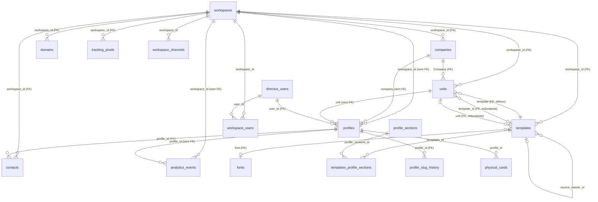

# Perfil digital do legado (cartaopro-linkko): análise para o módulo do GUIDU

- **Autor:** Claude (Opus 5.5), a pedido do Marcelo
- **Data:** 14/10/2026
- **Legado analisado:** `smarthubaiagency/cartaopro-linkko`, branch `main`, commit `d739429`. Somente leitura.
- **GUIDU de referência:** `smarthubaiagency/console-guidu-gemini`, `main` em `a6f83c4`.
- **Fontes:** só código, migrations, dumps de schema e documentos versionados. Nenhum banco ou serviço remoto foi consultado.

## Como ler as citações

- `caminho:linha` sem prefixo aponta para o **legado**.
- `guidu:caminho:linha` aponta para o **console-guidu-gemini**.
- `schema-dump.sql` e `directus-schema-snapshot.json` são os dumps de schema que estão na raiz do legado. O dump SQL **não traz as políticas nem as permissões do Directus**. Onde a segurança depende delas, o texto avisa.
- "**Inferido**" marca dedução que o código não afirma diretamente.

## Sumário

1. [Visão geral](#1-visão-geral)
2. [Modelo de dados](#2-modelo-de-dados)
3. [Hierarquia e permissões](#3-hierarquia-e-permissões)
4. [Templates e design](#4-templates-e-design)
5. [Catálogo de módulos (seções)](#5-catálogo-de-módulos-seções)
6. [Página pública](#6-página-pública)
7. [Formulário e leads](#7-formulário-e-leads)
8. [Métricas](#8-métricas)
9. [Fluxos de tela](#9-fluxos-de-tela)
10. [Uploads e mídia](#10-uploads-e-mídia)
11. [Planos e limites](#11-planos-e-limites)
12. [Integrações externas](#12-integrações-externas)
13. [Testes](#13-testes)
14. [Problemas e dívidas](#14-problemas-e-dívidas)
15. [Mapeamento para o GUIDU](#15-mapeamento-para-o-guidu)
16. [Proposta de módulo](#16-proposta-de-módulo)

## Correções ao que o Marcelo já sabia

| Afirmação                                        | Situação no legado                                                                                                                                                                                                                                                                                                                                                                                                                                                                                                                                                                                                        |
| ------------------------------------------------ | ------------------------------------------------------------------------------------------------------------------------------------------------------------------------------------------------------------------------------------------------------------------------------------------------------------------------------------------------------------------------------------------------------------------------------------------------------------------------------------------------------------------------------------------------------------------------------------------------------------------------- |
| Cada usuário pertence a uma unidade              | **Parcialmente.** O perfil (`profiles`) aponta para uma unidade, mas o campo aceita nulo (`schema-dump.sql:1646`). O inquilino é o **workspace**, e "empresa" (`companies`) é só um registro de marca dentro dele (`schema-dump.sql:211-249`, FK em `:3457`). Uma pessoa (conta) pode ter **vários perfis** no mesmo workspace (`lib/queries/profiles.ts:216-245`), e uma conta só pode estar em **um** workspace (`lib/server/members.ts:21-27`).                                                                                                                                                                        |
| Cada unidade tem um template                     | **Sim, com sujeira.** O ponteiro efetivo é `units.template` (`schema-dump.sql:2063`), lido pela página pública (`app/(public)/[...segments]/page.tsx:158-162`). Existem mais dois ponteiros redundantes: `units.template_id` (`schema-dump.sql:2066`) e `templates.unit` (`schema-dump.sql:1943`). A unidade também é usada como **endereço de entrega** de pedidos (`app/api/units/route.ts:187-190`).                                                                                                                                                                                                                   |
| O template é composto por módulos                | **Sim.** As seções vêm de uma tabela M2M (`templates_profile_sections`, `schema-dump.sql:2004-2008`). A página pública só desenha seis tipos: Hero, CTA, Social, Map, QR Code e Links (`components/server/ProfileRenderer.tsx:127-302`). Bio, arquivos, site, Google Business, horário e os formulários têm editor e chave liga/desliga, mas **não aparecem na página pública**. Formulário de contato e troca de contato existem fora da lista de seções (seção 5).                                                                                                                                                      |
| O admin muda o design e os módulos do template   | **Sim**, pelo editor do template (`app/(dashboard)/app/[workspaceSlug]/profile/t/[id]/page.tsx:26-30`) e por rotas que exigem `is_workspace_admin`.                                                                                                                                                                                                                                                                                                                                                                                                                                                                       |
| O usuário altera só as suas informações pessoais | **Não.** Links, redes sociais, título e descrição de SEO e imagem de compartilhamento ficam **no template** e são editáveis por qualquer membro, sem checagem de admin (`app/api/profile/links/route.ts:13-53`, `app/api/profile/social/route.ts:14-84`, `app/api/profile/seo/route.ts:14-63`, `app/api/profile/upload-og-image/route.ts:20-90`). Uma alteração de um membro muda o cartão de todos os colegas da unidade. Além disso, o membro troca o próprio slug pela rota `professional` (`app/api/profile/professional/route.ts:8`), sem passar pela checagem de disponibilidade e sem gravar histórico (seção 14). |

---

## 1. Visão geral

### Stack

| Item         | Valor                                                                                               | Fonte                                                                  |
| ------------ | --------------------------------------------------------------------------------------------------- | ---------------------------------------------------------------------- |
| Framework    | Next.js 16.2.1 (App Router), React 19.2.4 com React Compiler                                        | `package.json:50-56`, `docs/architecture.md:15-16`                     |
| Dados        | **Directus 11.17** sobre Postgres 17 (Supabase), acessado pelo `@directus/sdk` com token de serviço | `docs/architecture.md:31-40`, `directus-schema-snapshot.json:4`        |
| Banco direto | `pg` com RLS só nas tabelas de notificação/WhatsApp                                                 | `docs/architecture.md:46-61`                                           |
| Cache        | Redis (`ioredis`) para domínio, limitação de visitas e SSE                                          | `lib/server/domain-resolver.ts:17-24`, `lib/server/analytics.ts:54-68` |
| Sessão       | `iron-session` com tokens do Directus                                                               | `proxy.ts:3-5`, `proxy.ts:203-266`                                     |
| Estilo       | Tailwind v4 com tokens                                                                              | `docs/architecture.md:20`                                              |
| Deploy       | Docker standalone no EasyPanel                                                                      | `docs/architecture.md:22`                                              |
| Testes       | Vitest                                                                                              | `vitest.config.ts:1-12`                                                |

### Onde a feature mora

| Camada                     | Caminhos                                                                                                                                                                                                                                                                                                                                                                               |
| -------------------------- | -------------------------------------------------------------------------------------------------------------------------------------------------------------------------------------------------------------------------------------------------------------------------------------------------------------------------------------------------------------------------------------- |
| Rotas públicas             | `app/(public)/[...segments]/page.tsx` (perfil `/{slug}` e `/{lang}/{slug}`), `app/(public)/[channel]/[slug]/page.tsx` (canal de origem), `app/(public)/id/[id]/page.tsx` (link permanente), `app/(public)/contato/[slug]/page.tsx` (formulário), `app/(public)/t/[slug]/page.tsx` (prévia de template), `app/c/[code]/route.ts` e `app/(public)/claim/[code]/page.tsx` (cartão físico) |
| API pública                | `app/api/vcard/[slug]/route.ts`, `app/api/manifest/[companySlug]/[userSlug]/route.ts`, `app/api/contacts/route.ts` (troca de contato), `app/api/contacts/form/route.ts` (formulário)                                                                                                                                                                                                   |
| Editor do perfil (membro)  | `app/(dashboard)/app/[workspaceSlug]/profile/u/[slug]/*` (19 subpáginas), `components/client/ProfileTabsManager.tsx`                                                                                                                                                                                                                                                                   |
| Editor do template (admin) | `app/(dashboard)/app/[workspaceSlug]/profile/t/[id]/*`, `app/(dashboard)/app/[workspaceSlug]/templates/*`, `components/client/TemplateDesignEditorClient.tsx`                                                                                                                                                                                                                          |
| Unidades e membros (admin) | `app/(dashboard)/app/[workspaceSlug]/settings/workspace/units/*`, `.../settings/workspace/members/*`                                                                                                                                                                                                                                                                                   |
| API de edição              | `app/api/profile/*` (29 rotas), `app/api/units/route.ts`, `app/api/workspace/[workspaceSlug]/units/[unitId]/route.ts`, `app/api/workspace/templates/*`                                                                                                                                                                                                                                 |
| Renderização               | `components/server/ProfileRenderer.tsx`, `HeroPremium.tsx`, `HeroCTA.tsx`, `SocialSection.tsx`, `AddressSection.tsx`, `QRCodeSection.tsx`, `LinksSection.tsx`, `Footer.tsx`, `components/client/BottomNav.tsx`                                                                                                                                                                         |
| Serviços                   | `lib/queries/profiles.ts`, `lib/queries/slugs.ts`, `lib/queries/units.ts`, `lib/server/domain-resolver.ts`, `lib/server/profile-resolver.ts`, `lib/server/profile-edit-guard.ts`, `lib/server/analytics.ts`, `lib/theme/buildTheme.ts`, `lib/vcard.ts`, `lib/qrcode.ts`, `lib/clone-engine/*`                                                                                          |
| Tabelas                    | `profiles`, `templates`, `profile_sections`, `templates_profile_sections`, `units`, `companies`, `workspaces`, `workspace_users`, `profile_slug_history`, `analytics_events`, `contacts`, `domains`, `fonts`, `smart_design_system`, `smart_color_presets`, `tracking_pixels`, `workspace_channels`, `workspace_webhooks`, `physical_cards`, `plan`, `plan_features`, `globals`        |

---

## 2. Modelo de dados

Todas as tabelas abaixo são coleções do Directus e **nenhuma tem RLS**. A migration de RLS diz que as tabelas principais do Directus não recebem RLS (`migrations/006_rls_policies.sql:45-58`), e a arquitetura confirma que `profiles`, `templates`, `units`, `companies`, `contacts` e `analytics_events` ficam sem RLS (`docs/architecture.md:61-62`). O isolamento entre workspaces depende de: (a) filtros `workspace_id` escritos à mão em cada consulta; (b) permissões dos papéis do Directus, que **não estão versionadas no repositório**.

### 2.1 Tabelas do núcleo da feature

**`workspaces`** (`schema-dump.sql:2229-2240`): o inquilino.

| Coluna                 | Tipo    | Observação                                                                         |
| ---------------------- | ------- | ---------------------------------------------------------------------------------- |
| `workspace_id`         | uuid PK | `:3158`                                                                            |
| `status`               | varchar | padrão `draft`                                                                     |
| `name`, `slug`         | varchar | `slug` único (`:3166`)                                                             |
| `assigned_base_domain` | varchar | subdomínio do sistema (ex.: `oab.linkko.app`); único e indexado (`:3150`, `:3306`) |
| `upgrade_custom_rules` | json    | regras de upgrade                                                                  |

**`companies`** (`schema-dump.sql:211-249`): marca, PWA, Wallet e Chatwoot do workspace.

| Coluna                                                                                                           | Tipo         | Observação                                                          |
| ---------------------------------------------------------------------------------------------------------------- | ------------ | ------------------------------------------------------------------- |
| `id`                                                                                                             | uuid PK      | `:2422`                                                             |
| `name`, `slug`                                                                                                   | varchar      | `slug` único global (`:2430`)                                       |
| `logo`, `logo_update`, `icon`, `background_image`, `pwa_maskable_icon`                                           | uuid         | arquivos do Directus                                                |
| `google_business_profile`                                                                                        | varchar      | link de avaliação usado no mapa                                     |
| `links`                                                                                                          | json         | links corporativos do rodapé                                        |
| `workspace_id`                                                                                                   | uuid         | FK `workspaces` ON DELETE SET NULL (`:3457`)                        |
| `pwa_name`, `pwa_short_name`, `pwa_description`, `pwa_display`, `theme_color`, `background_color`                | varchar      | manifest PWA                                                        |
| `wallet_company_*` (7 colunas)                                                                                   | varchar/uuid | Google Wallet                                                       |
| `chatwoot_account_id`, `chatwoot_inbox_id`, `chatwoot_base_url`, `chatwoot_api_token`, `chatwoot_webhook_secret` | varchar      | **token e segredo em texto puro** (`:238-242`)                      |
| `cnpj`, `email_nf`, `owner_id`, `contact_id`                                                                     | varchar/uuid | `owner_id` e `contact_id` com FK para `profiles` (`:3409`, `:3377`) |

**`units`** (`schema-dump.sql:2053-2067`): unidade (filial ou setor).

| Coluna                 | Tipo          | Observação                                                                                                                                                                              |
| ---------------------- | ------------- | --------------------------------------------------------------------------------------------------------------------------------------------------------------------------------------- |
| `id`                   | uuid PK       | `:3078`                                                                                                                                                                                 |
| `status`               | varchar       | `draft`, `published`, `archived`                                                                                                                                                        |
| `Name`                 | varchar       | nome com maiúscula, herança do Directus                                                                                                                                                 |
| `Google_Maps_Location` | json NOT NULL | endereço montado (`street`, `number`, `complement`, `neighborhood`, `city`, `uf`, `cep`, `lat`, `lng`, `url`, `address`) (`types/index.ts:1402-1416`, `app/api/units/route.ts:131-143`) |
| `Company`              | uuid          | FK `companies` (`:4457`)                                                                                                                                                                |
| `template`             | uuid          | FK `templates` (`:4465`), **ponteiro efetivo**                                                                                                                                          |
| `template_id`          | uuid          | FK `templates` (`:4473`), redundante                                                                                                                                                    |
| `opening_hours`        | text          | texto livre **ou** JSON `{text, advanced, schedule[]}` (`components/server/ProfileRenderer.tsx:31-49`)                                                                                  |
| `workspace_id`         | uuid          | FK `workspaces` (`:4497`)                                                                                                                                                               |

**`templates`** (`schema-dump.sql:1901-1997`): 96 colunas físicas, 118 campos no Directus contando os grupos visuais (`directus-schema-snapshot.json`, coleção `templates`).

| Grupo                  | Colunas                                                                                                                                                                                                                                                                                                                                                                                       |
| ---------------------- | --------------------------------------------------------------------------------------------------------------------------------------------------------------------------------------------------------------------------------------------------------------------------------------------------------------------------------------------------------------------------------------------- |
| Identidade             | `id` uuid PK (`:3038`), `name`, `slug` (único global, `:3054`), `status`, `workspace_id` (FK `:4425`), `unit` (FK `:4401`), `is_master`, `is_default`, `source_master_id` (FK para si, `:4393`), `design_mode` (`smart` ou `managed`)                                                                                                                                                         |
| Cores (24 colunas)     | `primary_color`, `secundary_color` (sic), `accent_color`, `background_dark/base/card/surface/foreground/muted`, `text_on_dark/on_light/on_card/muted`, `button_primary_bg/text`, `button_secundary_bg/text`, `button_dark_bg/text`, `button_ctalink_bg/text`, `minibutton_ctalink_bg/text`, `social_bg`, `social_icon`, `link_color`, `divider_color`, `qr_code_color`, `avatar_border_color` |
| Layout                 | `border_radius`, `border_radius_btn`, `border_radius_avatar`, `avatar_border_width`, `header_mobile_height`, `logo_mobile_height`, `logo_footer_height`, `padding_mobile`                                                                                                                                                                                                                     |
| Tipografia e tokens    | `font` (FK `fonts`, `:4353`), `design_tokens` json, `hero_design` (`hero_premium`, `hero_personal`, `hero_linq`, `hero_business`)                                                                                                                                                                                                                                                             |
| CTA                    | `cta_type`, `cta_label`, `cta_url`, `cta_target`, `cta_whatsapp_number`, `cta_whatsapp_message`, `Icon`                                                                                                                                                                                                                                                                                       |
| Conteúdo compartilhado | `Link` json (lista `{Titulo, CTA_URL, CTA_Button}`, `types/index.ts:81-85`), `links_title`, `links_description`, `network` json (lista `{Social_Network, Social_Network_URL}`, `types/index.ts:76-79`), `copyright`, `map_id`                                                                                                                                                                 |
| QR                     | `qr_code_version` (`link`, `offline`, `custom`), `qr_code_title`, `qr_code_description`, `qr_code_url`                                                                                                                                                                                                                                                                                        |
| SEO                    | `profile_seo_title` (padrão `{{users.name}} \| {{company.name}}`), `profile_seo_description`, `open_graph_image`                                                                                                                                                                                                                                                                              |
| Troca de contato       | `exchange_require_name/email/phone/note`, `exchange_show_company/job_title`, `exchange_custom_message`, `exchange_consent_active`, `exchange_consent_text` (os dois últimos são **boolean**, embora o código trate `exchange_consent_text` como texto, `ProfileRenderer.tsx:173`)                                                                                                             |
| Formulário de contato  | `contact_form_enabled`, `contact_form_schema` json, `contact_form_title/subtitle/intro/button_label`                                                                                                                                                                                                                                                                                          |
| WhatsApp Conecte       | `lead_form_interests`, `lead_form_config`, `lead_form_coupon_text`, `lead_form_whatsapp_mesage` (sic), `lead_form_webhook_url`                                                                                                                                                                                                                                                                |
| Scripts                | `header_scripts` varchar (sem uso no código, inferido por busca sem resultado)                                                                                                                                                                                                                                                                                                                |

**`profile_sections`** (`schema-dump.sql:1586-1599`): catálogo de seções.

| Coluna                          | Tipo    | Observação                                                                                                          |
| ------------------------------- | ------- | ------------------------------------------------------------------------------------------------------------------- |
| `id`                            | uuid PK | `:2958`                                                                                                             |
| `status`                        | varchar | só `published` aparece (`ProfileRenderer.tsx:114`)                                                                  |
| `sort`                          | integer | ordem                                                                                                               |
| `type`                          | varchar | `Hero`, `CTA`, `Social`, `Map`, `Links`, `QR Code` (o tipo também lista `Header` e `Footer`, `types/index.ts:1454`) |
| `is_visible`                    | boolean |                                                                                                                     |
| `style`                         | varchar | `card`, `flat`, `none` (`types/index.ts:1458`)                                                                      |
| `padding_top`, `padding_bottom` | integer | padrão 10                                                                                                           |

**`templates_profile_sections`** (`schema-dump.sql:2004-2008`): junção M2M com apenas `id`, `templates_id` e `profile_sections_id` (FKs `:4377`, `:4385`; o snapshot do Directus confirma os três campos em `directus-schema-snapshot.json:28355-28399`). O tipo TypeScript declara também `sort`, `is_visible`, `style` e paddings na junção (`types/index.ts:1464-1472`), e o renderizador e uma rota tentam ler e gravar esses campos (seção 14).

**`profiles`** (`schema-dump.sql:1638-1705`): o cartão de cada pessoa. 66 colunas.

| Grupo               | Colunas                                                                                                                                                                                                                                                                                           |
| ------------------- | ------------------------------------------------------------------------------------------------------------------------------------------------------------------------------------------------------------------------------------------------------------------------------------------------- |
| Chaves              | `id` uuid PK (`:2974`), `user_id` uuid NOT NULL (FK `directus_users`, `:4273`), `workspace_id` NOT NULL, `company`, `unit` (**sem FK no banco** para os três últimos; só o Directus os trata como M2O no snapshot)                                                                                |
| Identidade pública  | `slug` NOT NULL (**sem índice nem unicidade** no dump), `name`, `prefix`, `pronouns`, `post_nominals`, `title`, `avatar`, `cover_photo`                                                                                                                                                           |
| Contato             | `email`, `work_phone`, `cell_phone`, `personal_linkedin`, `url_da_agenda`, `profile_url`                                                                                                                                                                                                          |
| Bio                 | `bio_title`, `bio_text`, `bio_skills` json                                                                                                                                                                                                                                                        |
| SEO                 | `profile_seo_title`, `profile_seo_description`                                                                                                                                                                                                                                                    |
| Liga/desliga        | `show_files`, `show_website`, `show_google_business`, `show_bio`, `show_cta`, `show_unit`, `show_social`, `show_links`, `show_qrcode`, `show_exchange_form`, `show_lead_form`, `show_opening_hours`, `show_contact_form`, `show_form`, `show_google_wallet`, `show_apple_wallet`, `show_chatwoot` |
| Modo evento         | `event_mode_active`, `event_mode_tag`, `event_mode_start`, `event_mode_end`, `event_mode_message`                                                                                                                                                                                                 |
| Outros              | `color_mode`, `remove_branding`, `lead_notifications_active`, `leads_webhook_url`, `wallet_is_pro`, `chatwoot_agent_id`, `is_workspace_admin`, `is_default`, `isActive`                                                                                                                           |
| Legado e importação | `otp_code`, `otp_expiry`, `nfc_devices` json, `import_batch`, `temp_company_name`, `temp_unit_name`, `external_id`                                                                                                                                                                                |

**`profile_slug_history`** (`schema-dump.sql:1606-1611`): `id` serial, `old_slug` NOT NULL, `changed_at`, `profile_id` (FK `profiles` SET NULL, `:4265`). Sem índice em `old_slug`, embora seja a coluna buscada a cada slug não encontrado.

**`workspace_users`** (`schema-dump.sql:2188-2199`): `user_id`, `workspace_id`, `role` (padrão `member`), `is_default`, `status`. Único em `(user_id, workspace_id)` (`:3134`). O código grava também `profile_id` e `is_workspace_admin` (`lib/clone-engine/helpers.ts:178-186`), colunas que o dump não tem (inferido: o dump está desatualizado ou o Directus descarta os campos).

### 2.2 Tabelas de apoio

| Tabela                  | Fonte                       | Papel                                                                                                                                                                                                                                                                                                                       |
| ----------------------- | --------------------------- | --------------------------------------------------------------------------------------------------------------------------------------------------------------------------------------------------------------------------------------------------------------------------------------------------------------------------- |
| `contacts`              | `schema-dump.sql:343-376`   | Leads. `workspace_id` (FK `:3577`), `profile_id` (FK `:3537`), dados do lead, `source`, `status`, consentimento (`consent_at`, `consent_ip`, `consent_user_agent`, `consent_term_version`, `consent_term_hash`, `consent_cookies`), `extra_payload` json, `subject`, `message`, `lead_metadata`, sincronização com Chatwoot |
| `analytics_events`      | `schema-dump.sql:90-98`     | Visitas. `profile_id`, `workspace_id`, `source` (canal), `event_type` (padrão `view`), `ip_hash` (16 caracteres), `timestamp`. Só PK (`:2382`), **sem índice** em `workspace_id`, `profile_id` ou `timestamp`                                                                                                               |
| `domains`               | `schema-dump.sql:1203-1214` | Domínio próprio do workspace. `domain` único e indexado (`:2806`, `:3194`), `status`, `is_primary`, `cloudflare_hostname_id`, FK `workspace_id` (`:4017`)                                                                                                                                                                   |
| `fonts`                 | `schema-dump.sql:1256-1269` | Catálogo global de fontes do Google (`slug` único, `:2846`)                                                                                                                                                                                                                                                                 |
| `smart_design_system`   | `schema-dump.sql:1802-1811` | Regras globais que derivam tokens das três cores-semente: `token_key`, `target_group`, `source_seed`, `stop_light`, `stop_dark`, `value_type`                                                                                                                                                                               |
| `smart_color_presets`   | `schema-dump.sql:1768-1775` | Paletas prontas (`primary`, `secondary`, `accent`)                                                                                                                                                                                                                                                                          |
| `tracking_pixels`       | `schema-dump.sql:2035-2046` | Pixels por workspace (`provider`, `tag`), injetados no perfil público                                                                                                                                                                                                                                                       |
| `workspace_channels`    | `schema-dump.sql:2173-2181` | Canais de origem personalizados (`slug`, `label`, `type`, `is_native`)                                                                                                                                                                                                                                                      |
| `workspace_webhooks`    | `schema-dump.sql:2206-2222` | Webhooks de lead (`trigger` padrão `form_contact`, `headers`, `mapping`, `retries`). `workspace_id` é **varchar**, sem FK                                                                                                                                                                                                   |
| `physical_cards`        | `schema-dump.sql:1465-1481` | Cartões NFC/QR físicos: `code` de 8 caracteres único (`:2902`), `status` (`free`, `linked`, `blocked`), `profile_id`, contadores `scans_nfc` e `scans_qr`                                                                                                                                                                   |
| `globals`               | `schema-dump.sql:1276-1303` | Singleton: `system_allowed_domains`, `system_allowed_short_domains`, logos e padrões do Wallet                                                                                                                                                                                                                              |
| `plan`, `plan_features` | `schema-dump.sql:1488-1526` | Planos e features em JSON (seção 11)                                                                                                                                                                                                                                                                                        |

### 2.3 Diagrama



---

## 3. Hierarquia e permissões

### 3.1 Hierarquia real

```text
plataforma (super-admin = papel Administrator do Directus)
  └── workspace (inquilino; 1 conta = 1 workspace)
        ├── company (1 por workspace na prática: marca, PWA, Wallet, Chatwoot)
        ├── units (N) ── template (1 por unidade)
        ├── templates (N, inclusive os não ligados a unidade)
        └── profiles (N; uma conta pode ter vários perfis)
```

- **Quem cria o workspace, a empresa, o dono, o template e a unidade "Matriz":** o motor de provisionamento, em cinco passos com desfazer compensatório (`lib/clone-engine/index.ts:18-30`). O template nasce clonado de um template mestre (`lib/clone-engine/helpers.ts:204-228`) e a unidade "Matriz" nasce com endereço vazio (`lib/clone-engine/helpers.ts:232-247`).
- **Uma conta, um workspace:** imposto no código (`lib/server/members.ts:21-27`, `:115-130`) e por `UNIQUE(user_id)` global, segundo o comentário (o dump só mostra `UNIQUE(user_id, workspace_id)` em `schema-dump.sql:3134`; inferido que a restrição global foi criada depois do dump).
- **Vários perfis por conta:** a sessão escolhe o perfil `is_default` ou o mais antigo (`lib/queries/profiles.ts:216-245`); a troca valida que o perfil é da mesma conta e do mesmo workspace (`app/api/profile/switch/route.ts:35-38`).

### 3.2 Papéis

| Papel                                | Onde fica                                                 | Efeito no perfil digital                                                                                                                                                                                          |
| ------------------------------------ | --------------------------------------------------------- | ----------------------------------------------------------------------------------------------------------------------------------------------------------------------------------------------------------------- |
| Anônimo                              | —                                                         | Vê o perfil, baixa o vCard, envia formulários (`docs/architecture.md:286`)                                                                                                                                        |
| `owner`, `admin`, `member`, `viewer` | `workspace_users.role` (`app/api/members/route.ts:40-42`) | Só `owner` e `admin` viram `is_workspace_admin = true` (`lib/server/role-sync.ts:29-36`). **`member` e `viewer` se comportam igual** no perfil: toda rota checa só o booleano (inferido pela matriz da seção 3.3) |
| Admin do workspace                   | `profiles.is_workspace_admin`, copiado para a sessão      | Edita template, unidade, slug, membros e o perfil de qualquer colega do mesmo workspace (`lib/server/profile-resolver.ts:99-110`)                                                                                 |
| Super-admin                          | Papel `Administrator` do Directus                         | Provisiona workspaces e acessa `/app/admin` (`docs/architecture.md:290`)                                                                                                                                          |

A autoridade tem **quatro fontes de verdade** que precisam ficar sincronizadas: `workspace_users.role`, `workspace_users.is_workspace_admin`, `profiles.is_workspace_admin` (lida pela sessão) e `directus_users.role` (lida pelas permissões do Directus) (`lib/server/role-sync.ts:7-19`).

### 3.3 Quem edita o quê (rotas de API)

| Rota (`app/api/profile/...`)                                           | Exige admin?                                      | Grava em                                                                       |
| ---------------------------------------------------------------------- | ------------------------------------------------- | ------------------------------------------------------------------------------ |
| `personal`                                                             | Não                                               | `profiles` (prefixo, nome, pronomes, LinkedIn) `personal/route.ts:7`           |
| `professional`                                                         | Não (só `Profile_URL` exige admin)                | `profiles` (cargo, **slug**, pós-nominais) `professional/route.ts:8-10`        |
| `contact`                                                              | Não                                               | `profiles` (e-mail, telefones, agenda) `contact/route.ts:7`                    |
| `bio`                                                                  | Não                                               | `profiles` `bio/route.ts:13-48`                                                |
| `theme`                                                                | Não                                               | `profiles.color_mode` `theme/route.ts:11-33`                                   |
| `upload-avatar`                                                        | Não                                               | `profiles.avatar` `upload-avatar/route.ts:75`                                  |
| `sections/static`                                                      | Não                                               | `profiles.show_*` `sections/static/route.ts:35-61`                             |
| **`links`**                                                            | **Não**                                           | **`templates.Link`** (compartilhado) `links/route.ts:13-53`                    |
| **`social`**                                                           | **Não**                                           | **`templates.network`** (compartilhado) `social/route.ts:14-84`                |
| **`seo`**                                                              | **Não**                                           | **`templates.profile_seo_*`** (compartilhado) `seo/route.ts:14-63`             |
| **`upload-og-image`**                                                  | **Não**                                           | **`templates.open_graph_image`** (compartilhado) `upload-og-image/route.ts:90` |
| **`sections/[id]`**                                                    | **Não** (depende do token do usuário no Directus) | `templates_profile_sections.is_visible` `sections/[id]/route.ts:6-34`          |
| `slug`                                                                 | Sim                                               | `profiles.slug` + histórico `slug/route.ts:20`                                 |
| `settings`                                                             | Sim                                               | `profiles` (modo evento, marca) `settings/route.ts:24`                         |
| `upload-cover-photo`                                                   | Sim                                               | `profiles.cover_photo` `upload-cover-photo/route.ts:26`                        |
| `design`                                                               | Sim                                               | `templates` (cores, fonte, hero) `design/route.ts:27`                          |
| `cta`, `website`, `qrcode`, `exchange-form`, `whatsapp-conecte`        | Sim                                               | `templates`                                                                    |
| `contact-form`                                                         | Sim                                               | `templates` e `profiles` `contact-form/route.ts:47`                            |
| `footer`                                                               | Sim                                               | `templates` e `companies`                                                      |
| `opening-hours`                                                        | Sim                                               | `units`                                                                        |
| `pwa`, `google-business`, `upload-logo`, `upload-app-icon`, `chatwoot` | Sim                                               | `companies`                                                                    |

### 3.4 Comparação com o GUIDU

| Legado                                           | GUIDU                                                                                                                                                                                                                    |
| ------------------------------------------------ | ------------------------------------------------------------------------------------------------------------------------------------------------------------------------------------------------------------------------ |
| Super-admin (Administrator do Directus)          | Plataforma, em `/platform` (`guidu:docs/adr/0012-plataforma-de-parceiros.md:18`)                                                                                                                                         |
| — (não existe revenda)                           | Parceiro, em `/admin`, **sem acesso aos dados dos workspaces** por padrão (`guidu:docs/adr/0012-plataforma-de-parceiros.md:19-21`)                                                                                       |
| `companies` (registro de marca)                  | `organizations` = empresa, nível acima do workspace (`guidu:prisma/schema.prisma:608-625`). Marca é do **parceiro** (`partner_brands`, `guidu:prisma/schema.prisma:537-564`)                                             |
| `workspaces`                                     | `workspaces` (`guidu:prisma/schema.prisma:640-666`)                                                                                                                                                                      |
| `workspace_users.role` owner/admin/member/viewer | `workspace_members.role` **owner/admin/editor/viewer** (`guidu:src/core/permissions/roles.ts:25-30`). O GUIDU não tem `member` no workspace; `member` existe só na empresa (`guidu:src/core/permissions/roles.ts:16-20`) |
| `is_workspace_admin` (booleano)                  | Permissões declaradas no manifesto com papéis padrão (`guidu:src/modules/portfolio/manifest.ts:84-95`)                                                                                                                   |
| 1 conta = 1 workspace                            | Identidade global; uma conta participa de vários workspaces (`guidu:docs/adr/0012-plataforma-de-parceiros.md:38`)                                                                                                        |

---

## 4. Templates e design

### 4.1 Como o design é guardado

**Colunas planas + JSON de ajuste.** Não há HTML nem CSS livre. O tema é montado no servidor por `buildTheme` em cascata (`lib/theme/buildTheme.ts:78-122`):

1. `presets.default`: rede de segurança com todos os campos (`lib/theme/buildTheme.ts:96-97`).
2. `presets.corporate`: base visual do projeto (`:99-100`).
3. Colunas planas do template, só as não nulas (`flatFieldsToTokens`, `:11-76`).
4. `templates.design_tokens` (JSON) por cima (`:108-111`).
5. Derivação a partir das três cores-semente (primária, secundária, destaque), com escala de 50 a 950 e cor de contraste automática (`:113-121`, `:132-191`). As regras vêm da tabela global `smart_design_system`; sem ela, vale a lógica fixa em `_hardcodedDeriveSeedsToTokens` (`:198` em diante).

O resultado vira variáveis CSS (`lib/theme/buildCSSVariables.ts`) aplicadas por `ThemeProvider`. A fonte vem do Google Fonts via `fonts.google_font_name` (`components/server/FontLoader.tsx:44`).

Observações:

- **A camada 5 sobrescreve as camadas 3 e 4** sempre que há cor-semente: quem preenche `background_card` à mão perde o valor quando também define `secundary_color` (`lib/theme/buildTheme.ts:118-121`, inferido do `deepMerge` em último lugar).
- `design_mode` (`smart` ou `managed`) é gravado pelo clone (`lib/clone-engine/helpers.ts:221`) e lido só pelo editor (`profile/t/[id]/page.tsx:100`); `buildTheme` não o considera.
- `hero_design` aceita quatro variantes (`app/api/profile/design/route.ts:59-62`), mas o renderizador **sempre usa `HeroPremium`** (`components/server/ProfileRenderer.tsx:129-147`).
- `color_mode` (claro/escuro) é do **perfil**, não do template (`app/api/profile/design/route.ts:100-103`).

### 4.2 Herança entre níveis

| Nível                 | O que define                                                                                                                                                    | Fonte                                               |
| --------------------- | --------------------------------------------------------------------------------------------------------------------------------------------------------------- | --------------------------------------------------- |
| Plataforma            | Presets, regras do `smart_design_system`, paletas, fontes                                                                                                       | `lib/theme/presets.ts`, `schema-dump.sql:1768-1811` |
| Template mestre       | `is_master = true`, visível para todos os workspaces                                                                                                            | `lib/queries/profiles.ts:37-59`                     |
| Template do workspace | Cópia do mestre; **depois da cópia não há vínculo vivo** (`source_master_id` existe mas o clone de `app/api/workspace/templates/clone/route.ts` não o preenche) | `app/api/workspace/templates/clone/route.ts:37-56`  |
| Unidade               | Escolhe o template                                                                                                                                              | `schema-dump.sql:2063`                              |
| Perfil                | Só `color_mode` e liga/desliga; sobrescreve o LinkedIn da lista de redes                                                                                        | `ProfileRenderer.tsx:228-233`                       |
| Empresa               | Logo, ícone e cor do tema do navegador (`theme_color`)                                                                                                          | `app/(public)/[...segments]/page.tsx:39-42`         |

### 4.3 Versões e prévia

- **Sem versionamento.** Toda alteração vale na hora para o público (inferido: as rotas fazem `updateItem` direto, sem rascunho).
- `templates.status` (`draft`, `published`, `archived`) existe, mas a página pública **não filtra** por ele (`lib/queries/profiles.ts:159-169`).
- **Prévia de template:** `/t/{slug}` desenha o template com um perfil "manequim" definido em `TEMPLATE_PREVIEW_PROFILE_SLUG`, com `noindex` (`app/(public)/t/[slug]/page.tsx:14-35`). Qualquer pessoa com o slug do template vê a prévia, inclusive de outro workspace.
- **Prévia do perfil:** o editor abre o próprio perfil público numa aba (`profile/u/[slug]/page.tsx:84-96`).

---

## 5. Catálogo de módulos (seções)

Legenda de quem edita: **A** = só admin; **M** = qualquer membro; **T** = dado do template (compartilhado pela unidade); **P** = dado do perfil (pessoal).

### 5.1 Hero (`Hero`)

| Item         | Detalhe                                                                                                                                                                             |
| ------------ | ----------------------------------------------------------------------------------------------------------------------------------------------------------------------------------- |
| Campos       | P: `avatar`, `name`, `title`, `cell_phone`, `email`. T: `contact_form_enabled`                                                                                                      |
| Renderização | `HeroPremium` com ações rápidas: ligar (`tel:+`), e-mail (ou link para `/contato/{slug}` quando o formulário está ativo), WhatsApp (`wa.me`), vCard (`ProfileRenderer.tsx:129-147`) |
| Estado vazio | Ação some quando o dado falta (`callHref` indefinido, `ProfileRenderer.tsx:138-143`)                                                                                                |
| Quem edita   | M (dados pessoais). Variantes de hero são A, mas não usadas                                                                                                                         |
| Limites      | Telefone vira só dígitos com `+` na frente; não há validação de formato (`ProfileRenderer.tsx:95`)                                                                                  |

### 5.2 CTA (`CTA`)

| Item         | Detalhe                                                                                                                                                                                                                                           |
| ------------ | ------------------------------------------------------------------------------------------------------------------------------------------------------------------------------------------------------------------------------------------------- |
| Campos       | T: `cta_type`, `cta_label`, `cta_url`, `cta_target` (`_blank`/`_self`), `cta_whatsapp_number`, `cta_whatsapp_message`                                                                                                                             |
| Tipos        | `default` (abre a troca de contato), `chat` (widget Chatwoot), `whatsapp`, `agendar`, `presentation`, `booking`, `comprar`, `video`, `call`, `link`, `suporte`, `review`, `cote`, `resume`, `file`, `pdf` e outros (`lib/ctaIconMap.tsx:173-212`) |
| Validação    | Tipo na lista, alvo `_blank`/`_self`, demais campos string (`app/api/profile/cta/route.ts:39-71`). **URL não é validada**                                                                                                                         |
| Renderização | WhatsApp usa o número do template ou, sem ele, o celular do perfil (`ProfileRenderer.tsx:200-207`). `chat` só aparece com o addon ativo e o toggle do perfil ligado (`:178-196`)                                                                  |
| Estado vazio | `href="#"` quando falta URL (`ProfileRenderer.tsx:199`)                                                                                                                                                                                           |
| Quem edita   | A                                                                                                                                                                                                                                                 |

### 5.3 Redes sociais (`Social`)

| Item          | Detalhe                                                                                                                                                                                                                |
| ------------- | ---------------------------------------------------------------------------------------------------------------------------------------------------------------------------------------------------------------------- |
| Campos        | T: `network` (lista). P: `personal_linkedin` substitui o LinkedIn do template (`ProfileRenderer.tsx:224-233`). O site institucional mora na mesma lista com chave `website` (`app/api/profile/website/route.ts:46-55`) |
| Redes aceitas | 20 chaves: behance, discord, dribbble, facebook, github, instagram, kwai, lattes, linkedin, medium, orcid, pinterest, spotify, telegram, threads, tiktok, twitch, vimeo, x, youtube (`lib/socialIconMap.tsx:167-214`)  |
| Validação     | Chave na lista e URL string (`app/api/profile/social/route.ts:31-46`). URL não é validada                                                                                                                              |
| Estilo        | `card`, `flat` ou `none` por seção                                                                                                                                                                                     |
| Quem edita    | **M** (lista compartilhada); site institucional **A**                                                                                                                                                                  |

### 5.4 Mapa / endereço (`Map`)

| Item         | Detalhe                                                                                                                                                 |
| ------------ | ------------------------------------------------------------------------------------------------------------------------------------------------------- |
| Campos       | Unidade: `Google_Maps_Location`, `opening_hours`. Empresa: `google_business_profile`. T: `map_id` (estilo de mapa do Google Cloud)                      |
| Renderização | `AddressSection` com endereço, horário, link de rota e de avaliação no Google; mapa dinâmico pelo Maps JS API (`components/client/DynamicMap.tsx:4-65`) |
| Estado vazio | Some sem `address` (`ProfileRenderer.tsx:251`)                                                                                                          |
| Horário      | Modo simples (texto) ou avançado (dias e faixas), achatado em uma linha (`ProfileRenderer.tsx:31-49`)                                                   |
| Quem edita   | A (unidade, `app/api/units/route.ts:55-57`; horário, `app/api/profile/opening-hours/route.ts:18`)                                                       |

### 5.5 QR Code (`QR Code`)

| Item         | Detalhe                                                                                                                                           |
| ------------ | ------------------------------------------------------------------------------------------------------------------------------------------------- |
| Modos        | `link` (URL do perfil), `offline` (vCard dentro do QR), `custom` (URL, título e descrição próprios) (`components/server/QRCodeSection.tsx:42-56`) |
| Renderização | SVG gerado no servidor a cada visita (`lib/qrcode.ts:11-24`), com cores do tema, inserido por `dangerouslySetInnerHTML` (`QRCodeSection.tsx:96`)  |
| Quem edita   | A (`app/api/profile/qrcode/route.ts:23`)                                                                                                          |
| Estado vazio | Some sem template (`ProfileRenderer.tsx:268`)                                                                                                     |

### 5.6 Links personalizados (`Links`)

| Item         | Detalhe                                                                                  |
| ------------ | ---------------------------------------------------------------------------------------- |
| Campos       | T: `Link` (lista `{Titulo, CTA_URL, CTA_Button}`), `links_title`, `links_description`    |
| Validação    | Só exige array; nenhum campo do item é validado (`app/api/profile/links/route.ts:25-41`) |
| Renderização | Botões com `target="_blank"` (`components/server/LinksSection.tsx:51-52`)                |
| Estado vazio | Some sem itens (`ProfileRenderer.tsx:287`)                                               |
| Quem edita   | **M**, mas a lista é do template                                                         |
| Limites      | Nenhum                                                                                   |

### 5.7 Cabeçalho, rodapé e barra inferior (fixos)

- **Cabeçalho:** logo da empresa e link para a home do perfil (`ProfileRenderer.tsx:124`).
- **Rodapé:** logo, nome, `copyright` do template e links corporativos da empresa (`ProfileRenderer.tsx:324-330`).
- **Barra inferior:** compartilhar (Web Share API), trocar contato e formulário (`components/client/BottomNav.tsx:5`, `:70-72`, `:83`).
- **Instalar como app (PWA):** `PWAInstallSheet` e manifest por perfil (`ProfileRenderer.tsx:338-342`, `app/api/manifest/[companySlug]/[userSlug]/route.ts:36-43`).

### 5.8 Seções com editor, mas sem renderização pública

O editor lista 13 itens (`components/client/ProfileTabsManager.tsx:180-320`), e a rota de liga/desliga aceita 17 chaves (`app/api/profile/sections/static/route.ts:7-12`). Destes, **não aparecem na página pública**: Bio (`bio_title`, `bio_text`, `bio_skills`), Arquivos, Website (só como ícone dentro de Social), Google Business (só como link dentro de Map), Horário (só dentro de Map), Wallet e as flags `show_*` em geral. O `ProfileRenderer` não lê nenhum `show_*` exceto `show_chatwoot` (`app/(public)/[...segments]/page.tsx:179-182`). Inferido: são módulos planejados ou removidos da página.

### 5.9 Troca de contato (fora da lista de seções)

| Item         | Detalhe                                                                                                                                                                                 |
| ------------ | --------------------------------------------------------------------------------------------------------------------------------------------------------------------------------------- |
| Onde aparece | CTA tipo `default` e barra inferior (`ProfileRenderer.tsx:154-176`, `BottomNav.tsx:83`)                                                                                                 |
| Campos       | T: obrigatoriedade de nome, e-mail, telefone e nota; mostrar empresa e cargo; mensagem; consentimento. Workspace: texto de consentimento que sobrescreve o do template (`page.tsx:207`) |
| Quem edita   | A (`app/api/profile/exchange-form/route.ts:41`)                                                                                                                                         |
| Destino      | `POST /api/contacts` (seção 7)                                                                                                                                                          |

### 5.10 Formulário de contato (página própria)

| Item       | Detalhe                                                                                                                                                                                                                           |
| ---------- | --------------------------------------------------------------------------------------------------------------------------------------------------------------------------------------------------------------------------------- |
| Rota       | `/contato/{slug}`, `noindex`, 404 quando desligado (`app/(public)/contato/[slug]/page.tsx:16-42`)                                                                                                                                 |
| Campos     | Fixos: nome, e-mail, telefone, assunto, mensagem. Dinâmicos em `contact_form_schema`: `text`, `email`, `tel`, `textarea`, `select`, `radio`, `upload`, com `label`, `placeholder`, `required`, `options` (`types/index.ts:90-97`) |
| Quem edita | A                                                                                                                                                                                                                                 |
| Destino    | `POST /api/contacts/form` (seção 7)                                                                                                                                                                                               |

### 5.11 WhatsApp Conecte, Chatwoot, Wallet

- **WhatsApp Conecte** (`lead_form_*` no template): formulário de interesse com cupom e mensagem de WhatsApp, editado pelo admin (`app/api/profile/whatsapp-conecte/route.ts:30`). Não aparece no `ProfileRenderer` (inferido que é usado em outro fluxo).
- **Chatwoot:** widget de chat e CTA `chat` (`ProfileRenderer.tsx:178-196`).
- **Google Wallet:** passe gerado por `app/api/wallet/pass/[slug]/route.ts`, com padrões em `companies.wallet_company_*` e `globals.wallet_*`.

### 5.12 O que é fixo do template e o que é pessoal

| Do template (compartilhado)                                                                                                                        | Do perfil (pessoal)                                                                                                                                                         |
| -------------------------------------------------------------------------------------------------------------------------------------------------- | --------------------------------------------------------------------------------------------------------------------------------------------------------------------------- |
| Design inteiro, ordem e estilo das seções, CTA, links, redes (exceto LinkedIn), QR, SEO padrão, imagem de compartilhamento, formulários, copyright | Nome, prefixo, pronomes, pós-nominais, cargo, foto, capa, e-mail, telefones, agenda, LinkedIn, bio, slug, modo claro/escuro, liga/desliga (sem efeito público), modo evento |

---

## 6. Página pública

### 6.1 URLs

| Forma                         | Exemplo                                                                                                                  | Fonte                                                                              |
| ----------------------------- | ------------------------------------------------------------------------------------------------------------------------ | ---------------------------------------------------------------------------------- |
| Slug no domínio principal     | `linkko.pro/maria`                                                                                                       | `app/(public)/[...segments]/page.tsx:132-153`                                      |
| Com idioma                    | `/en/maria`, `/es/maria`                                                                                                 | `lib/i18n` (`parseLangFromSegments`), `docs/architecture.md:262-268`               |
| Com canal de origem           | `/nfc/maria`, `/qr/maria`, `/{canal}/maria`                                                                              | `app/(public)/[channel]/[slug]/page.tsx:26-62`                                     |
| Subdomínio do sistema         | `oab.linkko.app/maria`                                                                                                   | `lib/server/domain-resolver.ts:128-155`                                            |
| Domínio próprio               | `card.cliente.com/maria`                                                                                                 | `lib/server/domain-resolver.ts:94-126`                                             |
| Link permanente               | `/id/{uuid}` → 308 para `/{slug}`                                                                                        | `app/(public)/id/[id]/page.tsx:17-23`                                              |
| Slug antigo                   | 308 para o slug novo, preservando idioma e canal                                                                         | `app/(public)/[...segments]/page.tsx:144-152`, `[channel]/[slug]/page.tsx:199-207` |
| Cartão físico (domínio curto) | `mobqr.co/abcd1234` (NFC), `mobqr.co/q/abcd1234` (QR) → `/c/{code}` → 302 para `/{canal}/{slug}` no domínio do workspace | `proxy.ts:71-107`, `app/c/[code]/route.ts:33-79`                                   |
| Ações de consentimento        | `/{slug}/privacy`, `/{slug}/opt-in`, `/{slug}/opt-out`                                                                   | `app/(public)/[...segments]/page.tsx:114-130`                                      |

### 6.2 Resolução do host

1. O `proxy.ts` copia o host original para o cabeçalho `x-domain`, sem I/O (`proxy.ts:130-144`). Rotas `/app/*` fora do host do painel viram 404 (`proxy.ts:169-171`).
2. A página chama `resolveWorkspaceByHost`: Redis (5 min) → `domains` com `status = active` → `workspaces.assigned_base_domain`, só se o host terminar num domínio de `globals.system_allowed_domains` (`lib/server/domain-resolver.ts:159-192`). Resultado nulo nunca vai para o cache (`:166`).
3. Com workspace resolvido, o slug é buscado dentro dele; **sem domínio, a busca é global** (`lib/queries/profiles.ts:155-157`).

### 6.3 SEO e Open Graph

- `generateMetadata` monta título, descrição, canonical, ícones, manifest, Open Graph (`type: profile`, imagem 1200×630 em WebP) e Twitter Card (`app/(public)/[...segments]/page.tsx:45-109`).
- Prioridade do título: `profile.Profile_SEO_Title` → `template.profile_seo_title` → `"{nome} — {empresa}"` (`:74`). A coluna real é `profile_seo_title`, minúscula (`schema-dump.sql:1655`); o tipo declara as duas grafias (`types/index.ts:1176-1177`, `:1314-1315`). **Inferido: o SEO por perfil nunca é usado.**
- O padrão do template é `{{users.name}} | {{company.name}}` (`schema-dump.sql:1941`), e **não há interpolação** desses marcadores no código (busca por `{{users` e `{{company` sem resultado). Inferido: um template não editado publica o título com as chaves literais.
- Imagem de compartilhamento: `template.open_graph_image` ou a foto do perfil (`page.tsx:77-80`).
- Canonical sempre no domínio resolvido, sem canal (`[channel]/[slug]/page.tsx:123-124`).
- **Não há sitemap nem robots** para perfis (busca sem resultado). O `lang` do HTML é fixo em `pt-BR` (`app/layout.tsx:35`), mesmo em `/en` e `/es`; o idioma vai só numa meta `html-lang` (`page.tsx:107`).

### 6.4 vCard

`GET /api/vcard/{slug}` gera vCard 3.0 com nome, cargo, organização, e-mail, telefones, URL do perfil e LinkedIn (`lib/vcard.ts:8-46`). Sem foto, endereço ou nota. Emite o evento `vcard.downloaded` no barramento (`app/api/vcard/[slug]/route.ts:34-44`). Busca o perfil **sem filtrar o workspace** (`:16`).

### 6.5 QR Code e compartilhamento

QR no servidor (seção 5.5). Compartilhamento pela Web Share API com recuo (`components/client/BottomNav.tsx:70-72`).

### 6.6 Cache e performance

- A página é dinâmica (usa `headers()`), sem ISR (inferido; nenhum `revalidate` nas páginas públicas).
- `getProfileBySlug` roda **três vezes por visita** (viewport, metadata e página), cada uma com consulta profunda no Directus (perfil → empresa → unidade → template → fonte → seções), sem `cache()` do React (`lib/queries/profiles.ts:1-6`, `page.tsx:36`, `:55`, `:143`).
- Por visita também rodam: regras do design system (em `unstable_cache`, `lib/queries/design-system.ts:38`), consentimento do workspace, widget de chat, pixels e a geração do SVG do QR.
- Logs a cada requisição: `proxy.ts:177`, `QRCodeSection.tsx:33` e `:61`.
- A rota de canal não passa as regras do design system para `buildTheme` (`[channel]/[slug]/page.tsx:224`), então **o mesmo perfil pode ter cores diferentes** em `/maria` e `/nfc/maria` (inferido pelo recuo para a lógica fixa, `lib/theme/buildTheme.ts:140-142`).

### 6.7 Acessibilidade

Há `aria-label` nos botões do painel (ex.: `profile/u/[slug]/page.tsx:88`). A página pública não foi auditada neste levantamento; o `lang` fixo em português prejudica leitores de tela nas versões em inglês e espanhol.

---

## 7. Formulário e leads

### 7.1 Entradas

| Entrada                             | Rota                                               | Origem                         |
| ----------------------------------- | -------------------------------------------------- | ------------------------------ |
| Troca de contato                    | `POST /api/contacts` (modo público, `:196-379`)    | CTA `default` e barra inferior |
| Formulário de contato               | `POST /api/contacts/form`                          | `/contato/{slug}`              |
| Cadastro manual e scanner de cartão | `POST /api/contacts` (modo autenticado, `:51-194`) | Painel                         |

### 7.2 Fluxo do lead público

1. **Anti-spam:** só honeypot `_hp`, que devolve sucesso falso (`app/api/contacts/route.ts:200-203`, `app/api/contacts/form/route.ts:26-31`). Sem captcha e sem limite de taxa: o limitador existe, mas só é usado em chat e rotas do n8n (inferido pela lista de arquivos que importam `rate-limit`).
2. **Perfil:** resolvido pelo slug no servidor, **sem filtrar workspace** (`app/api/contacts/route.ts:214-220`, `app/api/contacts/form/route.ts:46-52`).
3. **Consentimento (LGPD):** a caixa é obrigatória (`app/api/contacts/route.ts:247-249`); grava data, IP, user agent, versão e hash do termo (`:251-254`, `:278-284`) e registra o consentimento versionado no c15t (`:366-372`).
4. **Política de tratamento do workspace:** se o workspace não permite guardar dados, o lead não é salvo e pode ser **encaminhado por e-mail** ao dono; a resposta ao visitante é igual (`app/api/contacts/route.ts:259-274`).
5. **Gravação:** busca ou cria o contato por e-mail/telefone dentro do workspace e atualiza o consentimento de quem volta (`:306-313`). A mensagem vira nota em `contact_notes` (`:316-325`).
6. **Modo evento:** aplica a etiqueta do evento se estiver no período (`:328-330`).
7. **Notificações:**
   - Barramento de eventos → WhatsApp (Evolution/Meta), **só quando há telefone** (`contact.exchange`, `event.lead_exchange`, `form.contact_submitted`, `event.lead_form`) (`:331-344`, `app/api/contacts/form/route.ts:221-233`).
   - Webhooks do workspace e do perfil, sem condição de telefone (`lib/server/dispatch-contact-webhooks.ts:30-45`), com mapeamento de campos, cabeçalhos e repetições (`schema-dump.sql:2206-2222`).
   - `profiles.lead_notifications_active` (`schema-dump.sql:1696`) só é gravado (`app/api/profile/settings/route.ts:78`) e **não é lido em nenhum lugar**.
8. **Arquivos do formulário:** JPEG, PNG, WebP, GIF ou PDF até 5 MB (`app/api/contacts/form/route.ts:13-20`, `:90-104`), enviados ao Directus **antes** da checagem de consentimento e da política de tratamento (`:86-118`, `:148`). Resultado: arquivo órfão quando o envio é recusado ou quando o workspace não guarda dados.

### 7.3 Integrações de lead

Webhooks genéricos (workspace e perfil), Chatwoot (sincronização de contato, `contacts.chatwoot_contact_id`), n8n (rotas internas de CRM em `app/api/internal/n8n/crm/*`) e encaminhamento por e-mail.

---

## 8. Métricas

| Métrica                             | Coleta                                                                                                                                                                        | Armazenamento                            | Exibição                                                                            |
| ----------------------------------- | ----------------------------------------------------------------------------------------------------------------------------------------------------------------------------- | ---------------------------------------- | ----------------------------------------------------------------------------------- |
| Visitas                             | `after()` na página pública, depois da resposta (`app/(public)/[...segments]/page.tsx:184-191`). Uma por (perfil, IP) a cada 60 s via Redis (`lib/server/analytics.ts:53-68`) | `analytics_events` (`event_type = view`) | `/app/{ws}/analytics` e dashboard (`lib/queries/analytics.ts:49-73`, `:79`, `:210`) |
| Visitantes únicos                   | `countDistinct(ip_hash)` (`lib/queries/analytics.ts:58-68`)                                                                                                                   | idem                                     | idem                                                                                |
| Origem (canal)                      | `source` = canal da URL ou `direct` (`[channel]/[slug]/page.tsx:243`)                                                                                                         | idem                                     | quebra por origem (`lib/queries/analytics.ts:79`)                                   |
| Leads                               | Contagem de `contacts` (`lib/queries/analytics.ts:109`)                                                                                                                       | `contacts`                               | dashboard                                                                           |
| Leituras de cartão físico           | Contadores `scans_nfc` e `scans_qr` (`app/c/[code]/route.ts:71-72`)                                                                                                           | `physical_cards`                         | detalhe do cartão                                                                   |
| Downloads de vCard                  | Evento `vcard.downloaded` no barramento (`app/api/vcard/[slug]/route.ts:34-44`)                                                                                               | Não fica em `analytics_events`           | Só via notificações                                                                 |
| **Cliques em links, CTA e módulos** | **Não coletados.** O tipo prevê `cta_click` e `vcard_save` (`types/index.ts:512`), mas nada grava esses eventos (busca sem resultado)                                         | —                                        | —                                                                                   |

O hash do IP é SHA-256 sem sal, cortado em 16 caracteres (`lib/server/analytics.ts:27-29`). Como o espaço de IPv4 é pequeno, o hash é reversível por força bruta; não é anonimização no sentido da LGPD (inferido).

---

## 9. Fluxos de tela

### 9.1 Admin do workspace

1. **Criar unidade:** `/settings/workspace/units/new-unit` (`NewUnitEditorClient`, 312 linhas). Campos: nome, situação, rua, número, complemento, bairro, cidade, UF, CEP, link de rota, latitude/longitude, horário, empresa e template (`app/api/units/route.ts:191-276`; `app/api/workspace/[workspaceSlug]/units/[unitId]/route.ts:56-154`). Excluir unidade não verifica perfis ligados (`:35-54`).
2. **Criar template:** `/settings/workspace/templates/new-template` ou hub `/templates`. Escolhe um template base (mestre ou do workspace), nome, slug e se aplica a uma unidade ou a todas (`app/api/workspace/templates/clone/route.ts:7-95`).
3. **Editar template:** `/profile/t/{id}` com abas (`TemplateEditorTabBar`): **Design** (logo, alturas do logo no cabeçalho e no rodapé, foto de capa, ícone do app, paleta pronta ou cores primária/secundária/destaque, modo claro/escuro, fonte, variante do hero; `components/client/TemplateDesignEditorClient.tsx:164-400`), **SEO** (`/profile/t/{id}/seo`), **PWA** (`/profile/t/{id}/pwa`) e **Rodapé** (`/profile/t/{id}/footer`). Seções (ordem e visibilidade) são editadas no Directus Admin (inferido: não há tela de reordenação no Next.js; a única rota de seção só muda `is_visible`).
4. **Renomear, publicar, arquivar ou marcar como mestre/padrão:** `PATCH /api/workspace/templates/{id}` (`app/api/workspace/templates/[id]/route.ts:47-53`).
5. **Convidar membro:** `/settings/workspace/members/new` (`NewMemberFormClient`, 492 linhas). Campos: nome, e-mail, papel (owner/admin/member/viewer), cargo, celular, telefone, LinkedIn, unidade, prefixo, pronomes, pós-nominais, agenda e slug opcional (`lib/server/members.ts:154-180`). A conta nasce `invited`, sem senha; o admin ativa depois (`:131-147`). Também há importação em lote (`/settings/workspace/members/import`).
6. **Editar o perfil de um membro:** o admin abre `/profile/u/{slug-do-membro}`; o guard aceita membro do mesmo workspace (`lib/server/profile-edit-guard.ts:22-44`).
7. **Domínio próprio:** `/settings/workspace/domain` com verificação de CNAME e Cloudflare (`docs/custom-domain-cloudflare-ssl.md:192-240`).

### 9.2 Membro

1. Entra em `/app/{ws}/profile` (lista os próprios perfis e o limite do plano, `app/(dashboard)/app/[workspaceSlug]/profile/page.tsx:24-35`).
2. Abre `/profile/u/{slug}` com abas **Conteúdo**, **Design**, **Integrações** e **Configurações** (`components/client/ProfileTabsManager.tsx:103-108`). A aba Design fica oculta no editor pessoal (`showDesignTab={false}`, `profile/u/[slug]/page.tsx:139`).
3. Itens da aba Conteúdo: Bio, Arquivos, Website, Google Business, CTA, Endereço/Unidade, Links, Redes, QR, Horário, Formulário de contato, Troca de contatos, WhatsApp Conecte (`ProfileTabsManager.tsx:180-320`), cada um com liga/desliga e subpágina própria.
4. Subpáginas pessoais: `personal` (prefixo, nome, pronomes, LinkedIn), `professional` (cargo, pós-nominais, link), `contact` (e-mail, celular, telefone, agenda), `bio`, `qrcode`, `social`, `links`, `files`, `integrations` (webhooks do perfil e Chatwoot).
5. **Prévia:** botão que abre o perfil público em nova aba (`profile/u/[slug]/page.tsx:84-96`).
6. **Publicar:** não existe. Toda gravação é imediata.

### 9.3 Cartão físico

Etiqueta lida → domínio curto → `/c/{code}` → cartão livre vai para `/claim/{code}`, onde o usuário logado vincula o cartão ao perfil ativo (`app/(public)/claim/[code]/page.tsx:27-80`); cartão vinculado redireciona para o perfil com canal `nfc` ou `qr` (`app/c/[code]/route.ts:62-78`).

---

## 10. Uploads e mídia

| Arquivo                    | Rota                                                                                     | Limite       | Tipo aceito                          | Onde grava                            |
| -------------------------- | ---------------------------------------------------------------------------------------- | ------------ | ------------------------------------ | ------------------------------------- |
| Foto do perfil             | `app/api/profile/upload-avatar/route.ts`                                                 | 5 MB (`:10`) | `image/*` (`:39`)                    | `profiles.avatar`                     |
| Foto de capa               | `app/api/profile/upload-cover-photo/route.ts`                                            | 5 MB (`:8`)  | `image/*` (`:42`)                    | `profiles.cover_photo`                |
| Logo                       | `app/api/profile/upload-logo/route.ts`, `app/api/workspace/upload-company-logo/route.ts` | 5 MB         | `image/*`                            | `companies.logo` / `logo_update`      |
| Ícone do app               | `app/api/profile/upload-app-icon/route.ts`                                               | 5 MB         | `image/*`                            | `companies.pwa_maskable_icon`         |
| Imagem de compartilhamento | `app/api/profile/upload-og-image/route.ts`                                               | 5 MB (`:9`)  | `image/*` (`:39`)                    | `templates.open_graph_image`          |
| Fundo e ícone da empresa   | `app/api/workspace/upload-company-bg/route.ts`, `upload-company-icon/route.ts`           | 5 MB         | `image/*`                            | `companies.background_image` / `icon` |
| Anexos do formulário       | `app/api/contacts/form/route.ts`                                                         | 5 MB (`:20`) | JPEG, PNG, WebP, GIF, PDF (`:13-19`) | `contacts.extra_payload`              |

- **Armazenamento:** Directus Files, enviados com o token de serviço (`upload-avatar/route.ts:57-61`), servidos em `{DIRECTUS_PUBLIC_URL}/assets/{id}` (`lib/utils.ts:33-39`).
- **Processamento:** recorte no navegador com `react-easy-crop` (`components/client/admin/ImageCropperModal.tsx`); redimensionamento e conversão para WebP/PNG pelos parâmetros de transformação do Directus na URL (`app/(public)/[...segments]/page.tsx:68-80`).
- **Riscos:** `image/*` aceita SVG, que é servido pelo domínio de assets e pode carregar script (inferido). Arquivos substituídos não são apagados (inferido: nenhuma rota chama `deleteFile`).

---

## 11. Planos e limites

- **Estrutura:** `plan_features.features` (lista `{feature_key, value}`) e `features_limits` (lista `{feature_key, value}` com inteiro em texto) (`docs/plan-limits.md:9-18`).
- **Features da feature:** `section_bio`, `section_cta`, `section_social`, `section_website`, `section_google_business`, `section_unit`, `section_opening_hours`, `section_links`, `section_qrcode`, `section_exchange_form`, `section_lead_form`, `section_contact_form`, `section_files`, `remove_branding`, `addon_google_wallet`, `addon_custom_domain`, `addon_webhook` (`docs/plan-limits.md:22-45`).
- **Limites:** `profiles_limit` (padrão 1), `team_members_limit`, `pixels_limit`, `custom_channels`, `storage_limit_gb` (`docs/plan-limits.md:49-64`).
- **Duas camadas de checagem:** `session.features` para esconder interface e `lib/server/plan-limits.ts` (cache de 5 min) para as APIs (`docs/plan-limits.md:68-98`).

**Onde é conferido de fato:**

| Regra                               | Situação                                                                                                                                                                                                             |
| ----------------------------------- | -------------------------------------------------------------------------------------------------------------------------------------------------------------------------------------------------------------------- |
| `profiles_limit`                    | **Só exibido** na lista de perfis (`app/(dashboard)/app/[workspaceSlug]/profile/page.tsx:30`). A criação de membro não confere (`lib/server/members.ts:91-229`)                                                      |
| `team_members_limit`, `seats_limit` | Usados no MobioCHAT e no checkout (`app/(dashboard)/app/[workspaceSlug]/mobiochat/addons/page.tsx:81`), não no perfil                                                                                                |
| Features de seção                   | O editor usa chaves que **não existem na tabela documentada**: `addon_exchange_form` e `addon_contact_form` (`profile/u/[slug]/page.tsx:31-32`) contra `section_exchange_form` e `section_contact_form` no documento |
| Remover marca                       | A rota exige `feature_remove_branding` (`app/api/profile/settings/route.ts:64-70`); o documento chama de `remove_branding`; o editor passa `featureRemoveBranding={false}` fixo (`profile/u/[slug]/page.tsx:137`)    |
| Domínio próprio                     | `addon_custom_domain` na interface e nas rotas de domínio (`app/api/domains/activate/route.ts:27`)                                                                                                                   |
| Público                             | A página pública **não confere plano nenhum** (`app/(public)/[...segments]/page.tsx:111-215`)                                                                                                                        |

---

## 12. Integrações externas

| Serviço                                               | Uso na feature                                                                                                                     | Variáveis (só nomes)                                                                          |
| ----------------------------------------------------- | ---------------------------------------------------------------------------------------------------------------------------------- | --------------------------------------------------------------------------------------------- |
| Directus                                              | Dados, arquivos e autenticação                                                                                                     | `DIRECTUS_URL`, `DIRECTUS_TOKEN`, `NEXT_PUBLIC_DIRECTUS_URL`                                  |
| Redis                                                 | Cache de domínio, limite de visitas                                                                                                | `REDIS_URL`                                                                                   |
| Cloudflare for SaaS                                   | Domínio próprio com SSL (Custom Hostnames, CNAME para o proxy)                                                                     | `CLOUDFLARE_API_TOKEN`, `CLOUDFLARE_ZONE_ID` (`docs/custom-domain-cloudflare-ssl.md:114-130`) |
| Google Maps JS API                                    | Mapa da unidade, com `map_id` para estilo                                                                                          | `NEXT_PUBLIC_GOOGLE_MAPS_API_KEY` (`components/client/DynamicMap.tsx:8`)                      |
| Google Fonts                                          | Fonte do template                                                                                                                  | —                                                                                             |
| Google Wallet                                         | Passe digital                                                                                                                      | `GOOGLE_ISSUER_ID`, `GOOGLE_CLIENT_EMAIL`, `GOOGLE_PRIVATE_KEY`                               |
| Pixels (GTM, GA4, Meta, Google Ads, LinkedIn, TikTok) | Injetados no perfil a partir de IDs validados por regex (`lib/pixel-validators.ts:22-29`, `components/server/PixelHead.tsx:10-35`) | —                                                                                             |
| c15t                                                  | Registro de consentimento                                                                                                          | `DATABASE_URL`                                                                                |
| Barramento de eventos → WA-Bridge (Evolution/Meta)    | Aviso de lead no WhatsApp                                                                                                          | `WA_BRIDGE_URL`, `WA_BRIDGE_API_KEY`, `WA_BRIDGE_WEBHOOK_SECRET`                              |
| Chatwoot                                              | Widget de chat e sincronização de contato                                                                                          | `CHATWOOT_URL`, `CHATWOOT_API_TOKEN`                                                          |
| SMTP                                                  | Encaminhamento de lead por e-mail (`lib/server/data-treatment.ts`)                                                                 | configuração por workspace (inferido)                                                         |
| Domínios curtos                                       | NFC/QR físicos                                                                                                                     | `NEXT_PUBLIC_SHORT_DOMAINS`, `NEXT_PUBLIC_CLAIM_ORIGIN`, `NEXT_PUBLIC_APP_URL`                |
| Prévia de template                                    | Perfil manequim                                                                                                                    | `TEMPLATE_PREVIEW_PROFILE_SLUG`                                                               |

---

## 13. Testes

Existem **dois** arquivos de teste no repositório, ambos de notificações: `__tests__/unit/notifications-permissions.test.ts` e `__tests__/unit/resolve-instance.test.ts`. **Nenhum teste cobre o perfil digital**: renderização, resolução de domínio, slug, permissões de edição, tema, vCard, formulários ou métricas. Os únicos registros de verificação são manuais (`docs/slug-redirect-engine.md:204-214`).

---

## 14. Problemas e dívidas

### 14.1 Segurança

| #   | Problema                                                                                                                                                                                                                                                                                         | Fonte                                                                                                                                                      | Gravidade          |
| --- | ------------------------------------------------------------------------------------------------------------------------------------------------------------------------------------------------------------------------------------------------------------------------------------------------ | ---------------------------------------------------------------------------------------------------------------------------------------------------------- | ------------------ |
| 1   | **Vazamento entre empresas via template mestre.** O admin de qualquer workspace pode marcar o próprio template como `is_master`; mestres aparecem para todos os workspaces e podem ser clonados por qualquer admin, levando links, números de WhatsApp e textos.                                 | `app/api/workspace/templates/[id]/route.ts:52`, `lib/queries/profiles.ts:41-59`, `app/api/workspace/templates/clone/route.ts:33`                           | Alta               |
| 2   | **Lead no workspace errado.** Troca de contato, formulário, vCard e `/contato` buscam o perfil só pelo slug. Se dois workspaces tiverem o mesmo slug (permitido pela migração para unicidade por workspace em `scripts/migrate-slug-composite.mjs:1-17`), o lead vai para o primeiro encontrado. | `app/api/contacts/route.ts:214-220`, `app/api/contacts/form/route.ts:46-52`, `app/api/vcard/[slug]/route.ts:16`, `app/(public)/contato/[slug]/page.tsx:30` | Alta               |
| 3   | **Membro altera conteúdo compartilhado.** Links, redes, SEO e imagem de compartilhamento do template, sem exigir admin.                                                                                                                                                                          | Seção 3.3                                                                                                                                                  | Alta               |
| 4   | **`templateId` vindo do cliente.** `design` (admin) e `seo` (qualquer membro) gravam no template indicado no corpo sem conferir o workspace; o freio depende das permissões do Directus, que não estão no repositório.                                                                           | `app/api/profile/design/route.ts:66-77`, `app/api/profile/seo/route.ts:45-57`                                                                              | Alta (a confirmar) |
| 5   | **Vínculo de unidade de outro workspace** no clone (`applyToUnitId`) e na criação de unidade (`company_id`, `template_id` do corpo).                                                                                                                                                             | `app/api/workspace/templates/clone/route.ts:79-83`, `app/api/units/route.ts:266-267`                                                                       | Média              |
| 6   | **Leitura de template de outro workspace** no editor: `getTemplateById` sem filtro de workspace.                                                                                                                                                                                                 | `app/(dashboard)/app/[workspaceSlug]/profile/t/[id]/page.tsx:36`                                                                                           | Média              |
| 7   | **XSS armazenado** na política de privacidade: HTML do admin gravado sem sanitização e renderizado no domínio público.                                                                                                                                                                           | `app/actions/privacy-policy-actions.ts:71-83`, `components/server/public/PrivacyView.tsx:67`                                                               | Média              |
| 8   | **URLs sem validação** em links, redes, CTA e rota do mapa. O React 19 bloqueia `javascript:` em `href` (inferido do comportamento da versão), mas `data:` e domínios maliciosos passam.                                                                                                         | `app/api/profile/links/route.ts:25-41`, `app/api/profile/cta/route.ts:49-61`                                                                               | Média              |
| 9   | **SVG como imagem** em todos os uploads (`image/*`).                                                                                                                                                                                                                                             | Seção 10                                                                                                                                                   | Média              |
| 10  | **Sem limite de taxa** nos formulários públicos; só honeypot.                                                                                                                                                                                                                                    | Seção 7.2                                                                                                                                                  | Média              |
| 11  | **Segredos do Chatwoot em texto puro** em `companies`.                                                                                                                                                                                                                                           | `schema-dump.sql:238-242`                                                                                                                                  | Média              |
| 12  | **Hash de IP sem sal**, reversível.                                                                                                                                                                                                                                                              | `lib/server/analytics.ts:27-29`                                                                                                                            | Baixa              |
| 13  | **Sem RLS**: o isolamento depende de cada consulta lembrar o filtro.                                                                                                                                                                                                                             | `docs/architecture.md:61-62`                                                                                                                               | Estrutural         |

### 14.2 Bugs aparentes

| #   | Problema                                                                                                                                                                                                                                                                                                        | Fonte                                                                                                                    |
| --- | --------------------------------------------------------------------------------------------------------------------------------------------------------------------------------------------------------------------------------------------------------------------------------------------------------------- | ------------------------------------------------------------------------------------------------------------------------ |
| 1   | `professional` aceita `slug` sem checar disponibilidade nem gravar histórico; o QR e os links antigos quebram e pode haver colisão.                                                                                                                                                                             | `app/api/profile/professional/route.ts:8`                                                                                |
| 2   | `professional` grava `Profile_URL`, mas a coluna é `profile_url`.                                                                                                                                                                                                                                               | `app/api/profile/professional/route.ts:10`, `schema-dump.sql:1654`                                                       |
| 3   | O renderizador lê `sort`, `is_visible`, `style` e paddings da junção, e `sections/[id]` grava `is_visible` nela, mas a junção só tem ids. Inferido: a gravação falha ou é descartada, e a ordem vem de `profile_sections`, que é **compartilhada entre templates** quando o clone reaproveita as mesmas linhas. | `components/server/ProfileRenderer.tsx:98-117`, `app/api/profile/sections/[id]/route.ts:26`, `schema-dump.sql:2004-2008` |
| 4   | SEO por perfil ignorado (`Profile_SEO_Title` contra `profile_seo_title`) e marcadores `{{...}}` sem interpolação.                                                                                                                                                                                               | Seção 6.3                                                                                                                |
| 5   | `hero_design` gravado e nunca usado; flags `show_*` sem efeito público; `lead_notifications_active` sem leitura.                                                                                                                                                                                                | Seções 4.1, 5.8, 7.2                                                                                                     |
| 6   | Cores diferentes entre `/maria` e `/canal/maria`.                                                                                                                                                                                                                                                               | Seção 6.6                                                                                                                |
| 7   | `isSlugAvailable` é global, mas a busca pública com domínio é por workspace: regras de unicidade divergentes. Criação de membro com slug informado e o provisionamento não conferem disponibilidade.                                                                                                            | `lib/queries/slugs.ts:65-100`, `lib/server/members.ts:156-158`, `lib/clone-engine/helpers.ts:141-153`                    |
| 8   | `/id/{uuid}` redireciona para `/{slug}` no host atual, sem idioma e sem considerar o domínio do workspace.                                                                                                                                                                                                      | `app/(public)/id/[id]/page.tsx:20-23`                                                                                    |
| 9   | Excluir unidade deixa perfis apontando para id inexistente (sem FK em `profiles.unit`).                                                                                                                                                                                                                         | `app/api/workspace/[workspaceSlug]/units/[unitId]/route.ts:35-54`, `schema-dump.sql:1646`                                |
| 10  | Unidade "Matriz" criada com `Google_Maps_Location = ''` numa coluna JSON NOT NULL.                                                                                                                                                                                                                              | `lib/clone-engine/helpers.ts:240`, `schema-dump.sql:2061`                                                                |
| 11  | `exchange_consent_text` é boolean no banco e texto no código.                                                                                                                                                                                                                                                   | `schema-dump.sql:1980`, `components/server/ProfileRenderer.tsx:173`                                                      |
| 12  | Limite de perfis só exibido; chaves de feature divergentes entre documento, rota e editor.                                                                                                                                                                                                                      | Seção 11                                                                                                                 |

### 14.3 Gargalos

- Três consultas profundas por visita e nenhum cache de página (seção 6.6).
- `analytics_events` sem índices, agregada com `limit: -1` (`lib/queries/analytics.ts:57-63`).
- `profile_slug_history.old_slug` sem índice, consultada em todo 404.

### 14.4 O que não vale a pena trazer

- **96 colunas de cor e layout no template.** Basta guardar as sementes e um JSON de ajuste validado; o resto é derivado.
- **Conteúdo compartilhado misturado com conteúdo pessoal** na mesma tabela de template.
- **Quatro fontes de verdade de papel** e o booleano `is_workspace_admin`.
- **Ponteiros triplos** unidade ↔ template.
- **`companies` como entidade separada** do workspace só para guardar marca.
- **Directus como camada de dados** e o token de serviço que ignora permissões.
- Colunas legadas do perfil: `otp_*`, `nfc_devices`, `temp_*`, `import_batch`, `isActive`, `show_form`.
- Flags e editores sem efeito público (Bio, Arquivos e Horário como blocos ocultos), até que se decida se viram blocos de verdade.
- Variantes de hero e `design_mode` sem efeito.

---

## 15. Mapeamento para o GUIDU

### 15.1 O que já existe no GUIDU

| Peça                                                                                 | Fonte                                                                                                                                                                                                                                                                                                                                                                                                                                                    |
| ------------------------------------------------------------------------------------ | -------------------------------------------------------------------------------------------------------------------------------------------------------------------------------------------------------------------------------------------------------------------------------------------------------------------------------------------------------------------------------------------------------------------------------------------------------- |
| Contrato de módulos com manifesto, rotas, permissões, quotas e `configurationSchema` | `guidu:docs/modules/README.md:1-30`, `guidu:docs/adr/0006-manifesto-de-modulos.md:12-14`                                                                                                                                                                                                                                                                                                                                                                 |
| Rotas de módulo no `/app`, `/admin` e `/platform`                                    | `guidu:docs/adr/0005-rotas-de-modulos.md:15-16` (com a mudança de `/admin` para `/platform` na ADR 0012)                                                                                                                                                                                                                                                                                                                                                 |
| Parceiros e white label                                                              | `guidu:docs/adr/0012-plataforma-de-parceiros.md:14-30`                                                                                                                                                                                                                                                                                                                                                                                                   |
| Configurações em cascata com trava                                                   | `guidu:docs/adr/0018-configuracoes-em-cascata.md:12-19`, tabela `settings` (`guidu:prisma/schema.prisma:1302-1316`)                                                                                                                                                                                                                                                                                                                                      |
| Domínios públicos do workspace                                                       | `workspace_domains` (`guidu:prisma/schema.prisma:587-606`), `resolvePublicDomain` (`guidu:src/core/domains/runtime.ts:111-136`), função `private.resolve_public_domain` (`guidu:supabase/migrations/20261111090000_cf2b_domains.sql:266-277`), cota `core.public_domains` com padrão 0 (`guidu:src/core/entitlements/quotas.ts:35-39`, `guidu:docs/operacao/dominios.md:12-14`). Rotas públicas ainda não existem (`guidu:docs/operacao/dominios.md:43`) |
| Locais (lojas) do workspace no formato UCP                                           | `workspace_locations` com endereço, coordenadas, horários, exceções, fuso e comodidades (`guidu:prisma/schema.prisma:1140-1161`, `guidu:src/core/locations/service.ts:14-20`)                                                                                                                                                                                                                                                                            |
| CRM                                                                                  | `crm_contacts` (`guidu:prisma/schema.prisma:1066-1083`) e serviço público `createContact` (`guidu:src/modules/crm/server.ts:7-16`)                                                                                                                                                                                                                                                                                                                       |
| Gaveta interna de edição                                                             | `guidu:docs/adr/0015-janela-de-edicao-gaveta-interna.md:17-31`                                                                                                                                                                                                                                                                                                                                                                                           |
| Isolamento de projeto                                                                | `guidu:docs/adr/0007-isolamento-do-projeto.md:14`: código e dados do CartãoPRO não são reaproveitados sem decisão registrada                                                                                                                                                                                                                                                                                                                             |
| Armazenamento de mídia                                                               | **Pendente**: Supabase Storage ou Cloudflare R2 (`guidu:docs/pendencias.md:7`)                                                                                                                                                                                                                                                                                                                                                                           |

### 15.2 Conceito do legado → equivalente no GUIDU

| Legado                                           | GUIDU                                                                                                                     | Observação                                                                        |
| ------------------------------------------------ | ------------------------------------------------------------------------------------------------------------------------- | --------------------------------------------------------------------------------- |
| Super-admin                                      | Plataforma (`/platform`)                                                                                                  | Catálogo de blocos, presets de cor, fontes, padrões de cota                       |
| — (sem revenda)                                  | Parceiro (`/admin`)                                                                                                       | Biblioteca de templates base, se aprovado                                         |
| `workspaces`                                     | `workspaces`                                                                                                              | 1:1                                                                               |
| `companies`                                      | `organizations` (empresa) + `partner_brands` (marca)                                                                      | Logo e cor do cartão passam a ser do template; PWA e Wallet ficam para depois     |
| `units`                                          | **Grupo do módulo** (`digital_profile_groups`) com ponteiro opcional para `workspace_locations` (recomendado, seção 15.3) |                                                                                   |
| `Google_Maps_Location` + `opening_hours`         | `workspace_locations` (endereço, coordenadas, `hours`, `exception_hours`, `timezone`)                                     | Já no formato UCP e lido por Portfólio, Google Business e agente                  |
| `templates` (96 colunas)                         | `digital_profile_templates` com `design` (JSON validado por zod) e `blocks` (JSON ordenado)                               |                                                                                   |
| `is_master`                                      | Templates da plataforma ou do parceiro (biblioteca), nunca de um workspace                                                | Fecha o vazamento 14.1-1                                                          |
| `profile_sections` + junção                      | Item da lista `blocks` do template                                                                                        | Sem tabela compartilhada                                                          |
| `profiles`                                       | `digital_profile_cards`                                                                                                   | Ligado a `workspace_members.user_id`, opcionalmente sem conta                     |
| `profile_slug_history`                           | `digital_profile_slug_history` com único `(workspace_id, old_slug)`                                                       |                                                                                   |
| `workspace_users.role` owner/admin/member/viewer | `workspace_members.role` owner/admin/**editor**/viewer + permissões do manifesto                                          | `member` do legado ≈ `editor` ou `viewer` com permissão "editar o próprio cartão" |
| `is_workspace_admin`                             | `digital_profile.templates.manage`, `digital_profile.cards.manage`                                                        |                                                                                   |
| `contacts` (leads)                               | `crm_contacts` pelo serviço público do CRM + registro de envio no módulo                                                  | O CRM precisa aceitar origem pública e consentimento (seção 16)                   |
| `analytics_events`                               | `digital_profile_events` (bruto, retenção curta) + `digital_profile_daily_stats` (agregado)                               |                                                                                   |
| `domains` + `assigned_base_domain`               | `workspace_domains` + `resolvePublicDomain`                                                                               | Pronto                                                                            |
| `plan_features` (JSON)                           | Entitlements do manifesto + planos versionados                                                                            |                                                                                   |
| `workspace_webhooks`                             | Eventos do módulo; webhooks genéricos do núcleo quando existirem (inferido: não há webhook de workspace no GUIDU)         |                                                                                   |
| `tracking_pixels`                                | Configuração do workspace no módulo, com consentimento de cookies                                                         |                                                                                   |
| `physical_cards`, claim, domínios curtos         | Etapa futura                                                                                                              |                                                                                   |
| `globals.system_allowed_domains`                 | Hosts da plataforma e subdomínios de parceiro (`guidu:docs/operacao/dominios.md:9-11`)                                    |                                                                                   |
| Directus Files                                   | Serviço de arquivos da plataforma (pendente)                                                                              | Bloqueia o envio de fotos                                                         |

### 15.3 Como "unidade" deve virar algo no GUIDU

**Opção A: cada unidade é um workspace.**

- Prós: isolamento total; domínio, cota, módulos e cobrança por unidade usam o que já existe; o parceiro já lista workspaces dos clientes.
- Contras: uma rede com 30 filiais vira 30 workspaces, cada um com membros, templates e CRM separados; leads da empresa ficam espalhados; trocar alguém de filial é remover e convidar de novo; o template compartilhado entre filiais precisaria morar na empresa ou no parceiro, níveis que hoje não guardam dados de módulo (`guidu:docs/modules/README.md:35`).

**Opção B: grupo dentro do workspace, definido pelo módulo (recomendada).**

- Tabela `digital_profile_groups` com nome, template, situação e `location_id` opcional (FK composta para `workspace_locations`).
- Prós: uma empresa = um workspace, como no legado; um admin, um CRM, uma lista de leads; mudar de unidade é trocar o grupo; reaproveita endereço e horário dos locais; serve tanto para filial (com local) quanto para setor (sem local).
- Contras: conceito novo restrito ao módulo; se outros módulos quiserem "equipes", o grupo precisa subir para o núcleo depois; gerente de unidade com poder só sobre o próprio grupo exige permissão por grupo, que o núcleo não tem.

**Opção C: a unidade é o próprio `workspace_locations`.**

- Prós: nada novo; o endereço já está lá.
- Contras: local é lugar físico; setores sem endereço precisariam de locais falsos; o template e os membros teriam de ser pendurados no local por tabelas do módulo de qualquer jeito.

**Recomendação:** B, com `location_id` opcional. Deixar registrado que, se "equipes" virarem necessidade de outros módulos, o grupo sobe para o núcleo.

---

## 16. Proposta de módulo

### 16.1 Nome e chave

- **Nome:** Perfil Digital.
- **Chave:** `digital-profile`, no padrão das chaves existentes (`guidu:src/modules/registry.ts:70-71`).
- **Prefixo das tabelas:** `digital_profile_` (Adendo §7, `guidu:docs/spec/adendo-modulos-v1.1.md:131`).

### 16.2 Tabelas novas

Todas com `organization_id` e `workspace_id`, FK composta para `workspaces(id, organization_id)`, `ENABLE` + `FORCE RLS`, sem grants para `anon`/`authenticated` (`guidu:docs/modules/README.md:50`), auditoria na mesma transação.

| Tabela                              | Colunas principais                                                                                                                                                                                                                                                                                                                                                                                             | RLS (via `app_runtime` e contexto)                                                                                                                                 |
| ----------------------------------- | -------------------------------------------------------------------------------------------------------------------------------------------------------------------------------------------------------------------------------------------------------------------------------------------------------------------------------------------------------------------------------------------------------------- | ------------------------------------------------------------------------------------------------------------------------------------------------------------------ |
| `digital_profile_templates`         | `name`, `status` (`draft`, `published`, `archived`), `design` jsonb (sementes de cor, modo, fonte do catálogo, raios, logo), `blocks` jsonb (lista ordenada: `key`, `type`, `visible`, `style`, `config` do admin, `member_editable[]`), `shared_content` jsonb (links e redes da empresa), `published_version`, `source_library_id`                                                                           | Leitura: membros do workspace. Escrita: `digital_profile.templates.manage`                                                                                         |
| `digital_profile_template_versions` | `template_id`, `version`, `snapshot` jsonb imutável, `published_by`, `published_at`                                                                                                                                                                                                                                                                                                                            | Leitura: gestores. Inserção só pela publicação                                                                                                                     |
| `digital_profile_groups`            | `name`, `template_id` (FK composta), `location_id` (FK composta opcional para `workspace_locations`), `status`                                                                                                                                                                                                                                                                                                 | Leitura: membros. Escrita: `digital_profile.groups.manage`                                                                                                         |
| `digital_profile_cards`             | `user_id` (nulo para cartão sem conta), `group_id`, `slug` (único por workspace), `status` (`draft`, `active`, `inactive`), dados pessoais (nome, prefixo, pronomes, pós-nominais, cargo, e-mail, telefones E.164, agenda, bio), `avatar_ref`, `cover_ref`, `personal_links` jsonb, `personal_social` jsonb, `overrides` jsonb (só chaves que o template libera), `seo_title`, `seo_description`, `color_mode` | Leitura: membros. Escrita: `cards.manage` em qualquer cartão; `cards.edit_own` só onde `user_id = auth.uid()` e só nas colunas pessoais (trigger recusa as demais) |
| `digital_profile_slug_history`      | `card_id`, `old_slug`, `changed_at`; único `(workspace_id, old_slug)`                                                                                                                                                                                                                                                                                                                                          | Leitura pública só pela função de resolução                                                                                                                        |
| `digital_profile_events`            | `card_id`, `event_type` (`view`, `click`, `vcard`, `share`, `qr_scan`, `lead`), `block_key`, `target_key`, `channel`, `visitor_hash` (HMAC com sal diário), `occurred_at`; índice `(workspace_id, card_id, occurred_at desc)`                                                                                                                                                                                  | Inserção só pela função pública. Leitura: `analytics.read`                                                                                                         |
| `digital_profile_daily_stats`       | `card_id`, `day`, `event_type`, `block_key`, `count`, `unique_count`                                                                                                                                                                                                                                                                                                                                           | Leitura: `analytics.read`; escrita pelo worker                                                                                                                     |
| `digital_profile_submissions`       | `card_id`, `form_key`, `payload` jsonb, `consent` jsonb (versão e hash do termo, data, IP com hash), `crm_contact_id`, `status`                                                                                                                                                                                                                                                                                | Inserção só pela função pública. Leitura: `leads.read`                                                                                                             |

**Leitura e escrita públicas:** funções `security definer` no esquema `private`, no padrão de `private.resolve_public_domain`:

- `private.digital_profile_public(host, slug)` devolve um DTO só com campos públicos do cartão ativo, do template publicado e do local.
- `private.digital_profile_track(...)` e `private.digital_profile_submit(...)` gravam evento e envio, com limite de taxa por `visitor_hash`.

O runtime do módulo nunca recebe conexão privilegiada (`guidu:docs/spec/adendo-modulos-v1.1.md:131`).

**Permissões do manifesto (proposta):**

| Permissão                          | Papéis padrão                          |
| ---------------------------------- | -------------------------------------- |
| `digital_profile.templates.manage` | owner, admin                           |
| `digital_profile.groups.manage`    | owner, admin                           |
| `digital_profile.cards.manage`     | owner, admin                           |
| `digital_profile.cards.edit_own`   | owner, admin, editor, viewer           |
| `digital_profile.analytics.read`   | owner, admin (o próprio cartão, todos) |
| `digital_profile.leads.read`       | owner, admin                           |

### 16.3 Telas

| Onde                                         | Tela                                                                                                                                                                                                                                         |
| -------------------------------------------- | -------------------------------------------------------------------------------------------------------------------------------------------------------------------------------------------------------------------------------------------- |
| `/platform/settings/modules/digital-profile` | Padrões de cota, catálogo de blocos liberados, paletas e fontes, retenção de eventos                                                                                                                                                         |
| `/platform/modules`                          | Disponibilidade, beta e manutenção (já existe)                                                                                                                                                                                               |
| `/admin` (parceiro)                          | Biblioteca de templates base para os clientes (se aprovado); domínios dos clientes (já existe)                                                                                                                                               |
| `/app/{ws}/digital-profile`                  | Lista de cartões com `RecordWorkbench`; edição na gaveta larga (700 px) com prévia ao lado; ações: ativar, desativar, trocar grupo, copiar link, baixar QR                                                                                   |
| `/app/{ws}/digital-profile/templates`        | Lista e editor do template: abas Design (sementes, modo, fonte, logo, raios), Blocos (ordem, visibilidade, estilo, conteúdo da empresa, campos que o membro pode editar), SEO e Prévia com cartão de exemplo; botão **Publicar** gera versão |
| `/app/{ws}/digital-profile/groups`           | Unidades: nome, template, local                                                                                                                                                                                                              |
| `/app/{ws}/digital-profile/insights`         | Visitas, únicos, cliques por bloco e por link, origem, leads, por cartão e por grupo                                                                                                                                                         |
| `/app/{ws}/digital-profile/me`               | **Meu cartão** para o membro: só os campos pessoais e os liberados pelo template, prévia ao vivo, QR, vCard, link para compartilhar                                                                                                          |
| `/app/{ws}/settings/modules/digital-profile` | Domínio padrão do cartão, texto de consentimento, destino dos leads, pixels                                                                                                                                                                  |
| Público                                      | `https://{domínio-do-workspace}/{slug}`, `/{slug}/vcard`, `/{slug}/qr.svg`, `/{slug}/contato`, `/{slug}/og.png`                                                                                                                              |

Todas as telas do painel seguem o shell padrão, a gaveta interna e o `useStatus()` (`guidu:AGENTS.md:24-26`).

### 16.4 Rota pública

1. Host → `resolvePublicDomain` (pronto) → `workspace_id`.
2. `private.digital_profile_public(host, slug)`; se não achar, consulta o histórico e responde 308.
3. Página com ISR ou cache de dados por (workspace, slug), invalidado na publicação do template e na gravação do cartão (inferido como melhor prática; a decisão é de implementação).
4. `lang` do HTML pelo idioma do cartão; canonical sem canal; o canal vai em `?ch=` ou num segmento, e o evento registra a origem.
5. **Lacuna:** sem domínio próprio não há endereço, porque `core.public_domains` vale 0 por padrão (`guidu:docs/operacao/dominios.md:14`). Precisa de decisão (seção 16.7).

### 16.5 Cotas por plano

| Chave                                   | Escopo    | Padrão sugerido              |
| --------------------------------------- | --------- | ---------------------------- |
| `digital_profile.cards`                 | workspace | 5                            |
| `digital_profile.templates`             | workspace | 2                            |
| `digital_profile.groups`                | workspace | 1                            |
| `digital_profile.custom_forms`          | workspace | 0 no MVP                     |
| `digital_profile.events_retention_days` | workspace | 90 (configuração em cascata) |
| `core.public_domains`                   | workspace | já existe                    |

Recursos ligados ou desligados por plano entram como entitlement booleano (ex.: `digital_profile.remove_branding`, `digital_profile.pixels`). A remoção da marca do parceiro pode ser **travada pelo parceiro** na cascata (`guidu:docs/adr/0018-configuracoes-em-cascata.md:15`).

### 16.6 Etapas sugeridas

| Etapa         | Entrega                                                                                                                                                                                                                                                                                                            |
| ------------- | ------------------------------------------------------------------------------------------------------------------------------------------------------------------------------------------------------------------------------------------------------------------------------------------------------------------ |
| **DP0**       | `MODULE_SPEC.md` aprovada com as respostas da seção 16.7; decisão sobre migração de dados (ADR 0007)                                                                                                                                                                                                               |
| **DP1 (MVP)** | Tabelas de template, versões, grupos, cartões e histórico de slug; editor de template com blocos Hero, CTA, Links, Redes, Mapa (de `workspace_locations`), QR e Rodapé; "Meu cartão"; página pública no domínio do workspace com SEO, Open Graph, vCard e QR; eventos de visita; testes de RLS com dois workspaces |
| **DP2**       | Troca de contato e formulário fixo, gravando no CRM e em `digital_profile_submissions`, com consentimento, limite de taxa e aviso por e-mail                                                                                                                                                                       |
| **DP3**       | Cliques por bloco e por link, agregação diária no worker, tela de insights                                                                                                                                                                                                                                         |
| **DP4**       | Formulários personalizados, anexos (depende do armazenamento de mídia), pixels com consentimento de cookies, webhooks                                                                                                                                                                                              |
| **DP5**       | Biblioteca de templates do parceiro, PWA, Wallet, cartões físicos NFC/QR                                                                                                                                                                                                                                           |
| **DP6**       | Importação do legado, se aprovada                                                                                                                                                                                                                                                                                  |

### 16.7 Perguntas em aberto para o Marcelo

1. **Unidade:** grupo dentro do workspace (recomendado), workspace por unidade ou o próprio local (`workspace_locations`)?
2. **Endereço sem domínio próprio:** o cartão exige domínio do workspace, ou a plataforma e o parceiro oferecem um host padrão (ex.: `{parceiro}/{workspace}/{slug}`)? Hoje a cota de domínios é 0 por padrão.
3. **Links e redes:** são da empresa (template), do membro, ou dos dois? Quais campos o admin pode liberar para o membro editar?
4. **Leads:** vão para o CRM? Se sim, o serviço público do CRM precisa aceitar contato criado por visitante (hoje `created_by` é obrigatório, `guidu:prisma/schema.prisma:1066-1080`) e guardar origem e consentimento.
5. **Parceiro:** ele só oferece uma biblioteca de templates, ou também edita o design dos clientes pelo `/admin`? A segunda opção exige revisar a ADR 0012, como foi feito para os agentes de IA (`guidu:docs/adr/0012-plataforma-de-parceiros.md:40-48`).
6. **Cartão sem conta:** a empresa pode criar cartão para quem não usa o painel?
7. **Vários cartões por pessoa** (o legado permite, `lib/queries/profiles.ts:216-245`): entra?
8. **Papel `member`:** o legado usa owner/admin/member/viewer e o GUIDU usa owner/admin/editor/viewer. Confirmar que "editar o próprio cartão" vale para todos, inclusive `viewer`.
9. **Armazenamento de fotos:** decidir Supabase Storage ou R2 antes da DP1, ou aceitar foto por URL no MVP como o Portfólio.
10. **Migração do legado:** importar perfis, templates e leads do CartãoPRO? A ADR 0007 exige decisão explícita.
11. **Escopo do MVP:** NFC/cartões físicos, Wallet, PWA, chat e WhatsApp Conecte ficam fora?
12. **Idiomas públicos:** manter pt/en/es por cartão?
